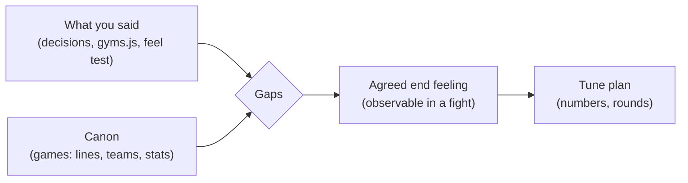
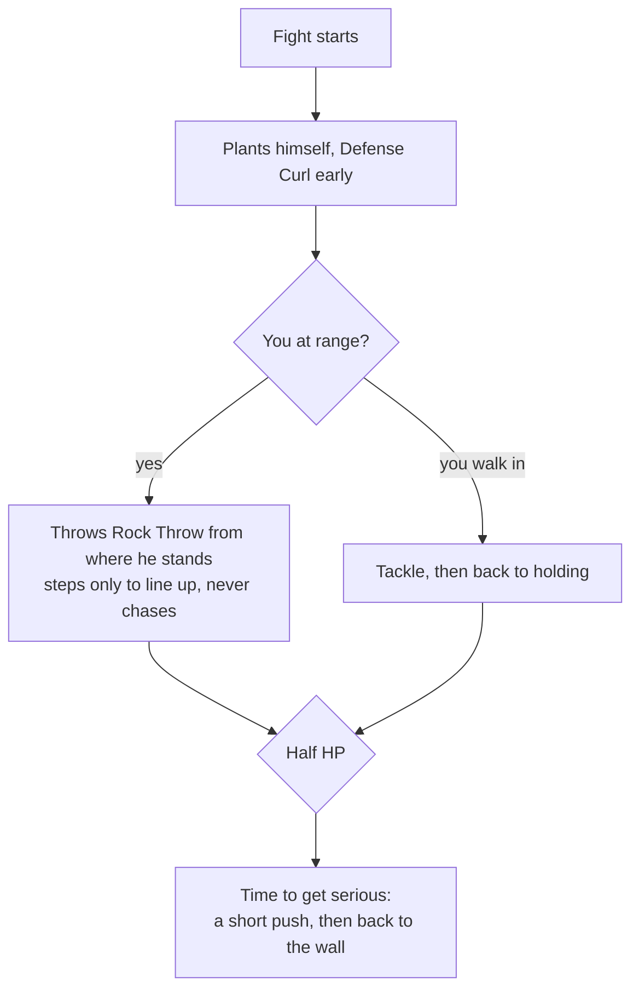
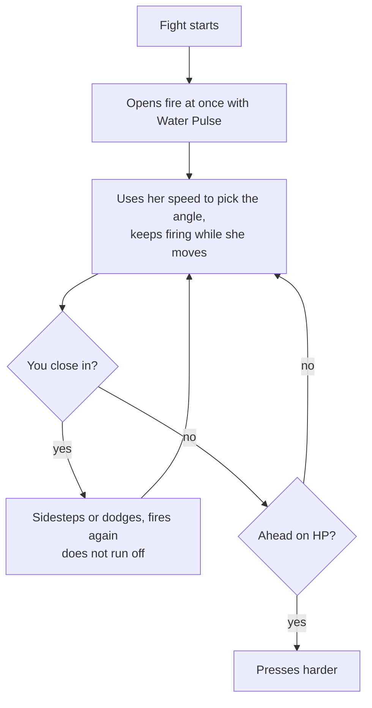
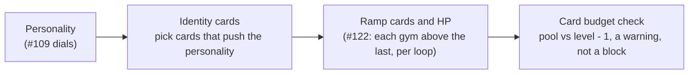

# #109 Brock and Misty: target feel (stated vs canon)

Not approved. Step 0 of #109: agree the end feeling before any tuning plan.
Judged at loop 1 (Brock: Geodude with Tackle, Defense Curl, Rock Throw; Misty: Staryu with Tackle, Harden, Water Pulse,
Recover under 35%), per js/data/gyms.js.

## How we get to a tune

## Brock

| Source | What it says |
|---|---|
| You, 2026-11-08 (slice 5 split) | a wall: patient, mid range, buffs early, rarely swaps, a little slow to react |
| You, gyms.js lines | "Rock holds its ground"; at half HP "Time to get serious" (pushes for 10 s); up: "solid defense" |
| You, 39a feel test | distinct, but closes the distance too much for a wall |
| Canon, game intro | believes in rock-hard defense and determination, which is why his team is all Rock-type |
| Canon, Red/Blue team | Geodude (Tackle, Defense Curl), Onix (Tackle, Screech, Bide, Bind) |
| Canon, Bide | soaks hits for a few turns, then returns double: the wall that punishes you for swinging at it |
| Canon, stats | Geodude Def 100, Spe 20 (pokeapi-master): hard to hurt, very slow |

## Misty

| Source | What it says |
|---|---|
| You, 2026-11-08 (slice 5 split) | tempo: kites with Water Pulse, pushes when ahead, swaps for matchups, reads you fast |
| You, gyms.js lines | "keep your head above water"; up: "Go with the flow, or get swept away!" |
| You, 39a feel test | distinct, but moves too much and does not fight enough |
| Canon, game intro | her policy is an all-out offensive with Water-type Pokemon |
| Canon, Red/Blue team | Staryu (Tackle, Harden, Water Gun), Starmie (adds BubbleBeam) |
| Canon, guides | Starmie outspeeds most early teams and chips with BubbleBeam |
| Canon, stats | Staryu Spe 85, Starmie Spe 115 (pokeapi-master): fast, fragile early |

## Gaps between what you said and canon

| ID | Gap | Recommended |
|---|---|---|
| G1 | You said Misty kites; canon says all-out offensive, and your feel test says she runs too much | AGREED (Jess, 2026-11-14, T1): she is a fast aggressor. Kiting is a tool she uses between shots, not her identity |
| G2 | Brock "mid range" and "throws from range" come from your pilot Rock Throw; canon Brock is close (Tackle, Bind) | keep the range: slowness (Spe 20) makes a ranged wall read as "you come to me". Canon supports the holding, not the distance |
| G3 | Brock's half-HP line makes him push for 10 s; is a push still a wall? | keep it: canon "determination", and it gives the fight a second phase. It must end back at holding |
| G4 | Bide is his canon wall move (punish the attacker); the game has no Bide | not in #109. Signature actions stay unbuilt until a leader needs one (decision 2026-11-14-39-closes-on-feel-test-no-39b) |
| G5 | Misty "swaps for matchups"; canon has her on two mons with no strategy beyond offense | keep it: loop 1 is one mon anyway, so it does not change #109 |

## Proposed end feeling (what you should see in a loop 1 fight)

| | Brock should | Brock should not |
|---|---|---|
| Position | close only to throwing distance, never inside his range; you go to him (Jess, 2026-11-14, D3 a) | come inside his range, or dash at you |
| Attacks | Defense Curl early, then Rock Throw from where he stands; Tackle when you come close | walk in to get a hit he could throw from range |
| Reaction | dodge late and seldom (slow to react) | read every shot |
| Half HP | push briefly, then plant again | stay aggressive for the rest of the fight |

| | Misty should | Misty should not |
|---|---|---|
| Tempo | be firing most of the fight; moving is how she aims | spend long stretches moving without a shot |
| Distance | hold a Water Pulse distance and fight from it | back off whenever you step toward her |
| Reaction | read and dodge your shots quickly, then answer | dodge and keep running |
| Ahead on HP | press harder | coast |

The two read apart through position: Brock owns a spot, Misty owns the tempo.

## Decisions

| ID | Question | Recommended |
|---|---|---|
| T1 | Misty is a fast aggressor (G1), not a kiter | AGREED (Jess, 2026-11-14) |
| T2 | Brock keeps his ranged wall (G2) | AGREED (Jess, 2026-11-14) |
| T3 | Brock's half-HP push stays, but ends back at holding (G3) | AGREED; built by letting his half-HP trigger set goal weights (Jess, D2 b), plan in "109 - Trigger Goal Weights Plan.md" |
| T4 | The two tables above are #109's done-condition, judged by your feel test at loop 1 | AGREED (Jess, 2026-11-14) |

Recorded: decision 2026-11-14-109-brock-and-misty-target-feel. Tune plan: "109 - Template Check Slice Opening.md".

## Later: the per-loop levers for #122 (recorded, not #109's job)

#109 moves only the personality dials, so a pass or fail there says the dials can carry the identity. Everything below is
for #122, the eight-gym tuning pass (Jess, 2026-11-14: use the cards a leader holds per loop).

| Lever | Keyed by loop | Mainly moves | State today |
|---|---|---|---|
| `cards` | yes, cumulative (pool for loop N = loops 1 to N) | power, shot shape | loop 1 only: Brock 13 stacks, Misty 16 |
| `runItems` | yes, cumulative, at most 4 and one stone | power, special effects | none authored |
| `hpMult` | yes | time to kill | Brock 16 / 12, Misty 25 / 19 (loops 1 / 2) |
| move `sets` | yes, per slot | kit | loops 1 and 2 |
| `ivs`, `evs`, `nature` | yes, per slot | stats | none authored |
| `ai` settings | any one, as a number or keyed by loop | behavior | flat numbers |
| `intelligence` | base plus growth per loop | reads and reactions | Brock 0.4 + 0.08, Misty 0.6 + 0.08 |

Identity cards, ideas only: Brock leans on Defense Vitamins, Duration (his Defense Curl and Harden stages last longer)
and Area on Rock Throw, a wall that hits back. Misty leans on Velocity, Cooldown and Count, fast offense that fits T1.
Loops 2 to 6 gain no cards for either today, so their climb comes only from hpMult, move sets and intelligence growth.
