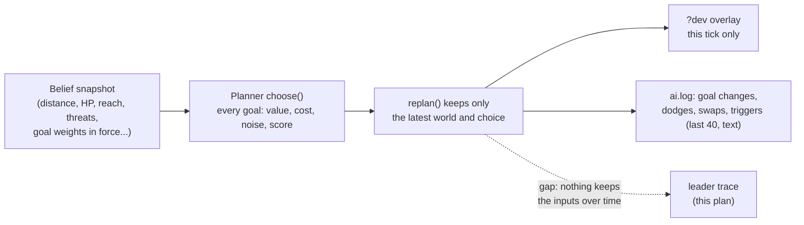
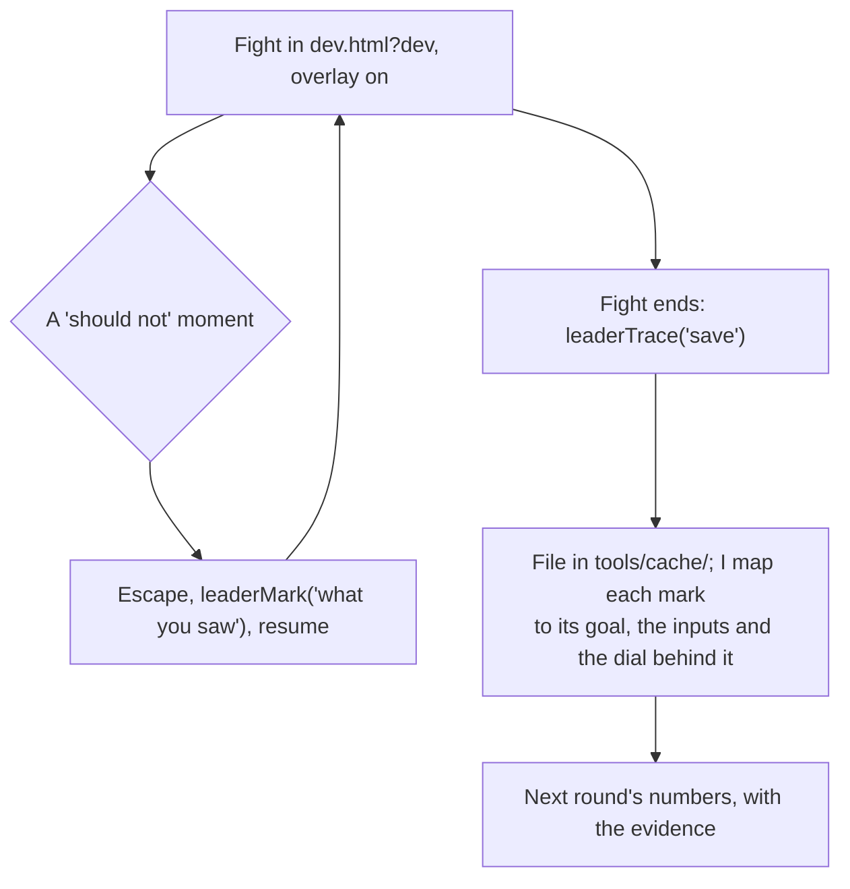

# #109 Leader decision trace: plan

Not approved. Jess, 2026-11-14: before any feel pass, a debug command that logs the gym leader's decisions and the inputs
that made it choose each one. Dev only (?dev), changes nothing in play. Branch: balance/109-template-check.

## What already exists, and the gap

Today you can see a decision only on the frame it happens, and `G.Debug.leaderAI()` prints the last 12 log lines with no
inputs. The trace keeps every think tick's inputs and full ranking for the fight, so a "should not" moment can be read
back afterward.

## The commands

| Command | Does |
|---|---|
| `G.Debug.leaderTrace()` | prints the current or last fight as a table, one row per decision change: time, why it replanned, goal and plan, its value, cost and noise, the runner-up goal and the gap to it, and the key inputs (distance, its range, your HP, its HP, your best reach, confidence, the goal weights in force). Dodges, swaps, triggers and marks are interleaved from the existing log |
| `G.Debug.leaderTrace('all')` | the same, one row per think tick |
| `G.Debug.leaderTrace(12.5)` | the full record nearest 12.5 s: every goal's value, cost, noise, score and commitment bonus, the chosen plan's steps, and every input Belief handed the planner |
| `G.Debug.leaderMark('walked in')` | stamps a note at the current fight time. Pause with the Escape toggle, mark, resume |
| `G.Debug.leaderTrace('save')` | downloads the whole fight as JSON (leader-trace-Brock-<date>.json). Drop it in tools/cache/ and I read it straight from the repo |

The overlay's status line gains the fight clock (t 12.4 s), so what you see on screen matches a row.

## Feel-test loop with the trace

## Changes

| File | Spot | Change | Approval |
|---|---|---|---|
| js/core/debug-leader-trace.js (new, about 150 lines) | whole file | the recorder (keeps the last 3 fights, copies each tick's inputs and ranking so later ticks cannot change them), the two commands, the save; documents both in its header; inert without ?dev | yes (game code) |
| js/entities/leader-ai.js | end of replan() | one hook: after the choice is made, hand it and the reason to the recorder when one is attached (nothing attached outside ?dev). File goes 974 to about 977 lines | yes |
| js/entities/leader-ai.js | status() | the fight clock first on the overlay line | yes |
| dev.html | script list, after debug-leader.js | the new script tag | yes |
| js/main.js NEED | none | stays out, as the other split debug files (decision 2026-11-14-debug-split-files-stay-out-of-need) | none |
| docs/LEADER-AI.md | OVERLAY rule | one line naming the trace | free |

## Tests

| Kind | File | What and why |
|---|---|---|
| New checks | docs/proposals/leader-ai-harness.js, section 16h | does-what-it-says: with no recorder attached nothing is kept; attached, one record per replan in clock order. Wiring: each record's pick, ranking and goal weights equal what the AI held at that tick (read inside the same tick), and a record taken during a trigger's push still shows the push after it ends (proves the copy). Parity: a seeded fight makes the same decisions (the same goal sequence in ai.log) with the recorder attached and without it, so the trace never changes play. A mark lands at the current clock. No tuning data. The harness loads the new file with the dev flag on, as it loads the engine files |
| Existing check, no edit | docs/proposals/debug-registry-harness.js | it reads every debug file's header from dev.html, so leaderTrace and leaderMark are checked to exist, not to collide, and to do nothing without ?dev, with no change to the harness |
| Mutants | docs/proposals/leader-ai-mutate.js (env LA_TRACE for the new file) | three, each caught only by 16h: the hook is skipped (nothing recorded); the recorder keeps the live goal table instead of a copy (the push check); the hook runs before the choice (a stale pick) |
| New harness, intent scenarios, debug sets | none | 16h sits beside the other leader AI checks; no move changes; the trace is itself the debug aid |
| check.js | no change | leader-ai-harness and debug-registry-harness are already in its list |

## Decisions

| ID | Question | Recommended |
|---|---|---|
| L1 | NEW DEFAULT (dev only): under ?dev the trace records every fight automatically, last 3 kept, no switch to remember | yes: you never lose a fight to a forgotten switch; it costs a little memory 4 times a second, in ?dev only |
| L2 | The default print shows decision changes only; 'all' shows every tick | yes: a 60 s fight is about 240 ticks |
| L3 | Save as a JSON download for tools/cache/ (it is git-ignored, so it never lands in a commit) | yes |
| L4 | Its own file (out of NEED) instead of growing debug-leader.js or leader-ai.js | yes: leader-ai.js is at 974 of the 1000-line limit |

## Risks

- The harness loading a debug file is new for leader-ai-harness; if its loader resists, 16h moves into its own small harness file, named before I build it.
- A trace row explains a choice through the planner's numbers. If a "should not" moment comes from the body (your rules refusing a step) rather than the choice, the row shows the step as refused, which points at the rule, not a dial.
