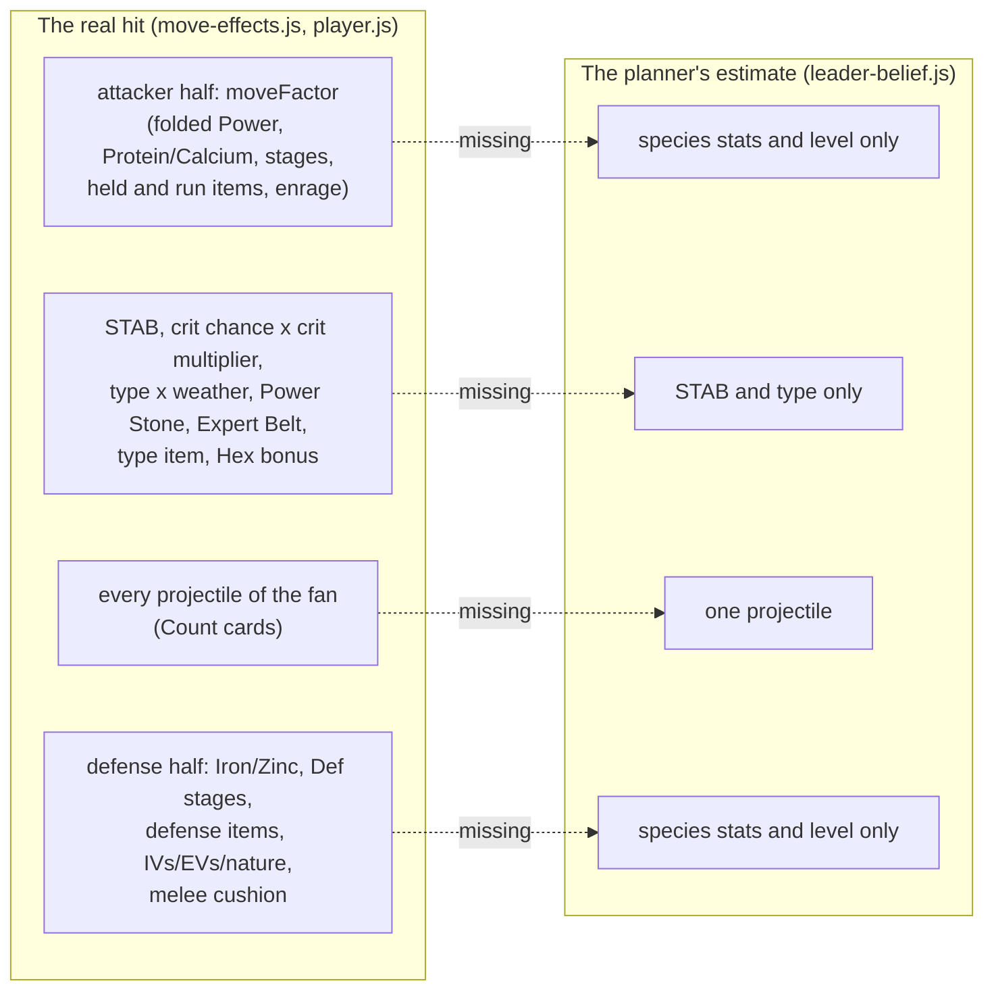
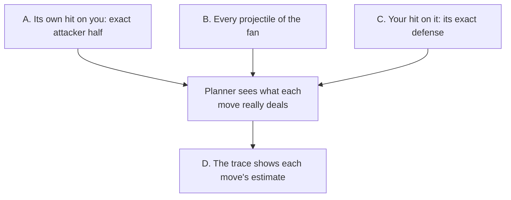

# #109 The leader reads its whole kit: plan

Not approved. Jess, 2026-11-14, after round 1: "for the calculations they're running, they need to understand their whole
kit, all upgrades and items and everything." Evidence: "109 - Round 1 Trace Findings.md". Branch:
balance/109-template-check. Spec: docs/LEADER-AI.md BELIEF ("its own exact state") and COST. Round 1 numbers stay as
they are; this is the missing dial the template check was meant to catch.

Feel test (Jess): Brock felt stable; walk away and he shoots a while, then comes in. Misty clung to you.

## What the planner reads today vs what the hit really does

Already counted (the move it reads is the card-folded copy): Damage and type Damage cards (Power), Velocity (flight
time), Area (shot width), Cooldown (cycle).

## Parts

### A. Its own hit on you, from its whole build
- **leader-belief.js**, moveView (the hit on you of each open move): the attacker half comes from the leader mon's own
  moveFactor, the same call the real hit makes, so Power cards, Protein and Calcium, its stages, held and run items and the
  enrage all count. Then STAB from its stabFor, the expected crit (its crit chance plus the move's, times its crit
  multiplier), the type item and Expert Belt, type times weather with the Power Stone floor, and the Hex-style bonus when
  you hold a major status. Your half stays as seen (decision K1).
- **move-effects.js**: the attacker terms the real hit builds in blowOf (A, STAB, crit chance and multiplier, item and type
  multipliers) move into one exposed pure function that returns them without rolling; blowOf and hurtPlayer then use it and
  roll the crit as before. One home for the hit contract, so the estimate cannot drift from the hit.
- **stats.js**: visibleHitFrac is split so its defense half can take a ready attacker factor; visibleHitFrac keeps its
  current behavior by calling the split half (your side of Belief still uses it unchanged).
- Reuses: moveFactor, stabFor, G.Stats.itemDmgMul, G.Stats.applyDamage, G.Types.mult, G.Weather.mult. New: the exposed
  attacker-terms function (nothing exposes those terms today; critOf and typeK are private to move-effects).

### B. Every projectile of the fan
- **leader-belief.js**, moveView: adds the shot's count (from the folded move, so Count cards count) and its spread.
- **leader-planner.js**, hitChance: a fan counts each projectile. The middle one keeps today's formula; each side one sits
  at its sideways offset (spread x distance), and your sideways step is equally likely either way (decision K3). The
  result is expected projectiles landed, so a Use step's dealt is the hit size times that. A one-projectile move gives
  exactly today's chance.
- At loop 1 that is Brock's 3-rock Rock Throw (Count 2) and Misty's 3-pulse Water Pulse (Count 2).

### C. Your hit on it, against its exact defense
- **leader-belief.js**, yourThreats (danger, which drives a plan's damage taken): the defense half reads the leader mon's
  real defense: its Def or Sp. Def with IVs, EVs and nature, Iron and Zinc (Misty's Zinc 3), its Def stages (Defense Curl,
  Harden), defense items, and the 25% melee cushion while its active slot is melee. Your attacker half stays as seen
  (species, level, your revealed moves), as today.
- **player.js**, hurt: the defense multiplier it builds inline (stat cards, then the stage, then the defense item) moves
  into one small method on the Player entity, used by hurt and by Belief. Touched-code cleanup, about 6 lines,
  behavior-neutral.
- Reuses: G.Stats.applyPlayerDefense (the real defense formula), G.Stages.mul, incOf.

### D. The trace shows each move's estimate
- **debug-leader-trace.js**, the recorded inputs: each open move's id, its hit on you, its count, its reach, and the
  expected projectiles landed at the recorded distance, so round 2 can be checked against the fight.

## Not built (YAGNI), with where it goes
- Your shot count, area and speed cards as the leader sees them on screen: decision K2.
- An ailment card's chance in the Setback goal's value: neither leader picked Setback in round 1. Issue draft at wrap-up.
- Life Orb's 1% self-cost and Rocky Helmet's contact cost in a plan's cost: no leader holds them. Issue draft.
- Misty's dashes spending the charges her dodges need: a round 2 dial question, after this lands.

## Files and size

| File | Lines now | After (about) | Change |
|---|---|---|---|
| js/systems/move-effects.js | 577 | 595 | attacker terms exposed, blowOf and hurtPlayer use them |
| js/core/stats.js | 288 | 298 | visibleHitFrac split on its defense half |
| js/systems/leader-belief.js | 480 | 525 | A and C in moveView and yourThreats, B's count and spread |
| js/systems/leader-planner.js | 752 | 770 | the fan in hitChance |
| js/entities/player.js | 1349 (inherited, already over) | 1352 | the defense multiplier method |
| js/core/debug-leader-trace.js | 207 | 220 | D |
| docs/LEADER-AI.md | | | BELIEF and COST: what the estimate reads |

No dev.html or NEED change (no new file).

## Tests

| Kind | File | What and why |
|---|---|---|
| New checks | docs/proposals/leader-ai-harness.js, section 16i | Parity: for a leader mon with made-up cards, Vitamins, a stage, a type item and a crit chance, Belief's hit on you equals the real hit's attacker terms combined with your visible defense (crit at its expectation). Parity: Belief's hit on the leader uses the same defense multiplier hurt applies. Does-what-it-says on made-up moves: count 3 lands at least as much as count 1 and at most 3 times; at distance 0 every projectile lands; a wider spread never lands more at range; a crit chance raises the hit by chance x (multiplier - 1); a Def stage lowers danger. Wiring: a fielded leader with Count cards shows the folded count in its snapshot. No tuning data |
| Parity, existing | the damage harnesses check.js already runs | blowOf, hurtPlayer and hurt are refactored, not changed: every existing damage check must pass unedited |
| Existing checks that may move | leader-ai-harness 14k (a hand-derived danger number) | if C moves it, it is converted to a relation under decision 2026-11-14-tests-check-relations-not-values (named in the build report), not re-derived |
| Existing check, unchanged | leader-ai-harness 15a | its one-projectile hit chances must hold exactly (the count 1 parity) |
| Mutants | docs/proposals/leader-ai-mutate.js | six, each caught only by 16i: Belief uses species stats instead of moveFactor; the crit term dropped; the type item dropped; count ignored; spread ignored; the leader's defense multiplier ignored |
| New harness, intent scenarios, debug sets | none | 16i sits with the other Belief checks; no move data changes; the trace (D) is the debug aid |
| check.js | no change | the harnesses are already listed |

## Decisions

| ID | Question | Recommended |
|---|---|---|
| K1 | RULE: the leader knows its own build exactly (cards, items, stages, IVs), but reads YOUR side as seen (species, level, revealed moves), as today | yes: LEADER-AI already says Belief holds its own exact state; your hidden build stays hidden |
| K2 | Also read your shot count, area and speed as it sees them on screen | not now: a follow-up issue, since #109 is about its own kit |
| K3 | NEW DEFAULT: side projectiles of a fan land by the same hit-chance formula at their sideways offset, your step equally likely either way | yes: it reduces to today's formula for one projectile, and widens coverage the way the fan does |
| K4 | Rerun round 1's numbers unchanged after this, then trace and feel-test again | yes: one change at a time |

## Risks
- Brock and Misty will hit harder from range in their own estimate, so they may now stand off more than the targets want.
  That is the point; round 2 tunes it.
- Refactoring blowOf, hurtPlayer and hurt touches your hit path too. The existing damage harnesses must pass unedited;
  any edit they would need means the refactor changed behavior, and I stop.
- Danger rising or falling with its own stages makes Defense Curl and Harden worth more in plans, which may make Brock
  buff more often. That fits a wall.
