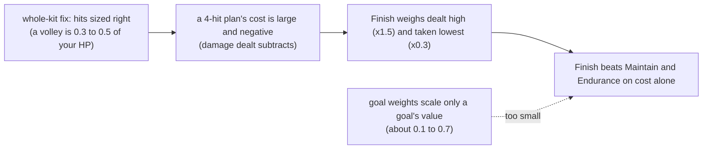
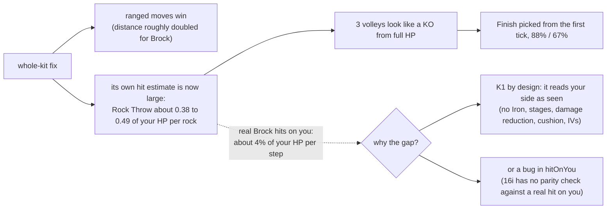
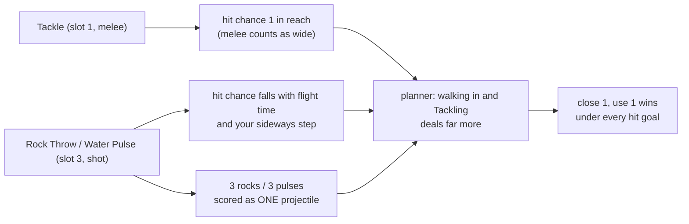

# #109 round 1: what the traces show

## Round 2 check (2026-11-15, home, after the overkill cap and Brock Finish 0.35)

Traces: leader-trace-Brock-2026-11-15T12-19-52-892Z.json (27.1 s, you won at 61%) and
leader-trace-Misty-2026-11-15T12-20-56-028Z.json (83.8 s, you won at 32%). Your reach 160 (a ranged starter). Not the
natural gate.

| Target row | Trace says |
|---|---|
| Brock a ranged wall that holds | yes: Maintain 35%, Endurance 33%, Pressure 18%, Finish 7%, Conserve 6% |
| Brock closes only to throwing distance | better: median 158 px (was 97), upper quartile 210, range 250; 11 plans open with a back-off |
| Brock Rock Throw from range, Tackle up close | yes: Rock Throw 148, Tackle 11 |
| Brock half-HP push, then holding | yes: trigger at 12.9 s, Pressure from about 19 to 22 s, then Endurance |
| Misty fast aggressor | yes: Water Pulse 555 uses, median distance 81 px; Finish 45% once your HP fell under about half, Pressure 24% |

### Found: Brock heals instead of finishing a mon at 1% HP

While your HP was under 15%, Brock picked Conserve 9 times and Endurance 2, never Finish. At 14.3 s (you at 0.011,
Rock Throw cooling) Recover scored 0.42 against Finish 0.09. Replaying Finish at 0.5, 0.7 and 1 changes nothing there:
at weight 1 Finish is still 0.26. Cause: the KO bonus (TUNE.koBonus 0.3) is worth less than healing 36% of his own HP, and
confidence (0.31) lifts Conserve and lowers Finish. Not the 0.35. A shared TUNE number, so it belongs to the eight-gym
tuning pass (#122), not this template check.

## After the score rule and #123 (2026-11-15, home)

Traces: leader-trace-Brock-2026-11-15T11-40-59-194Z.json (33.3 s, you won at 2% HP) and
leader-trace-Misty-2026-11-15T11-42-54-398Z.json (83.3 s, you won at 27%). Not the natural gate: Jess forced the gyms and
used a debug level-up, and the trace does not record the leader's level. Round 1 numbers, whole-score rule, new speeds.

| Target row | Trace says |
|---|---|
| Brock throws Rock Throw from where he stands, Tackle when you come close | yes: Rock Throw 316 uses in chosen plans, Tackle 18 |
| Brock half-HP push, then holding | first time it shows: trigger at 20.5 s, then Maintain ("use 3, use 3, hold 250, use 3") to the end |
| Brock closes only to throwing distance | unclear: median distance 97 px against a 250 px range, but you were in melee (reach 68) the whole fight; 11 plans opened with a close, 6 with a dash |
| Brock in Finish | 57% (was 81%), all of it in the first 20 s while your HP was 1.0 to 0.24 |
| Misty keeps firing, backs off only between shots | yes: Water Pulse 687 uses, a back-off as the first step in 10 of 271 choices, median distance 83 px (close in) |
| Misty's goal label | Kite 41%, Finish 25%, Maintain 19%, Pressure 11%. Kite's target is "a hit from outside your reach", so with your reach at 68 px her Water Pulse shots count as Kite. The behavior is the aggressor's, the label is not |

Misty at Finish 0.35 goes to Kite 58% and Finish 3%: her Finish stays at 1 (an aggressor should close out).

### Found: overkill counts as damage dealt (FIXED 2026-11-15, with Brock Finish 0.35)

At 29.4 s you had 0.024 HP. Brock's Maintain plan (three Rock Throws) was costed at -1.40, so it counted about 1.0 of your HP
dealt when only 0.024 was left, and it beat Finish (1.86 against 1.05). A planned hit's dealt damage is not capped at the HP
you have left, so long multi-hit plans of any goal look better than they are near a KO, and Finish loses exactly when it
should win. Not new, but the whole-score rule scales it up. Fix is a COST rule change (cap each step's dealt at your HP not
yet dealt in the plan): owner decision, then a plan.

### Dodges

Brock pressed 1 dodge in 33 s, Misty 3 in 83 s. Most dodge notes are "the threat is gone" (Brock 13, Misty 52): your melee
hits land at once (hits in 0.00 s), so there is nothing to react to. Charges were not the limit (no charge to spare: Brock
1, Misty 7).

## Natural-gate rerun (2026-11-14, 17:59 EST; same round 1 numbers, whole-kit fix in)

Traces: leader-trace-Brock-2026-11-14T22-58-55-963Z.json (21.0 s, you won) and
leader-trace-Misty-2026-11-14T22-59-52-224Z.json (69.5 s, you won). No marks. Misty's fight started 57 s after
Brock's, so hers was not the natural gate (that opens 4 min after his); the trace does not record a leader's level.

| Target row | Trace says |
|---|---|
| Brock closes only to throwing distance | you held melee range (your reach 68 on 62 of 71 choices); of 13 big closings, 4 were his (close, dash, draw), the rest yours. He held more than he walked |
| Brock throws Rock Throw from where he stands, Tackle when you come close | yes: Rock Throw 162 uses in plans, Tackle 32, mostly when you were on top of him |
| Brock dashes | 5 dashes in 21 s (dash x2 has not stopped them) |
| Brock half-HP push, then holding | trigger fired at 9.6 s, but he was in Finish 81% of the fight, so there was no holding to return to |
| Misty keeps firing, backs off only between shots | yes: Water Pulse 511 uses, a shot as the first step 60%, Back off 4% |
| Misty holds a Water Pulse distance | mixed: median 157 px, but 50 to 98 px from 15 to 40 s while you were in melee |

## The structural finding: Finish wins on cost, and goal weights cannot move it

Replaying the recorded rankings with Finish's value scaled down: Brock's Finish share goes 81% (x1), 74% (x0.5),
68% (x0.25), 65% (x0, worth nothing). Misty: 60%, 54%, 45%, 35%. While Finish was picked, its median score was 1.89
against Maintain 0.64 and Endurance 0.44 (Brock), and the gap is almost all cost. So the personality dials that make
Brock a wall (Endurance 1.4, Maintain 1.2) are swamped once hits are sized right: a scale problem in the Decider, not a
number to tune in round 2.

## Correction (2026-11-14, after Jess: "I entered the gym at level 1")

The rerun below is not a valid test of the target feel, and two readings in it were wrong.

| Reading | Corrected |
|---|---|
| "Real Brock hits take about 4% of your HP" | Wrong. The steady 1/24 drops are the sandstorm's chip on you (it hurts non-Rock types). His real Rock Throw hits took 0.875 to 0.201 in one step; Misty's 0.562 to 0.039. The estimate (about 0.49 a rock, 1.7 rocks expected) matches that size |
| "The estimate climbs for 3 s, cause unknown" | The arena weather fades in over 3 s (weather.js level()): sand x1.3 on Rock, rain x1.5 on Water. Brock's climb is x1.30, Misty's x1.49. Correct behavior |
| "Finish from full HP is a bug or K1" | Neither: the real hits took over half your HP a volley, so Finish was the right call |
| "The leaders were level 12" | Wrong (Jess caught it). That number came from the harness, which opens every gate at level 12. In game the gym level is the run-time level at the gate plus 4 (gym.js, LEVEL_OFFSET): G.Debug.gym(1) at 0:00 makes a level 5 Brock. The natural first gate opens at 4:00 (FIRST_AT 240 s) at level 12 |

Why a level 5 Brock still hits that hard: you were level 1, where HP is small and 4 levels is a large gap, and he carries
his whole loop 1 card pool (13 stacks, Damage +30% and 3 rocks), authored for a level 12 gate; a level 5 player holds 4.
Next: rerun at the natural first gate (play to 4:00, the gate opens itself at level 12, at whatever level the run gave
you), so the leader's level and cards match what the target feel was written for.
Still a test gap: 16i has no parity check between the estimate and a real hit on a plain player (planned, not built).

## Rerun after the whole-kit fix (2026-11-14 evening, same round 1 numbers)

Traces: leader-trace-Brock-2026-11-14T22-43-01-466Z.json (39.8 s), leader-trace-Misty-2026-11-14T22-44-17-760Z.json
(40.0 s, Misty won). No marks.

| | Brock before, after | Misty before, after |
|---|---|---|
| Ranged move in chosen plans | Rock Throw 57 of 191 uses, now 311 of 361 | Water Pulse 127 of 355, now 313 of 384 |
| Distance quartiles | 76 / 97 / 141, now 130 / 195 / 227 (range 250) | 95 / 137 / 180, now 75 / 167 / 233 (range 260) |
| Time by goal | Finish 55%, now 88% | Pressure 71%, now Finish 67%, Kite 19%, Maintain 13% |
| Dashes | 4, now 10 | 12, now 8 |

- Finish wins at full HP because the planner thinks a 4-step plan knocks you out. With the hit estimate that large,
  Finish's value (your HP plus the KO bonus) is reached, so it outranks Maintain and Endurance on nearly every tick.
- The estimate also climbs over the first 3 s of each fight (Brock 0.38 to 0.49, Misty 0.275 to 0.41) and then holds.
  Not enrage (both have it off). Cause not found yet.
- 16i checks that the estimate moves with moveFactor, crit and the type item, but has no check that it equals what a
  real hit takes from a plain player. That gap is mine: the plan named that parity check and I did not build it.

Read from tools/cache/leader-trace-Brock-2026-11-14T20-34-25-560Z.json (28.6 s, 95 choices) and
leader-trace-Misty-2026-11-14T20-35-49-258Z.json (91.5 s, 362 choices). No marks were placed. Your feel verdict is still
the done-condition; this is the evidence beside it.

Feel verdict (Jess, 2026-11-14): Brock felt a lot more stable; walk away and he shoots for a while, then comes in.
Misty clung to you. Next: "109 - Leader Reads Its Whole Kit Plan.md" (Jess: the planner must read the whole kit).

## The numbers

| | Brock | Misty |
|---|---|---|
| Time by goal | Finish 55%, Pressure 25%, Maintain 10%, Conserve 9%; Endurance 0% (his top weight) | Pressure 71%, Conserve 14%, Finish 12%, Kite 1% |
| Distance (quartiles) | 76 / 97 / 141 px, range 250 | 95 / 137 / 180 px, range 260 |
| Plans | Finish: "close 1, use 1, use 1, use 1" (walk in, Tackle) | Pressure: "close 1, use 1" (walk in, Tackle) |
| Back off as a first step | n/a | 2% of the fight (the running is gone) |
| Dashes | 4 (2 under Pressure at 196 and 230 px) | 12; 38 dodges wanted with no charge left, 11 within 3 s of her own dash |
| Half-HP trigger | fired at 19.1 s, Pressure 1.6 in force (T3 works) but Finish already led | line only, as authored |

## Why both walk in

- leader-belief.js moveView sizes a move by one hit of its power, and leader-planner.js hitChance treats a shot as one
  projectile. Neither reads `space.count`, the field the Count card raises. So Brock's 3-rock Rock Throw (count 2 in his
  loop 1 cards) and Misty's 3-pulse Water Pulse count as a third of what they throw. That is a gap in the planner's
  damage estimate, not a personality problem.
- Goal weights only scale a goal's value. Pressure and Finish win on cost (their fixed profiles weigh damage dealt high,
  so a Tackle chain has a large negative cost). Replaying Brock's recorded rankings: Finish stays at 52 to 55% of the
  fight even at Finish 0.3, Pressure 0.3, Maintain 2. More weight rounds cannot fix him.

## What it means for #109

| Row | Trace says |
|---|---|
| Brock closes only to throwing distance | fails: median 97 px, mostly Tackle |
| Brock: Defense Curl early, Rock Throw from where he stands | fails after about 5 s |
| Brock: half-HP push, then holding | push works, but he was never holding |
| Misty keeps firing, backs off only between shots | backing off fixed (2%) |
| Misty holds a Water Pulse distance | fails: median 137 px, Tackle |
| Misty dodges quickly, then answers | weakened: her dashes spend the charges her dodges need |
