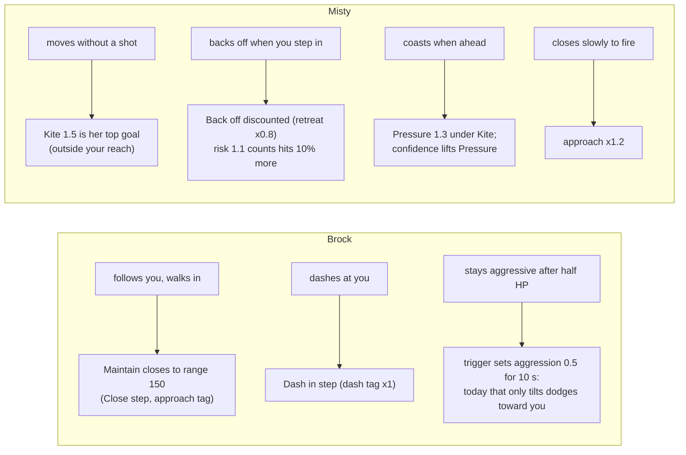
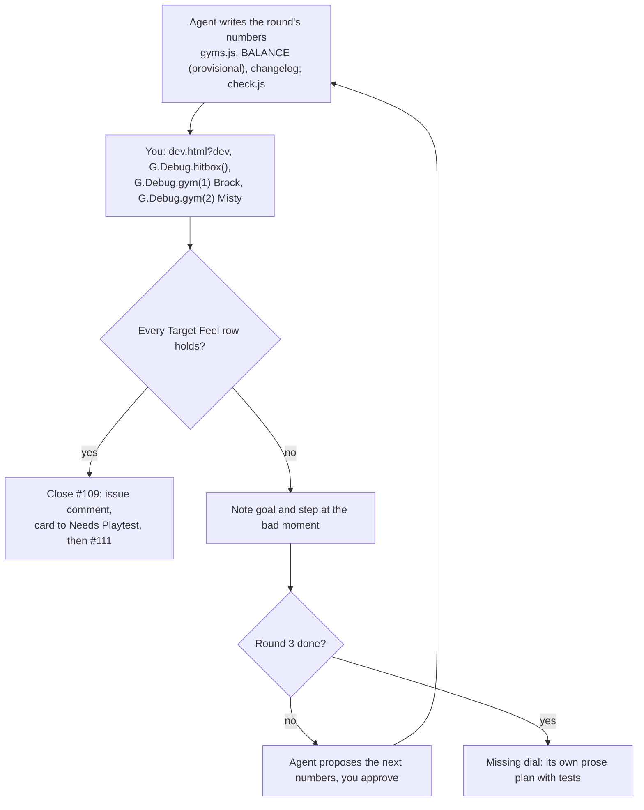

# #109 Brock and Misty template check: slice opening and tune plan

Not approved. Target feel: decision 2026-11-14-109-brock-and-misty-target-feel (tables in "109 - Brock and Misty Target
Feel.md"). Scope: decision 2026-11-14-template-check-then-gyms-then-full-tuning (dials only, numbers provisional).
Spec: docs/LEADER-AI.md "The Decider (#49)". Replaces the earlier draft of this page (39a's R1 to R5 were written for a
kiting Misty).

## The three opening items

| Item | Proposed |
|---|---|
| Goal | Brock reads as a ranged wall and Misty as a fast aggressor at loop 1, using the personality dials |
| Done when | every row of the Target Feel tables holds in your feel test; numbers in BALANCE.md "Leader AI" marked provisional; a dial found missing is added here before #111; `check.js` all passed with no test edits |
| End-goal test | your feel test, one fight each per round, overlay on, noting goal and step at each "should not" moment; 16f relations pass unchanged |

## Each "should not" to the dial that drives it

Already right, no change: Brock's Defense Curl early (Buff 1.5, buff tag x0.8), his late, rare dodges (intelligence 0.4:
reflex 0.18 s, dodgeRead 5.2 of 10); Misty's fast reads (intelligence 0.6: reflex 0.144 s, dodgeRead 6.4).

## Round 1 numbers (js/data/gyms.js, game data)

| Leader | Setting | Now | Round 1 | Drives |
|---|---|---|---|---|
| Brock | range | 150 px | 250 px | Maintain is met from much farther out; still inside Rock Throw (about 370 px) |
| Brock | tag approach | x1 | x1.5 | walking in is the expensive choice |
| Brock | tag dash | x1 | x2 | a wall does not lunge |
| Misty | goal kite | 1.5 | 1.0 | no longer her top lean; a tool among equals |
| Misty | goal pressure | 1.3 | 1.5 | her top lean: land hits, accept trades, rush |
| Misty | tag retreat | x0.8 | x1 | backing off costs normal |
| Misty | tag approach | x1.2 | x1 | closing to fire costs normal |
| Misty | risk | 1.1 | 0.9 | she takes trades a little more readily than the default |

Stays: Brock's other goal weights, retreat x1.4, buff x0.8, swapWill 2, risk 0.8, stubbornness 1.5, aggression 0.35;
Misty's range 260, position x0.8 (holding at range still fires), endurance 0.7, buff 0.6, swapWill 0.6, stubbornness
0.7, aggression 0.68 (tilts her dodges toward you, which fits). All within the validator's limits (goals 0 to 3, tags
0.25 to 4).

## The round loop

## Files

| File | Change | Approval |
|---|---|---|
| js/data/gyms.js | Brock's and Misty's `ai` numbers in place, lines kept under 120 columns (mutants match exact lines) | yes |
| BALANCE.md | the 39a line gets the round's numbers, "provisional, #109 round N" | free |
| js/data/changelog.js | today: Brock holds his ground and throws from range; Misty presses the attack | free, parse-checked |
| docs/LEADER-AI.md | none, unless D2 or D3 changes a rule | free |

## Tests

| Kind | This slice | Why |
|---|---|---|
| New harness | none | how a leader reads is your feel test (decision 2026-11-14-tests-check-relations-not-values); 16f already proves each dial does what its name says |
| Mutation runner | none new | numbers moving does not change what an existing mutant can catch; I grepped leader-ai-mutate and the harnesses: none match these gyms.js lines |
| Intent scenarios | none | no move changes |
| Debug sets | none new | G.Debug.gym(1) and gym(2), G.Debug.hitbox() for goal and step, G.Debug.leaderAI() for the last decisions |
| Existing harnesses, check.js | no edits | 16f-a to 16f-c use made-up inputs; 16f-f checks the authored values arrive as authored, whatever they are |
| If D2 or D3 adds a dial | named in that dial's own plan | a 16f-style relation check and one mutant only it catches |

## Decisions

| ID | Question | Recommended |
|---|---|---|
| D1 | Round 1 as in the table (3 Brock numbers, 5 Misty numbers) | yes |
| D2 | T3, Brock's half-HP push. Today the trigger sets aggression, which since #51 only tilts his dodges; goal weights may not be set by a trigger (39a D5), and #107 (trigger set limits) is your open call. (a) keep it a line plus the dodge tilt for #109 and rule the push under #107; (b) let that one trigger set goal weights now (a rule change); (c) drop the push | (a): #109 stays dials-only, and the row reads "a short shift, then back to holding" |
| D3 | "Stay near where he started" has no dial: every goal is an outcome, never a position, so beyond Rock Throw reach (about 370 px) Endurance still walks him in. (a) restate the row as "closes only to throwing distance, never inside his range"; (b) a home-spot dial (new code, a rule change) | (a): a slow mon that stops at throwing distance reads as "you come to me"; (b) only if your round 1 test still says he chases |
| D4 | Loop 1 only; 3 rounds per leader before calling a missing dial | yes |
| D5 | Branch `balance/109-template-check` off main | yes |

## Risks

- Misty at Pressure 1.5 with risk 0.9 could tip into face-tanking. Kite at 1.0 and her fast dodges should keep her moving between shots; round 2 can lift Kite.
- Brock with approach x1.5 and range 250 could feel inert if you play far away. D3 (a) is the honest limit; the arena edge does the rest.
- Numbers are provisional by design: #122 moves them again with cards and HP, so judge identity, not difficulty.
