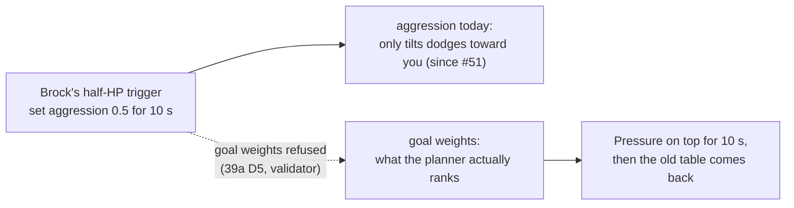

# #109 T3: a trigger may set goal weights (Brock's half-HP push)

Not approved. From Jess's T3 choice (b), 2026-11-14. Builds in the same step as round 1's numbers, on
`balance/109-template-check`. Spec: docs/LEADER-AI.md "Authoring a leader". Related: #107 (trigger set limits).

## Why it needs code

The apply side already works for any setting: a trigger's `set` swaps the value in and puts the old one back after `for`
seconds, and the planner reads the leader's settings every think tick. Two things block it: the validator refuses
`goalWeights` in a trigger, and a swap replaces the whole table.

## Changes

| File | Spot | Change |
|---|---|---|
| js/data/gyms.js | validate(), the trigger `set` loop | `goalWeights` takes the same check as the authored table (known goal names, 0 to 3) instead of the number check; `tagMultipliers` stays refused |
| js/data/gyms.js | the trigger comment block above TRIGGER_ON | one line: a set may name goalWeights, merged into the leader's own |
| js/entities/leader-ai.js | fireTriggers, the `set` loop | for goalWeights, the value swapped in is the leader's current table with only the named weights replaced; the restore after `for` is unchanged (it puts the whole old table back) |
| js/data/gyms.js | Brock's half-HP trigger | `set` gains goalWeights pressure 1.6; aggression 0.5 and `for` 10 stay |
| docs/LEADER-AI.md | "Authoring a leader", the Decider line | "never set by a trigger" becomes: goalWeights may be, merged and within limits; tagMultipliers never |
| BALANCE.md, changelog.js | the 39a line; today's line | the push number, provisional; "Brock pushes for a moment at half HP, then digs back in" |

Brock's push in numbers: his table is endurance 1.4, maintain 1.2, pressure 0.7. For 10 s Pressure reads 1.6, so it
ranks first; then 0.7 again.

## Tests

| Kind | File | What and why |
|---|---|---|
| Changed check | docs/proposals/leader-ai-harness.js, 17f | the line asserting "a trigger may not set goalWeights" (39a D5) flips, since the rule changes. It becomes four shape checks on made-up tables: a trigger goal weight inside 0 to 3 is accepted; 3.5 is refused; an unknown goal name is refused; tagMultipliers in a trigger are still refused |
| New check | same file, 16f-g | does-what-it-says plus wiring, on a test leader (tools/test-leaders.js, no personality) given a made-up start trigger setting kite 2 for 1 s: once it fires, the snapshot's kite weight is the set one and every other weight equals the leader's own; after 1 s of clock the snapshot's table equals the one before. No tuning data in it |
| Mutants | docs/proposals/leader-ai-mutate.js | four, each caught only by the checks above: the trigger replaces the whole table (16f-g "others kept"); a trigger's set never wears off (16f-g "after 1 s", and no mutant covers the restore today); the validator skips the trigger table's limits (17f 3.5); the validator lets tagMultipliers through a trigger (17f tags) |
| New harness, intent scenarios, debug sets | none | the existing leader-ai harness owns trigger and personality checks; no move changes; G.Debug.gym(1) and the overlay show the push (the goal line reads Pressure for 10 s after the half-HP banner) |
| check.js | no change | leader-ai-harness and leader-ai-mutate are already in its list |

## Decisions

| ID | Question | Recommended |
|---|---|---|
| P1 | RULE CHANGE: a trigger may set goalWeights (replaces 39a D5 for goal weights only); tagMultipliers stay unsettable | yes, your T3 choice; tag multipliers have no need yet |
| P2 | NEW DEFAULT: a trigger's goalWeights merge into the leader's own (named weights change, the rest stay), instead of replacing the table | merge: replacing would quietly reset Brock's other weights to 1 for 10 s |
| P3 | a trigger's goalWeights get the authored limits (0 to 3, known names) | yes; matches #107's done-condition for this key; #107 stays open for the rest |
| P4 | Brock's push: Pressure 1.6 for 10 s, aggression 0.5 kept | yes, provisional like round 1 |

## Risks

- During the push his approach x1.5 and dash x2 still apply, so the push reads as throwing faster and holding less, not a
  charge. That fits "a wall that gets serious"; if you want a real charge, round 2 lowers those during the push (it would
  need tagMultipliers in a trigger, a second rule change).
- A trigger re-firing while its set is live extends the clock and merges onto the current table, the same as today's
  settings; Brock's half-HP trigger fires once per arming, so this does not come up in #109.
