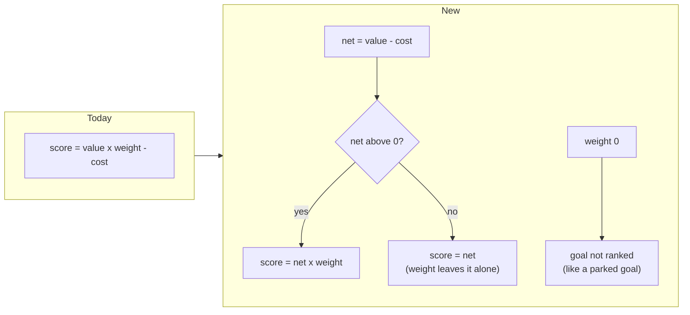
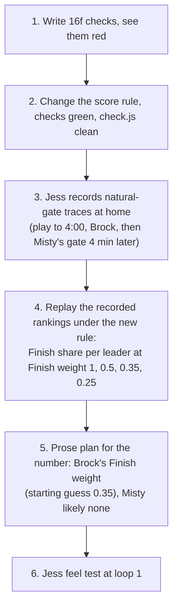

# #109: goal weights scale the whole score (plan)

Prose plan, no code. Opens the scale fix ruled in chat 2026-11-15 (option 1 of STATE.md START HERE).
Evidence: "109 - Round 1 Trace Findings.md", top section.

## Slice opening

| | |
|---|---|
| Goal | A goal weight moves a goal's whole score, so the personality tables (Brock's Endurance and Maintain, the T3 half-HP push) can outrank Finish once hits are sized right |
| Done when | The new relation checks pass, a fresh natural-gate replay shows Brock's Finish share falls and Maintain plus Endurance lead, and Jess's feel test at loop 1 matches the target feel table (decision 2026-11-14-109-brock-and-misty-target-feel, T4) |
| End-goal test | Harness 16f rewritten as relations (below), written first and red before the change, plus the replay of recorded rankings |

## The rule change

- "weight" here is the full utility multiplier the planner already uses: the authored goal weight times the confidence
  factor (Pressure and Finish rise with confidence, Conserve and Endurance fall). Nothing about confidence changes.
- Partial-credit plans follow the same rule (Finish's partial plan keeps leaving damage dealt out of its cost).
- Misjudge noise still reads the cost before the weight applies. The commitment bonus is unchanged (already scaled).
- Sign rule, answering "can it go negative?": the score has no clamp today. Clamps exist on parts of it (hit chance,
  gap closed, partial credit share), but cost can be negative by design and the net can be either sign (a Buff or
  Conserve plan that eats hits). The sign rule keeps a liked goal from being pushed down when its best plan is bad.

## Changes, by file

| File | What changes |
|---|---|
| js/systems/leader-planner.js | Where each plan is considered: weight applied to the net as above instead of to the value. The header CHOICE comment says the same. Weight 0 goals skipped in the ranking |
| js/data/gyms.js | Nothing in this step. Brock's Finish weight is set after the replay (step 3) |
| docs/proposals/leader-ai-harness.js | 16f-a and 16f-b rewritten (below); any older check that assumes value-only scaling updated |
| docs/LEADER-AI.md | GOAL VALUE AND SCORE and CHOICE lines: the new score rule, tagged Approved |
| docs/decisions/ + DECISIONS.md | New decision: weights scale the whole score, the sign rule, weight 0 not ranked |
| BALANCE.md "Leader AI" | One line: what a goal weight now means |

## Relation checks (16f, written first)

| Check | Relation |
|---|---|
| 16f-a | With net above 0, weight 2 makes that goal's score exactly twice its weight 1 score; every other goal's score unchanged; its rank never drops |
| 16f-a2 | With net at or below 0, a weight change leaves that goal's score unchanged |
| 16f-b | Weight 0: the goal is absent from the ranking |
| 16f-e (new) | On a made-up world where a high-cost plan leads by its cost alone, some weight inside the validator limit (0 to 3) on the runner-up moves it ahead; under today's rule that check fails (proves the old dial was dead) |

## Steps

The work-machine traces are git-ignored and not at home, so step 3 records new ones. Step 4's replay is a dev tool
under tools/ (free edit), reading the trace's per-goal value, cost and confidence.

## Plan check (coding-principles)

| Part | Reuses | New | Not built | Where it lives | Size |
|---|---|---|---|---|---|
| Score rule | utility() as the one weight (confidence included); the existing consider step in search, which gets the weight and applies the sign rule there instead of the value being pre-multiplied | Nothing new: no setting, no flag, no constant | No per-leader cost profiles (option 2), no base value retune (option 3), no "old rule" switch | leader-planner.js, the Decider's planner (the owner of CHOICE) | 762 lines, grows a few |
| Weight 0 not ranked | The PARKED_GOALS skip in choose, same spot and same pattern | Nothing | No validator change (0 to 3 limit stays) | leader-planner.js choose | a line or two |
| 16f checks | Section 15's made-up worlds, the existing rankOf, of and near helpers | 16f-a2 and 16f-e | No duel, no Brock or Misty numbers (relations only) | the harness | already 3158 lines, past the 1000-line mark; this adds about 20. Splitting it is not this slice (no issue yet; draft one if Jess wants) |
| Replay tool | The trace's recorded per-goal value, cost, confidence and weights | tools/replay-leader-trace.js: reads a trace, rescores each ranking under a given rule and weights, prints the Finish share per leader. A repo file, not scratch, since #111 and #122 tune six more leaders the same way | No in-game UI, no new trace fields (the level field stays its own issue) | tools/ (dev only, free edit) | new, small |

Touched-code cleanups: the header CHOICE comment and the utility() comment now describe the old rule, so both are
rewritten in the lines the change touches. Nothing else.

The rule change itself (and decisions 1 and 2 below) is the standalone owner decision this plan asks for.

## Risks

| Risk | Note |
|---|---|
| Confidence now scales cost too | A confident leader's Finish gets stronger. Fits "closes out when ahead"; flag if Misty feels relentless |
| Weights above 1 grow faster than before | A weight of 1.5 on a goal with a big net is a big push. Brock's 1.4 and 1.5 Buff may now matter more than tuned for; the replay shows it |
| Small discontinuity in slope at net 0 | The score stays continuous (both sides are 0 there); only how fast the weight acts changes |
| Other leaders | Only Brock and Misty have tables today; gyms 3 to 8 (#111) are authored under the new rule |

## Decisions for Jess

1. Sign rule as above (weight touches only a positive net). Recommended.
2. Weight 0 means "never ranked". Recommended (today it means "worth nothing", which can still win when every other goal is negative).
3. Brock's Finish weight is a separate step after the replay, not in this plan's build.
