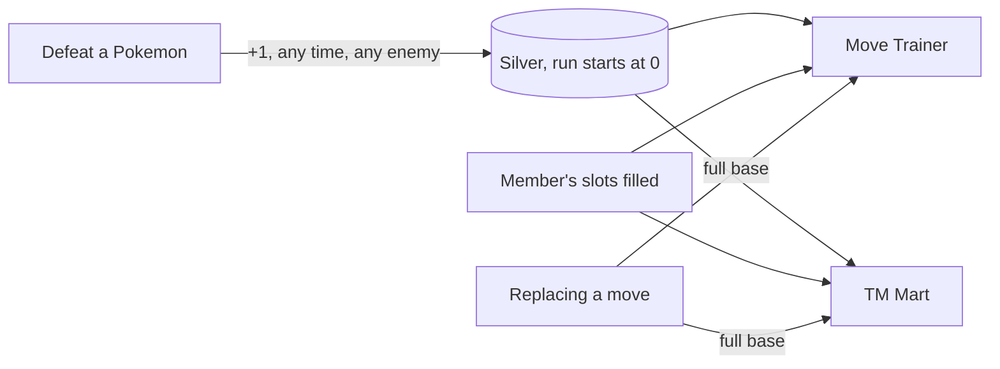
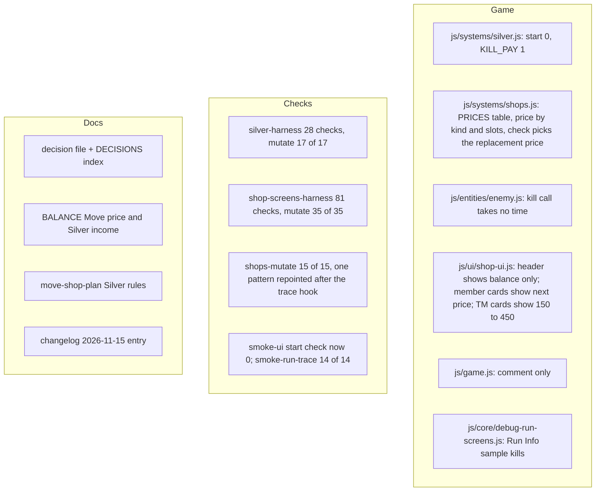

# #124 Economy rule: what was built (2026-11-15)

Ruling: docs/decisions/2026-11-15-124-move-price-by-slots-filled.md. Branch: balance/124-economy-xp.

## Silver in, Silver out

## Price ladder

| Slots filled before the buy | Move Trainer (base 300) | TM Mart (base 450) |
|---|---|---|
| 1 (buying slot 2) | 60 (80% off) | 150 (two thirds off) |
| 2 (buying slot 3) | 120 (60% off) | 300 (one third off) |
| 3 (buying slot 4) | 240 (20% off) | 400 (one ninth off) |
| 4, or a replacement | 300 | 450 |

A member that starts with 2 moves begins at the second row. Filling six members from 1 move each at the Trainer: 2,520.

## Files

## Results

| Check | Result |
|---|---|
| node tools/check.js | all passed, 60 harnesses |
| smoke-ui | all passed on the second run (the first timed out in a later, unrelated step) |
| smoke-run-trace | 14 of 14 |
| Shop screen, headless, 212 Silver | Trainer: "1 / 4 slots, next 60", offers at 60. Mart: "Can learn, 150 Silver", TM cards "150 to 450" |

## Not built yet

| Item | Waits on |
|---|---|
| Elite, boss and special encounter bonuses (1 + bonus) | a traced run that reaches gym 1 |
| Shops 2 to 4 check of the 18-move horizon | the same trace |

## Feel test

One run on dev.html?dev: Silver starts at 0 and climbs by 1 a kill; at the first shop each member's next move shows 60;
buying one makes that member's next 120; a full member shows 300 (replaces).
