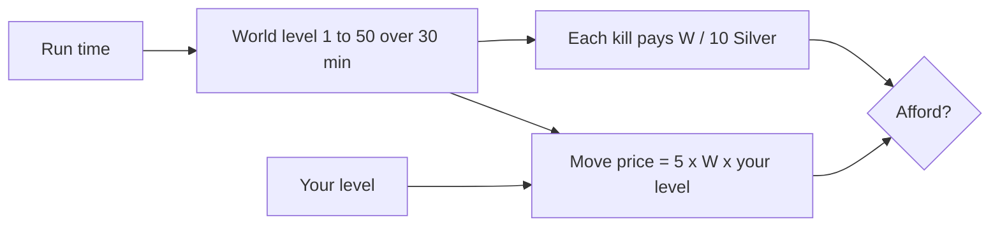
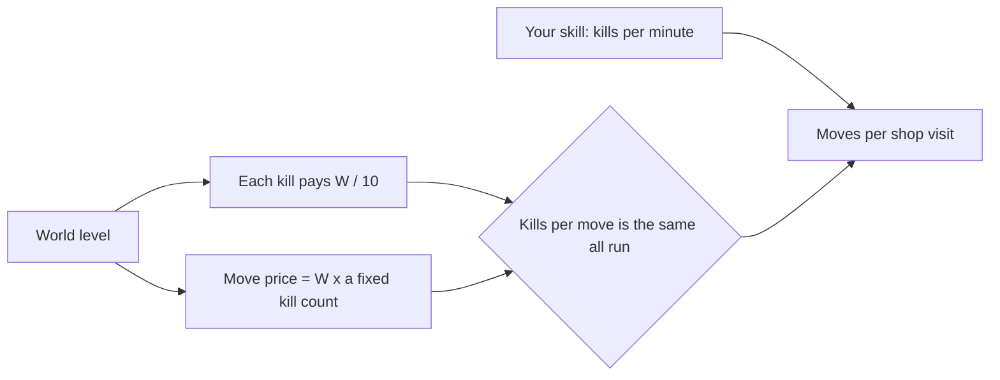
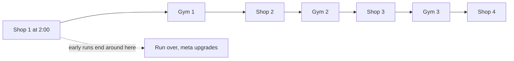
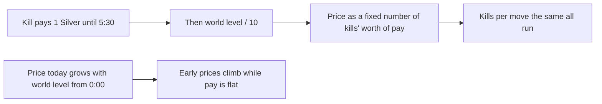

# #124 Economy pass: slice opening (draft for Jess)

Ruling: docs/decisions/2026-11-15-124-economy-independent-of-xp.md

## Today

Income and price both grow with W, so they cancel out. Price also grows with your level and income does not, so the faster you level, the more kills each move costs.

## Proposed

Your level drops out of the price, so a move costs the same number of kills from start to finish. Skill (kill rate) alone decides surplus or grind.

## The three opening items

| Item | Draft |
|---|---|
| Goal | Shop prices stop depending on your level; what a move costs is a fixed number of kills all run |
| Done when | Price at a given time is the same at any run level; an average-pace run affords 4 to 6 Trainer moves per shop visit (18 by visit 3 or 4); Trainer moves cost less than TMs; a slow run affords fewer but can catch up by grinding; Jess feel test |
| End-goal test | New relations in the Silver harness, below |

## Jess's answers (2026-11-15)

- Horizon: over the first 3 to 4 shop visits an average player fills all 4 slots on a team of six (bonds not counted),
  so 3 x 6 = 18 bought moves, about 4 to 6 per visit.
- The Move Trainer (level-up and egg moves) is cheaper than the TM Mart.
- Jess is the average player. An average player needs a couple of runs plus meta upgrades to reach gym 1 or 2.

Silver resets every run, so the 18-move target is for a run that gets to shop 3 or 4, which is a run after some meta
upgrades. Early runs that end near gym 1 fill part of the team, which fits the restart loop in #125.

## Kill rate: measure it, do not guess

No new code. Jess plays 2 or 3 normal runs; at each shop visit, open the pause menu Run Info and note "Silver earned" and the
run time. That table is the reference average. The price numbers are then set so that table buys 4 to 6 moves per visit.

## End-goal test (relations, written first)

| # | Relation |
|---|---|
| E1 | Same run time, different run levels: the price is equal |
| E2 | Price divided by Silver per kill is the same at every world level |
| E3 | At each shop visit in Jess's recorded runs, Silver earned since the last visit buys 4 to 6 Trainer moves |
| E4 | Cumulative over visits 1 to 4 of those runs, at least 18 Trainer moves are affordable |
| E5 | A Trainer move always costs less than a TM Mart move at the same time |
| E6 | At half the recorded kill rate, fewer moves per visit, and grinding longer always closes the gap |

## Open, needs Jess

| # | Question | Blocks |
|---|---|---|
| O1 | Record the Run Info table (2 or 3 runs) | E3, E4, E6, the price numbers |
| O2 | How much cheaper is a Trainer move than a TM: half, two thirds, or another ratio? | E5's number |
| O3 | Is your team usually six by shop 1, or does the "per visit" count only members you have then? | E3 |

## First trace (Jess, 2 runs, 2026-11-15)

| Reading | Value |
|---|---|
| Kills per minute, minutes 1 to 4 | about 30, 74, 60, 104 (one run reached minute 4) |
| Silver earned | equals kills: each kill pays 1 until world level 10 (about 5:30), the floor in silver.js |
| Shop pair 1 (2:00) | 112 earned + 100 start = 212 to spend, your level 6, world level 4, team 3 |
| Price there today | 5 x 4 x 6 = 120: one move, which is what Jess bought |
| Run length | 4.3 and 1.9 minutes, both fainted; no run reached gym 1, so only shop pair 1 has data |

## Proposed rule (superseded the same day by Jess's rule: decision 2026-11-15-124-move-price-by-slots-filled)

- A Trainer move costs a fixed number of kills' worth of Silver: that count times what one kill pays now. Your level is
  out. Before 5:30 that is a flat price, since a kill pays 1 there.
- From the trace: 212 at shop 1 and 4 to 6 moves gives about 35 to 50 kills per move. Proposed: 40 (5 moves at shop 1).
- At half Jess's kill rate, shop 1 holds 156, so 3 moves: fewer, and every extra kill closes the gap (E6).
- A TM costs the Trainer price times a ratio above 1 (O2).
- Later shops (2 to 4) have no data yet, since runs end before gym 1. At about 70 kills a minute, 40 per move is close to
  2 moves a minute of play. Recheck E3 and E4 once a traced run reaches gym 1.
