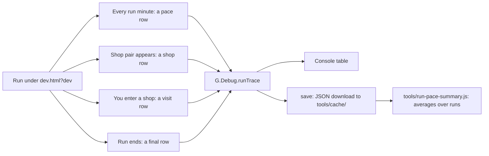

# #124 Run pace trace: plan (dev tool, needs Jess's OK)

Purpose: record an average player's kills per minute and Silver per shop visit, so #124's prices are set from Jess's
real runs (E3, E4, E6 in "124 - Economy Slice Opening.md"). Dev only: nothing happens without ?dev.

## What each row holds

| Row | When | Fields |
|---|---|---|
| Pace | each full minute of run clock | minute, kills that minute, kills total, Silver earned total, world level, your level, team size |
| Shop | a shop pair appears | time, Silver earned since the previous pair, balance, world level, your level, team size |
| Visit | you enter the Trainer or the Mart | time, which shop, balance on entry, moves bought, Silver spent |
| End | the run ends (faint, quit, gym loss) | time, kills total, Silver earned, shops seen, shops entered |

The shop row matters most: it records what you could have spent at that shop even if you skip it.

## Changes

| Where | What |
|---|---|
| New js/core/debug-run-trace.js | The recorder and the G.Debug.runTrace command, modelled on debug-leader-trace.js: dev only, out of the NEED array (decision 2026-11-14-debug-split-files-stay-out-of-need), keeps the last 5 runs |
| dev.html | One script tag after debug-leader-trace.js |
| js/systems/shops.js | When a pair is placed, and when one is entered, call the recorder if one is attached (the leader trace's pattern); nothing attached without ?dev |
| js/game.js | Run start and run end call the recorder the same way |
| New tools/run-pace-summary.js | Reads the saved runs in tools/cache/ and prints average kills per minute by minute, and Silver per shop pair by visit number |
| ONBOARDING.md | One line for the new dev file |

Pace rows are read from the run clock each frame the recorder is called from, so pause and menus do not count. Kills
come from the run's shared counters (the pause menu's Run Info), so a swap does not reset them.

## Commands (for Jess)

| Command | Does |
|---|---|
| G.Debug.runTrace() | table of the current or last run |
| G.Debug.runTrace('save') | download it as JSON; put it in tools/cache/ |
| node tools/run-pace-summary.js | averages over every saved run |

## Test

A headless smoke on file:// dev.html?dev: start a run, fast forward past 2:00 and a shop pair, check the trace has pace
rows with rising totals, one shop row, and that without ?dev the recorder never attaches. Plus node tools/check.js and
npm run format.

## Risk

Low: no change to play without ?dev. The two hook calls in shops.js and game.js are the only game-code touches.
