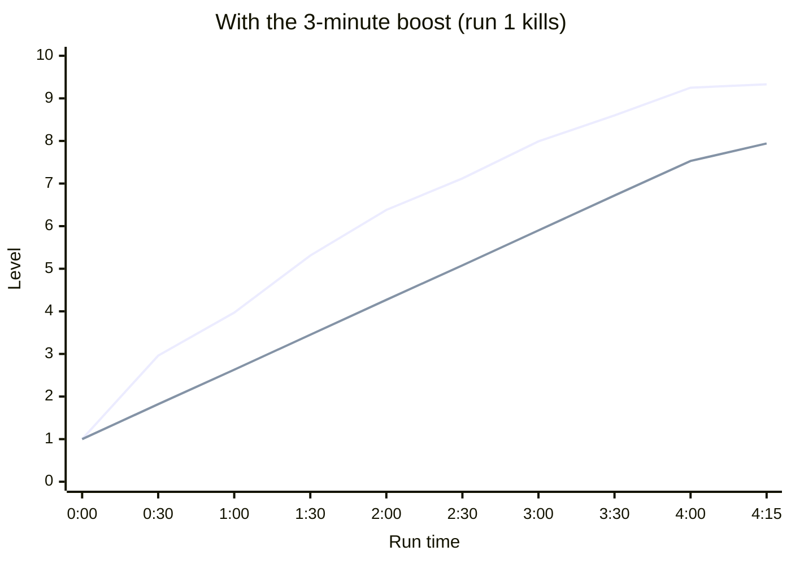
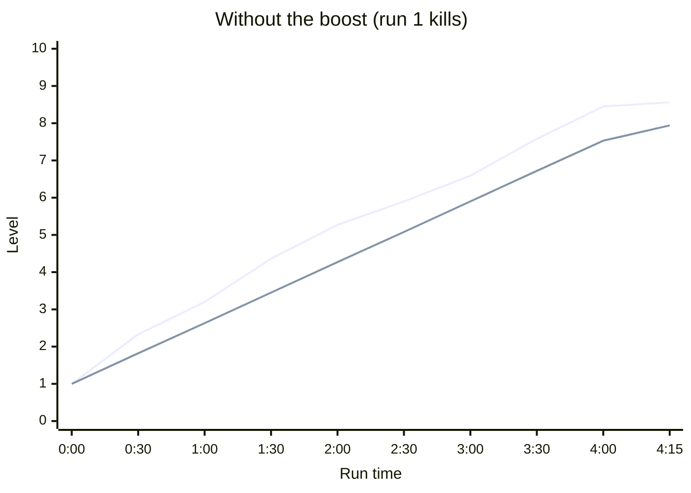
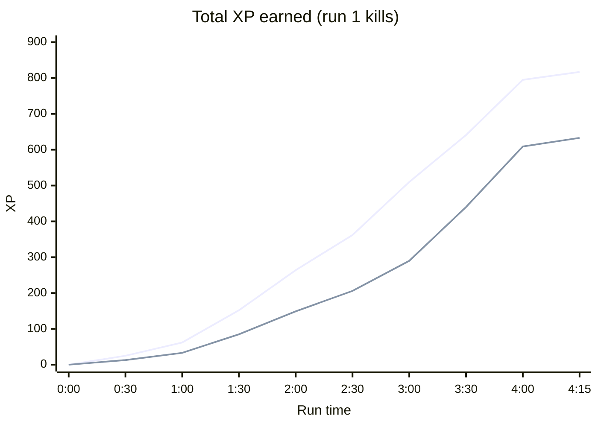

# #125 XP with and without the 3-minute boost (from Jess's two traced runs)

Kills come from the run pace traces (tools/cache/run-trace-*.json, run 1: 283 kills in 4:15). XP per kill uses the game's
own formulas: mainline Medium Fast cost (G.Stats.xpToNext) and the Gen 5 yield (G.Stats.xpYield, XP_SCALAR 0.035), where
the enemy level is the world level and the yield shrinks as you outlevel it. The boost doubles XP before 3:00
(G.Spawner.xpBoost, XP_BOOST 2.0, XP_BOOST_END 180 s).

One number is fitted: the average base XP per kill (species base experience times your XP multiplier), set so the
"with boost" model lands on the levels your trace recorded. Fitted value: 67, which is in the range of early wild species.
Then the same kills are replayed with the boost off.

## 1. Current curve plus boost

Lines, top to bottom: your level (model, boost on), world level.

Check against the trace (whole levels): model 3.97 / 6.38 / 7.99 / 9.25 at 1:00 / 2:00 / 3:00 / 4:00 against your 3 / 6 / 8 / 9.

## 2. Same kills, boost removed

Lines, top to bottom: your level (model, boost off), world level.

## 3. Total XP earned

Lines, top to bottom: boost on, boost off.

## Your lead over the world level

| Time | Boost on | Boost off |
|---|---|---|
| 1:00 | +1.3 | +0.6 |
| 2:00 | +2.1 | +1.0 |
| 3:00 | +2.1 | +0.7 |
| 4:15 | +1.4 | +0.6 |
| Run 2 at 1:53 (80 kills) | +1.7 | +0.7 |

## Reading

- The boost makes most of the early lead: +2.1 levels at 3:00 against +0.7 without it.
- After 3:00 the lead shrinks either way, since the Gen 5 yield pays less once you are ahead (the diminishing return
  the #125 ruling asks for is already in the formula).
- Without the boost an average pace still sits about half a level to one level ahead in the first 4 minutes.
- Limits: only 4:15 of kills, one fitted number, gems are counted as collected at the kill, the trace records whole levels.
  Past 4:15 is not modelled.
