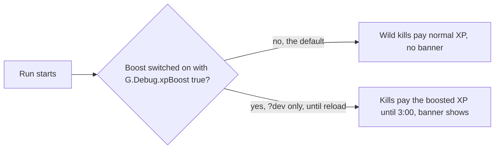

# 125 - XP Boost Off By Default (plan, 2026-11-15)

Jess, 2026-11-15: the opening XP boost is off by default and only turned on through debug.

| File | Location | Change |
|---|---|---|
| js/systems/spawner.js | the boost switch near the top (line 39) | Starts off instead of on. Its comment says so. |
| js/core/debug.js | header line and the xpBoost help text | Says the default is off and true turns it on. |
| docs/decisions/ + DECISIONS.md | new file | "Opening XP boost off by default, debug only". |
| BALANCE.md, STATE.md, #125 | XP boost lines | Default now off. |

Unchanged on purpose: the 3:00 window still drives the opening HP discount (wild HP starts at 55%) and the Density Bonus start. The run trace already records the setting.

Risk: any harness that expects boosted XP in the first 3 minutes fails. check.js shows this, and I fix it in the same step.

Test: check.js, smoke-run-trace, and a headless file:// run that shows no banner and normal XP by default, and the boost back after G.Debug.xpBoost(true).
