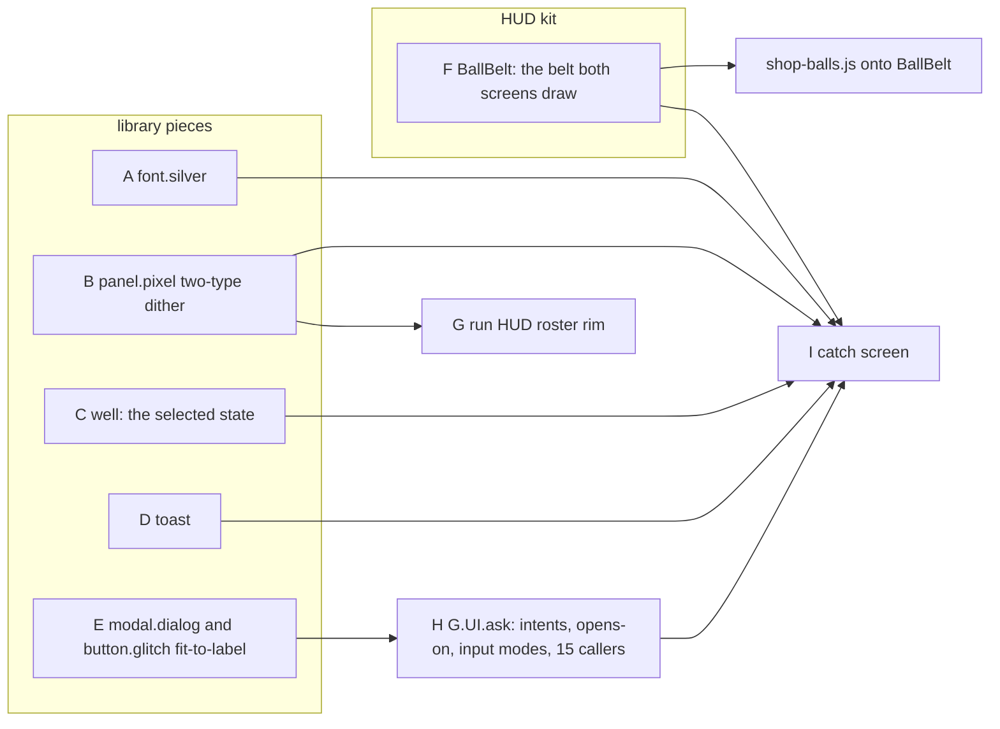

# catch.window Plan: the catch screen on the library (2026-11-21, approved and built)

## Status (2026-11-21, Quick)

Approved with D1 to D7 as recommended: tooltips wait for #158; purchase asks stay as positive asks; reveal-first in
the dialog only; cursor.ring only with the keys; an ask with no intent is negative; the thrown ball at 2x; the run HUD
roster only. Built in one step. Owed by Jess: `node tools/check.js`, `npm run format`, `node tools/smoke-ui.js`,
`node tools/smoke-hud-overlay.js`, `node tools/smoke-pause-menu.js`, `node docs/proposals/pixel-dither-mutate.js`,
then the feel test.

| Where the build differs from this plan | Why |
|---|---|
| The Move Shop's ask is negative when the buy replaces a move, positive otherwise | Decision 2026-11-20-155-move-shop-replace-a-move-asks-replace-or-go-back makes the replace a loss (no refund). Confirmed by Jess after the build (2026-11-21). |
| The Pokemon owned scroll box is a cursor ring's reach (4 px) bigger all round | So the ring is never clipped; the faces sit where the board puts them. |
| smoke-pause-menu.js's toast check changed | It compared the bad toast's edge to the old red; it now reads the red.base token. |
| tools/library/stories/modal.story.js updated | The board's Modal story takes the dialog's new props (intent, byKeys). |
| docs/HUD-STYLE.md "Catch screen" and "Toasts" rewritten | The look they describe changed; the #136b table is history. |
| The dither harness checked offline in Python | Node does not run from Quick: the rule passes at all three sizes and every mutant fails it, in a Python copy. The JS harness and runner still need Jess's run. |

---

The catch screen (js/ui/catch-ui.js) is already Preact; nothing moves off the canvas. This slice redraws it in the
approved look (decisions 2026-11-20-155-catch-window-look, -catch-result-is-a-toast-and-the-window-is-shorter,
-catch-let-it-go-ask-opens-on-keep-trying) from library pieces, pulled forward from #126. Under decision
2026-11-21-unify-work-builds-final-building-blocks the shared pieces it draws are built whole. Jess chose (2026-11-21):
the toast is built now from its decision, modal.dialog is built now and every ask changes, and the two-type rim's
dither is built and the run HUD roster switches to it. A prose plan with no code, checked against
.claude/skills/coding-principles/SKILL.md as amended by the unify ruling. Tracked as a comment on #128 (draft at the end).

## Opening (proposed; approving this plan agrees it)

| Item | |
|---|---|
| Goal | The game's catch screen matches the approved look, drawn from library pieces; the catch rules are unchanged. |
| Done when | Every point of the three catch decisions holds in the game. Throws, the flee ring, number-key throws, Let It Go and held catches work as today, except that the result is a toast and the ask opens on Keep trying. Every ask and toast in the game shows the new look. Jess's feel test passes. |
| End-goal test | smoke-ui.js's catch and ask sections rewritten (Tests 1 and 2), the roster check (Tests 3), the new dither harness and mutation runner (Tests 4 and 5); `node tools/check.js` ends "check: all passed". |

## What gets built

## Decisions for Jess before the build

| # | Decision | Options | Recommended |
|---|---|---|---|
| D1 | The owned tooltip. The approved tooltip (decision 2026-11-20-155-tooltip-is-panel-clean-yellow-frame-three-states) is shared by every tooltip, and its pinning states wait on #158 and your pin and close icons. | (a) Leave every tooltip as today; the tooltip is built whole at #158. (b) Restyle every tooltip's hover look now; the pin states come at #158. | (a). It can't be built whole yet, and (b) restyles the pause menu's detail tooltips with nothing else of the pause menu unified. |
| D2 | The purchase asks (Team Items buy, berry slot, team item slot, Box, TM teach, Move Shop buy). The dialog rule says purchases don't ask. | (a) Keep them for now as Positive asks that open on Buy; #126 removes them screen by screen. (b) Remove them now. | (a). This slice is the catch screen; (b) changes five screens and their smokes. |
| D3 | Reveal-first (decision 2026-11-19: after the mouse, the first Enter or Space only shows the focus). It applies to dialogs and menus. | (a) The dialog now; the menu windows at #126. (b) Both now. | (a). The dialog is the piece this slice builds. |
| D4 | The catch screen's cursor and the mouse. Today the corners follow the mouse too. | (a) As the Shop: cursor.ring only with the keys. Hovering still moves where the keys continue from and still shows the owned tooltip; buttons swipe on hover. (b) The ring follows the mouse as the corners do today. | (a). It follows decision 2026-11-17-no-selection-cursor-with-the-mouse. |
| D5 | What an ask with no intent does (the deferred cloud screens' asks, which this slice leaves untouched). | (a) Negative, opening on its back-out. (b) Positive, opening on its confirm. | (a). Every dialog left under the rule guards a loss. |
| D6 | The thrown ball's size. Today it flies at 1.5x; the belts' balls become 2x. | (a) 2x, as in the wells. (b) Keep 1.5x in flight. | (a). The ball doesn't jump in size as it leaves the belt. |
| D7 | Which roster. RosterCard draws both the run HUD roster and the pause menu's team cards. | (a) The run HUD roster only (run.hud.teamSlot, the decision's place); pause team cards keep their one-type rim until #126. (b) Both. | (a). |

Already ruled, listed so nothing goes in quietly:
- **The result is a toast.** It leaves the panel's note line. Caught is good news (teal); a miss, a flee and out of balls are bad news (red). The caught toast stays up about a second after the screen closes, over the run, beside today's "X was caught!" banner.
- **Let It Go opens on Keep trying.** Every Negative ask opens on its back-out, so a stray Enter loses nothing. Its back-out is Neutral teal and its confirm red.
- **Every toast and ask in the game takes the new look,** including the menus' asks.

## The parts, each with its plan check

### A. font.silver
- **Files:** js/ui/lib/tokens/tokens.js (FONTS) and css/style.css (its font face).
- **What changes:** the token font.silver, family "Silver 10px", file assets/fonts/Silver-10px.ttf (already in the repo), crisp at 20, 30 and 40. The catch screen's Pokemon text moves onto it with a one-font-pixel ink outline (the board's look).
- **Reuses:** the FONTS table and smoke-ui-library's font check, which reads FONTS.
- **New, and why:** the token, because no game font is Silver on a 10 px grid.
- **Not built:** moving other Silver text off GameFont (#126).
- **Size:** about 10 lines.

### B. panel.pixel's two-type dither
- **Files:**
  - js/ui/lib/primitives/pixels/pixels.js (the pure dither rule, which it exposes even without Preact so a Node harness can load it)
  - js/ui/lib/primitives/panel/panel.js (PixelPanel's rimRight)
  - js/ui/hud-kit-hp-bars.js (RosterCard's rimRight)
  - panel.css
- **What changes:** the rule from decision 2026-11-20-155-two-type-team-slot-rim-dithered-middle-band.
  - The first type's ramp is on the left and the second's on the right, with a dithered band across the middle 25% of the panel's own art width.
  - Every rim pixel is one type's light, base or dark whole.
  - Thresholds are shuffled per 8 px block, seeded, and the top and bottom rows shuffle differently.
  - PixelPanel's rimRight switches from today's SVG gradient to the dither. RosterCard gains rimRight. Painted rows are cached per size and pair of types.
- **Reuses:** pixelPanelRows (the shape), pixelPanelColours and letterRows' run building.
- **New, and why:** the dither rule, which nothing has today.
- **Not built:** dual types on any other box.
- **Touched-code cleanup:** the gradient path and the .pm-box-gradients CSS rule go. The catch screen is their only caller.
- **Size:** pixels.js about +40 lines, panel.js about +15 and -30, hud-kit-hp-bars.js about +10.

### C. well: the selected state
- **Files:** js/ui/lib/primitives/well/well.js and well.css.
- **What changes:** a fill colour for the inside, for the catch screen's selected ball: the pocket's dark inside, its light ring. The well's states are now empty, holding and selected.
- **Reuses:** the well as built for the Shop.
- **Size:** a few lines.

### D. toast
- **Files:**
  - new js/ui/lib/primitives/toast/toast.css
  - its link in dev.html
  - the .toast rules removed from css/style.css
- **What changes:** the look from decision 2026-11-20-155-catch-result-is-a-toast-and-the-window-is-shorter:
  - a panel.clean grey.panel body with a 1 px teal.base edge (bad news: red.base) and a 2 px grey.ink outline
  - Michroma 20 on 30 px lines, white
  - padding 12 by 24, at most 720 px wide, bottom centre as today

  G.UI.toast and its 62 callers don't change, and the classes toast and toast bad stay, so every smoke still reads it.
- **Reuses:** G.UI.toast and the layer.toast token.
- **New, and why:** the primitive folder, since the toast is a library piece. It's CSS only, because the element is plain DOM drawn by ui.js; no JS file, so no NEED entry.
- **Size:** about 25 lines moved and changed.

### E. modal.dialog, and button.glitch fitting its label
- **Files:**
  - js/ui/lib/primitives/modal/modal.js and modal.css (rebuilt)
  - js/ui/lib/primitives/button/button.js and button.css (fit-to-label)
- **What changes:** modal.dialog per decisions 2026-11-19 and 2026-11-20:
  - panel.clean, 720 px, padding 32/40/36, white text
  - Michroma title 24, message 18, note 14 in teal.base
  - one or two button.glitch 24 px apart, 28 px below the text
  - the confirm takes the ask's intent, the back-out is Neutral, and a notice has one Neutral button
  - it opens on the button the caller names
  - focus shows only with the keys; with the mouse both buttons rest and only the hovered one swipes

  button.glitch gains a fit-to-label size (no width given: the board's 16 by 20 px padding), since "Keep editing" doesn't fit a fixed width.
- **Reuses:** CleanPanel, GlitchButton and the kit's inputMode. The element ids ask-ok, ask-no, ask-title, ask-msg and ask-note stay, since every smoke clicks them.
- **Not built:** the cancel state (retired 2026-11-20).
- **Touched-code cleanup:** MODAL_BUTTON and the rounded-button label CSS go.
- **Size:** modal.js about the same, modal.css about -30, button.js about +5.

### F. BallBelt, the belt both screens draw
- **Files:** js/ui/hud-kit-items.js (next to BallSprite, which it draws), hud-overlay.js (the kit's name list), css/hud-overlay.css (the belt number's rule moves here from bw-shop.css), js/ui/shop-balls.js (onto it).
- **What changes:** one composite for the board's belt:
  - a panel.pixel sized to six wells over the Unified slot grid, in color.rim.belt, or the fainted ramp when not bought
  - the wells 52 px, 8 px apart, 16 px in
  - the number in Michroma 16
  - each screen passes how to draw a slot (its well, ball, keys, ring and input)
- **Reuses:** PixelPanel, the slotGridUnified pattern, Well, CursorRing and BallSprite.
- **New, and why:** the composite, because two screens draw the same approved belt ("the belts are main.shop.pokeball's").
- **Not built:** belts anywhere else.
- **Size:** hud-kit-items.js about +45, shop-balls.js about -30.

### G. The run HUD roster's rim
- **Files:** js/ui/hud-roster-panel.js (readRow).
- **What changes:** a two-type member's row passes its second type's ramp. Fainted stays grey, and one-type members are unchanged.
- **Reuses:** RosterCard with B.
- **Not built:** the rest of run.hud.teamSlot's approved look (#126), and the pause team cards (D7).
- **Size:** about 3 lines.

### H. G.UI.ask and its callers
- **Files:** js/ui/ui.js (ask) and the callers: catch-ui, ev-screen (2), gacha-ui (3), menu-team-copies (2), menu-team (2), menu.js, settings-ui.js, shop-tms, shop-ui, game.js, and ui.js confirmDelete.
- **What changes:** ask takes an intent; which button it opens on follows from it:
  - **negative** opens on the back-out
  - **positive** opens on the confirm
  - **notice** has one button

  The keys:
  - Left and Right move the focus
  - Enter or Space presses it; from mouse mode the first press only shows the focus (D3)
  - Esc cancels at once
  - after the mouse, the keys start from the last button it touched

  The callers' intents:
  - **Negative:** Let it go, Discard leftover EVs, Go Home, Sell one, Sell batch, Delete account, Sign out as guest (2), Discard team changes
  - **Positive:** the six purchase asks (D2)
  - **Notice:** New save
  - **Untouched:** the deferred cloud asks in mod-ui, ranking-ui and social-ui, which take the default (D5)
- **Reuses:** the promise, the sounds, the second-ask-cancels rule and the stage fit.
- **Size:** ui.js about +20; one option per caller.

### I. The catch screen
- **Files:** js/ui/catch-ui.js and css/bw-catch.css (mostly rewritten).
- **What changes:** the board's places and pieces:
  - **Window:** panel.clean, 980 x 424, centred.
  - **Pokemon panel:** panel.pixel in its types with the dithered two-type rim and a plain grey.raised body, 340 x 384.
  - **Flee ring:** portrait.round's ring at 160 px, face stroke 4, the first type's dark over grey.paper, one step per miss. The absorbed and fled fades are kept.
  - **Pokemon text:** "{Nature} {Name}" Silver 30 at 204, the band Silver 40 at 254, "with a {ball}" Silver 30 at 308. The note line goes.
  - **Belts:** BallBelt from 372 px, 96 px apart (84 wide, 12 apart), centred in height. A holding well rings in the belt's base and an empty one in ink; the selected ball's well is the pocket's dark inside its light ring. The numbered belt shows 1 to 6 in Silver 20.
  - **Pokemon owned:** panel.clean with a grey.raised body, 284 x 244 at 676, 20. 48 px portrait.round faces with an ink stroke, 4 across, 20 px apart across and 16 down, 16 px in. It scrolls in today's ScrollBox with the menu windows' colours. "None owned yet" in Silver 20.
  - **Buttons:** Throw (Positive) and Let It Go (Negative) as button.glitch, 280 x 54 at 678, at 280 and 350.
  - **Cursor:** cursor.ring on wells and faces with the keys (D4); the buttons show their own focus.
  - **Results:** a toast with its tone. Let It Go uses the Negative ask with today's words.
  - **Thrown ball:** 2x (D6).
- **Reuses:**
  - G.Catch for every rule
  - the keys, the cursor moves, the throw timing and the owned tooltip
  - Box (PixelPanel), RoundPortrait, BallBelt, GlitchButton, CursorRing and useRingTravel
- **New, and why:** none in logic.
- **Touched-code cleanup:** POCKET_RIM, LET_GO_RIM, OWNED_RIM, RING_EMPTY, the note signal and the GameFont pixel sizes go.
- **Not built:** the tooltip's new look (D1).
- **Size:** catch-ui.js about the same (585 lines); bw-catch.css shrinks.

**Load order:** no new script files (the toast is CSS only), so no NEED or dev.html script changes. There's one new stylesheet link.

## Tests

| # | File | Kind | What it checks | Why it is needed |
|---|---|---|---|---|
| 1 | tools/smoke-ui.js catchFlow, CHANGED | Relations | Listed below. | It covers the catch screen end to end today; updated, not duplicated. |
| 2 | tools/smoke-ui.js askFlow, CHANGED | Relations | Listed below. | The ask's rules change (intent, opens-on, input modes). Every other smoke clicks #ask-ok or #ask-no, so they need no change. |
| 3 | tools/smoke-hud-overlay.js roster check, CHANGED | Relations | A two-type member's row holds both types' base colours with no gradient; a one-type row holds only its type's; a fainted row only greys. | B and G change the roster. |
| 4 | docs/proposals/pixel-dither-harness.js, NEW | Shape and relations | Listed below. | The dither is the only new logic, and its rules can be checked offline. |
| 5 | docs/proposals/pixel-dither-mutate.js, NEW | Mutation runner | Listed below. | It proves the harness catches each way the rule can break. |
| 6 | Intent scenarios | none | | No moves are touched. |
| 7 | Debug sets | none | | The feel test fires a rescue with G.Rescue.debugFire() in the dev console, as the smoke does. |
| 8 | check.js, tokens-harness, ball-sprites-harness | no change | | check.js picks up test 4 by itself; smoke-ui-library's font check reads font.silver from FONTS. |

**1. catchFlow checks:**
- the window is panel.clean, and its height is a belt's plus twice its padding
- the Pokemon panel's rim holds both of Bulbasaur's types' base colours, with no gradient
- three belts of six wells, belt 1 numbered 1 to 6, locked belts in the fainted ramp
- the selected ball's well is the selected state
- by keys, cursor.ring walks the wells, owned faces, Throw and Let It Go on today's path, never with corners; with the mouse, no ring
- Esc opens the ask on Keep trying, and Enter keeps the catch
- a miss shows the toast "Oh no! It broke free." with the red edge (computed border equal to the red.base token), and there is no note line
- a catch shows a teal-edged toast
- kept as they are: the throws, flee ring, number keys, held catch and the frame-range check

**2. askFlow checks:**
- a Negative ask (the default) opens on its back-out: Enter gives false, Left then Enter gives true, Esc gives false
- a Positive ask opens on its confirm
- the back-out is glitch-neutral and the confirm takes the intent's class
- a notice has one Neutral button
- after a mouse move nothing is focused, the first Enter only shows the focus, and the second presses
- a second ask cancels the first, and the ids are still on the dialog

**4. pixel-dither-harness checks:**
- every pixel left of the band is the first ramp and every pixel right of it the second
- the band is 25% of the art width, rounded
- block by block across the band, the second ramp's share never falls
- the same inputs always give the same mask
- the top and bottom rows differ
- every pixel is one ramp or the other

**5. pixel-dither-mutate mutants:**
- a band twice as wide
- the sides swapped
- one shuffle for every row
- an unseeded shuffle

Each one must fail the harness.

## Feel test (you, in the browser)
Hard reload dev.html?dev. No fresh save is needed. Start a run, then fire a rescue with G.Rescue.debugFire() in the console, or wait for one.
1. **The window:** compare it with the board's catch.window. Check the two-type rim on a two-type Pokemon, the 160 px ring, the Silver text and the belts with their selected well and keys.
2. **By keys:** walk the wells and the owned faces; the ring plays its CRT on each move. With the mouse, there's no ring.
3. **A miss:** throw and miss; you get a red toast and the ring steps. Catch one; you get a teal toast and the screen closes.
4. **Let It Go:** press Esc. The ask opens on Keep trying, and Enter keeps the Pokemon.
5. **Other asks:** in the Main Menu, sell a Pokemon. Its ask opens on Cancel. A Team Items buy opens on Buy (D2 a).
6. **Toasts:** any toast now has the thin teal edge.
7. **The roster:** on the run HUD, a two-type member's row is first type left, second type right, dithered in the middle.

## Risks
- **Opens-on flips for every Negative ask.** Habits of pressing Enter to confirm a sale now keep the Pokemon. That's intended, but you'll feel it.
- **Toast timing:** the caught toast plus the banner may read as doubled. Watch for it at the feel test.
- **The roster's painted rows** are cached per pair of types, since they draw every frame; a missed cache would cost frame time.
- **smoke-ui.js** grows past 2,900 lines. The split stays an issue draft (in the Pokeballs plan).

## Draft: comment on #128 (you paste it)
> catch.window: the catch screen gets its approved look (decisions 2026-11-20-155-catch-window-look,
> -catch-result-is-a-toast-and-the-window-is-shorter, -catch-let-it-go-ask-opens-on-keep-trying), pulled forward
> from #126, from library pieces: font.silver, panel.pixel's two-type dither (the run HUD roster takes it too), the
> well's selected state, the toast, modal.dialog (every ask: intents, opens on the back-out for a loss, keys only show
> focus), and a shared BallBelt. Done when the three decisions hold in the game, the catch rules are unchanged, and
> Jess's feel test passes. Tests: smoke-ui catch and ask sections, the roster check, pixel-dither harness and
> mutation runner; check.js all passed. Plan: docs/AI Outputs/Issue-136/catch.window Plan.md.
