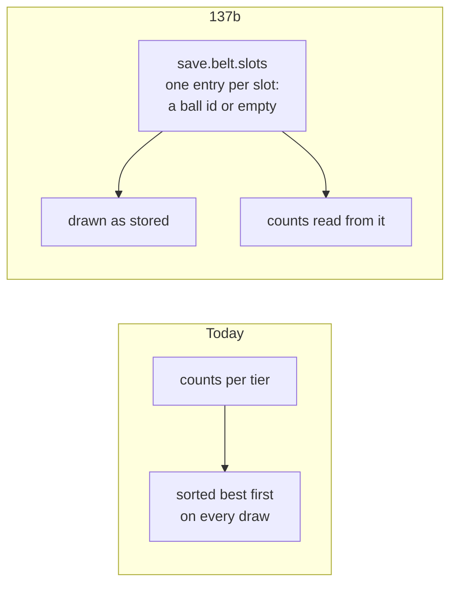
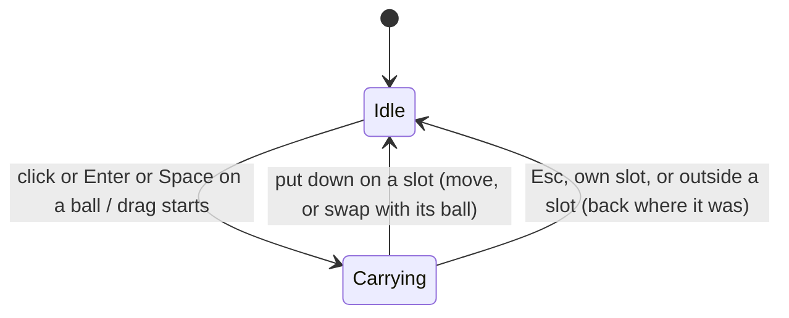

# #137b Belt slots: buys fill empty slots, the player arranges the balls (plan)

Feel-test feedback on #137 (Jess, 2026-11-17): buying a ball pushed the others down a slot and over to the next belt
instead of filling in; the player should be able to rearrange the balls by keys (arrows, Enter, Space) and by mouse
(click, drag). Stays inside #137 (its card back to In Progress).

## Opening

| Item | Text |
|---|---|
| Goal | Each ball has a slot of its own: a buy fills the first empty slot and moves nothing; the player moves balls between slots. |
| Done when | In the Shop, buying never moves a ball already there; a ball can be moved or swapped by keys and by click or drag; the catch screen shows and throws the same layout; it survives a save and an old save loads. |
| End-goal test | In place: rescue-harness part 6 (layout relations) and smoke-ui's Pokeballs and catch sections. |

## Why it happens today

The save keeps only counts per tier ({ poke: 7, great: 2 }); both screens redraw them best tier first on every change,
so a new Great Ball goes to the top and pushes every Poke Ball down one slot.

## Rulings to confirm (they change what the game does)

| # | Question | Default |
|---|---|---|
| R1 | Where a bought ball goes | The first empty slot, belt 1 top to bottom, then belt 2, then belt 3. Shift fills the first 10 empty slots. Nothing already placed moves. |
| R2 | Where you can rearrange | The Shop's Pokeballs tab only. The catch screen shows your layout but does not rearrange (a catch is a quick pause). |
| R3 | Mouse | As the in-run Inventory: a click picks a ball up and a second click puts it down; a drag puts it down where you let go. Onto an empty slot it moves; onto a ball the two swap. Anywhere else, Esc, or its own slot puts it back. |
| R4 | Keys | The cursor reaches every slot of the bought belts (empty ones too). Enter or Space on a ball picks it up (the slot shows it lifted); move with the arrows or movement keys; Enter or Space puts it down (move or swap); Esc puts it back. |
| R5 | A thrown ball | Leaves its slot empty in the save, for good, until a buy fills it (today the slot empties only for that catch). |
| R6 | The catch screen's first selected ball | The best ball on the belts, its first slot in reading order (the spec's "best stocked ball starts selected"). Alternative: the first ball in your order. |
| R7 | Slots on a locked belt | Not reachable, cannot take a ball. |

## Shape

## Parts

| Part | File and place | Change |
|---|---|---|
| 1 Layout | js/systems/catch.js, "the belt" section and header | save.belt gains slots: one entry per slot (a ball id or null), its length the belt size. It becomes the one source: count, total and ballsBestFirst read it. The fix-up builds it for an old save from its counts (best tier first, the order it has always shown), pads or trims it to the size (extra balls trimmed from the end), drops unknown ids, then removes the old per-tier counts. |
| 2 Rules | js/systems/catch.js | buyBalls puts each ball in the first empty slot (R1). buyBelt adds six empty slots. New moveBall(save, from, to): an empty target takes the ball, a filled one swaps; refuses a slot out of range. throwBall takes a slot (the ball thrown is that slot's) and empties it (R5). bestSlot: the first slot holding the best tier (R6). |
| 3 Shop | js/ui/shop-balls.js | Belts drawn from slots as stored. Every slot of a bought belt becomes a cursor item. A carried signal and the click, drag and key handlers copied from js/ui/pause-inventory.js's pattern (press, drag start distance, a ghost ball under the pointer, swallow the click after a drag). Enter or Space on a slot picks up or puts down (R4); Esc puts back. Saves after each move (G.DB.commit). |
| 4 Routing | js/ui/gacha-ui.js | The pane's press already takes its own ids; Esc asks the pane first (puts a carried ball back) before closing, as the TMs tab's escape does. |
| 5 Catch screen | js/ui/catch-ui.js | Draws the stored slots; the per-catch thrownSlots set goes (the save's empty slot is the truth); a throw sends its slot to G.Catch.throwBall. First selection: G.Catch.bestSlot (R6). |
| 6 Save default | js/core/db.js | A new save's belt: size 6, slots six Poke Balls, unlocked empty. |

## Tests (relations, in place)

| Where | Relation |
|---|---|
| rescue-harness 6c | An old save with counts loads with the same balls per tier in slots, best tier first, and no counts left. A layout longer than the size is cut to it. A throw empties exactly its slot; every other slot is unchanged. |
| rescue-harness 6f | A buy fills the first empty slots and leaves every filled slot as it was; Shift fills the first min(10, room, affordable). A belt buy adds six empty slots at the end. moveBall to an empty slot moves; to a filled slot swaps; out of range refuses and changes nothing; tier counts never change on a move. |
| smoke-ui Pokeballs | After a buy with empty slots in the middle, every ball that was drawn is still in its slot and the new one is in the first empty one. Keys: Enter on a ball, arrows, Enter on an empty slot moves it; on a ball swaps; Esc puts back. Mouse: a click then a click moves it; a drag swaps two. Each move is in the save. |
| smoke-ui catch | The catch screen draws the save's layout slot for slot; a throw empties that slot in the save. |

## As built (2026-11-17)

R1 to R7 accepted as defaulted. Built as planned. Differences: throwBall keeps the tier as its first argument and takes
the slot as a third (it defaults to the first slot of that tier), so the harness's many throws did not change; only the
next belt shows a Buy (from #137). Results: rescue-harness, smoke-ui and check.js all passed; smoke-pause-menu only the
known 401 px failure. Screenshot over http: the lifted ball fades in its slot and its ghost follows the pointer.

## Plan check (coding principles)

| | |
|---|---|
| Reuses | pause-inventory's pick-up model (behavior and its constants' meaning), the Shop cursor (createMenuCursor), CursorButton look for slots where it fits, G.DB.commit, the ok-or-error result shape. |
| New | save.belt.slots (replaces the per-tier counts, so there is one source); moveBall, bestSlot; the Shop's carry handlers. |
| Not built | Rearranging on the catch screen (R2); a shared drag helper for the Inventory and the Shop (two users today; extract on a third); sorting buttons. |
| Where it lives | Layout rules in G.Catch; drawing and input in shop-balls.js and catch-ui.js. |
| Size | catch.js about 420 to 470; shop-balls.js about 270 to 400; catch-ui.js about the same (thrownSlots goes). |
| Risk | The save shape changes (counts to slots). The fix-up converts on load, so no save needs clearing; the old count fields are removed after the conversion. |
