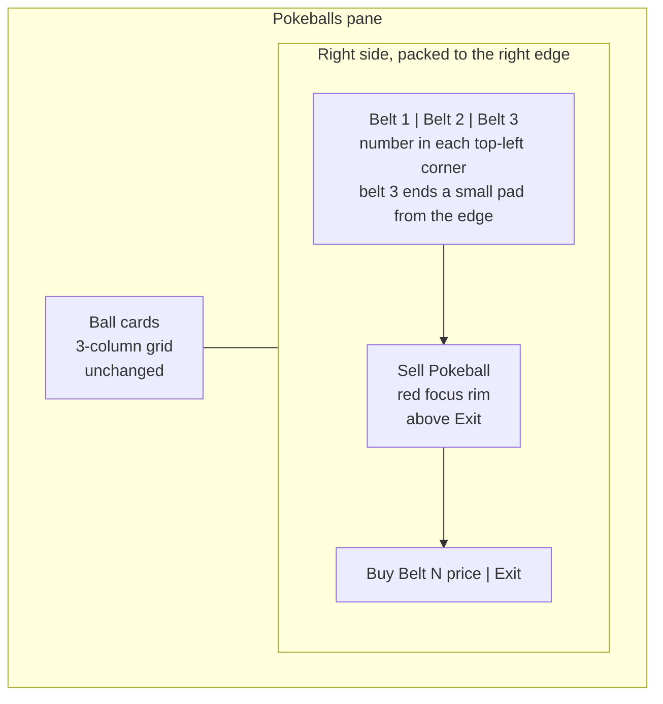
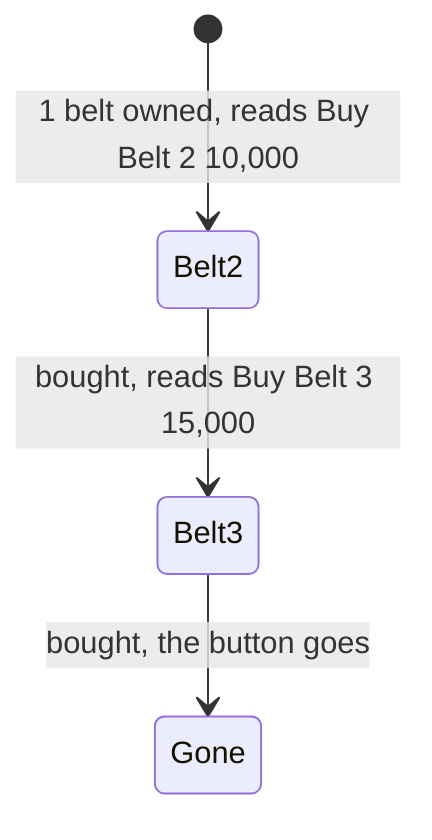

# #137c Pokeballs tab: belts to the right, one belt Buy, Sell, lit Unlock (plan)

Branch feature/128-acquisition. Feel-test follow-up to #137 (Jess 2026-11-17, four asks). Plan only, no code.

## Opening (to agree)

| Item | Text |
|---|---|
| Goal | The Pokeballs tab gains a Sell button and a single belt Buy in the Exit row; the belts sit at the right and show their numbers; an affordable Unlock reads as pressable. |
| Done when | The four asks below behave as described, buys and sells survive a save, and the existing Pokeballs checks still pass. |
| End-goal test | In place, no new harness: smoke-ui's Pokeballs section and rescue-harness 6f gain the relations under Tests. |

## Layout (pane pixels, 1005 x 616)

## The four asks

| # | Ask | Change (file, place) |
|---|---|---|
| 1 | Belts right-justified, numbered | js/ui/shop-balls.js, the BELT sizes: belts move right so belt 3's right edge sits 12 px in from the pane's edge (P1). With no Buy under each belt, the gap between belts shrinks to 20 px (P2). Each belt (bought or locked) draws its number, 1 to 3, in its top-left corner in the Silver font (P3). css/bw-shop.css gets the number's style. |
| 2 | One belt Buy, in the Exit row | js/ui/shop-balls.js: the per-belt Buy goes. One button, left of Exit on its row (same gap as Inventory on Team Items), wide enough for "Buy Belt 3 15,000" (about 210 px; checked by screenshot over http). It buys the next belt, then reads the next one's number and price, and is gone once Belt 3 is bought (P4). It still asks first (B9), shift-click skips. The button lives in the pane, positioned on the Exit row; js/ui/gacha-ui.js is untouched beyond the cursor list it already takes from the pane. |
| 3 | Sell Pokeball, above Exit | Rules: js/systems/catch.js gains sellBall: empties one slot and pays half that ball's price, rounded down (Poke 25, Great 75, Ultra 150). The share (0.5) sits in js/data/balls.js beside the prices. Screen: js/ui/shop-balls.js, a button "Sell Pokeball" the width of Exit, right-aligned over it with an 8 px gap. Rest rim the usual paper; focus rim built from #e8202a and #7c1016 (P5). Which ball it sells: P6. A sale saves and toasts "Sold a Great Ball for 75." |
| 4 | Affordable Unlock not dimmed | js/ui/menu-window-kit.js ItemCard and css/bw-shop.css: a dimmed card dims its picture, divider, name and line (and rim) instead of the whole box, so its button can stay lit. shop-balls.js marks the button lit when the card is a locked Great or Ultra you can afford. An unaffordable Unlock and the "Coming soon" cards look exactly as now. |

## Defaults to confirm (they change what the game does)

| # | Question | Default |
|---|---|---|
| P1 | Padding right of belt 3 | 12 px. |
| P2 | Gap between belts now that the Buys are gone | 20 px (was 49). Say "keep spacing" to only slide them right. |
| P3 | Belt number style | Small white number sitting on the belt's top-left rim corner, so it covers no slot. |
| P4 | After Belt 3 | The button disappears (not a greyed "All belts bought"). |
| P5 | Focus rim | #e8202a as the base, #7c1016 as the dark edge, and a light highlight mixed from #e8202a toward white, the same way the green focus rim is built. |
| P6 | Which ball Sell sells | The ball you are holding: pick a ball up (click or Enter), then press Sell, or drag it onto Sell. With nothing held, Sell refuses "Pick up a ball first." Shift sells one only. |
| P7 | Does Sell ask first? | No, instant with a toast (as a ball buy). |

## Tests (relations, in place)

| Where | Relation |
|---|---|
| rescue-harness 6f | sellBall on a filled slot: the slot becomes empty, the coins rise by half that ball's price rounded down, no other slot changes. On an empty slot it refuses and changes nothing. Sell then buy of the same ball loses coins (no free coins loop). |
| smoke-ui Pokeballs | Belt 3's right edge is within the padding of the pane's right edge; belts keep their order left to right; each belt shows its number. Exactly one belt Buy, on Exit's row, reading the next belt's number and price; after a buy it reads the next; after Belt 3, none. Sell sits above Exit and its width matches; holding a ball and pressing Sell empties that slot and raises coins by the share; Sell with nothing held toasts and changes nothing. A locked, affordable Great's button is fully opaque while its picture is dimmed; an unaffordable one stays refused. |
| check.js, npm run format | All passed. |

## Plan check (coding principles)

| | |
|---|---|
| Reuses | CursorButton (Sell and belt Buy), the carried-ball state from 137b, settle and refusals, G.Catch ok-or-error pattern, G.UI.toast, G.DB.commit. |
| New | G.Catch.sellBall; a sell share in balls.js; a focusRim option passed through CursorButton (TeamButton already takes one). |
| Not built | Selling more than one at a time; a confirm on sell; a fourth belt. |
| Risk | Space: belts end at y 492 and Exit starts at 562, so Sell (54 tall) fits with 8 px gaps and nothing to spare. ItemCard's dim is also used by the Inventory (unbought items) and the TMs tab (a TM no one can learn). Those keep today's look: the button dims with the card unless the caller asks for a lit button, which only the ball cards do. smoke-ui covers all three screens. |
| Docs at close | New decision file (sell at half price), DECISIONS index, BALANCE (sell share), changelog, STATE, TODO, DEVLOG, #137 comment. |

## As built (2026-11-17)

Jess: P2 belts 1 and 2 slide right toward belt 3 (as defaulted, 20 px apart); P5 light #ff8a90; the rest as defaulted.

| Plan said | Built |
|---|---|
| Sell at Exit's width | 186 px (Exit is 156): "Sell Pokeball" did not fit at Exit's width. Right-aligned with Exit. |
| (not in plan) | The pane is 1003 px wide inside the window's rim, and Exit ends 2 px past it, so Sell's right end was clipped; the Pokeballs pane now shows overflow (its cards scroll in their own box). Belt 3's pad reads 10 px, not 12, for the same reason. |
| (not in plan) | Sell is its own small component: a Preact component that reads a signal skips redraws when its props are unchanged, so the Pane reading the held ball stopped redrawing on a save (caught by smoke-ui). |

Results: rescue-harness 6f (sell relations) all passed; smoke-ui all passed (layout, arrows, Unlock opacity, Sell by
keys, click and drag, refusal); check.js all passed. Screenshots over http: labels fit, red rim shows on Sell.
