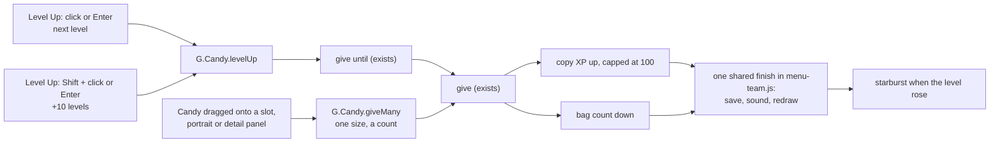

# #139 Part F (slice B): candy in the Team menu

Status: built and feel-tested 2026-11-24 (Jess: all good). Parts [Approved] come from decision
2026-11-23-97-139-team-menu-and-upgrade-popup-rulings and the sketch assets/excalidraw/team-menu.excalidraw.

## Opening (agreed 2026-11-23, on #139)

| | |
|---|---|
| Goal | Give candy in the new Team menu: Level Up, the EXP Bag popup and dragged candy |
| Done when | The test passes in `node tools/check.js`, Jess feel-tests it, an existing save loads unchanged |
| Test | Candy spent equals candy removed from the bag. XP rises by its value, capped at OOR 100. Level Up reaches at least the next level (Shift: at least +10) unless the bag empties or 100 is reached |

## How it flows

## Parts

| Part | Where | What changes | Reuses | New |
|---|---|---|---|---|
| F1 test first | docs/proposals/candy-harness.js, candy-mutate.js | The end-goal test above, as relations, for the two new functions. Existing give and give until cases stay | The harness's save and copy helpers | Cases and mutants only, no new harness |
| F2 rules | js/systems/candy.js | Level Up by a number of levels (1 or 10, clamped at 100); give a count of one size (stops at 100 or an empty size, reports how many went in); progress to the next level | give, give until, xpForLevel | 3 small functions: levelUp, giveMany, levelProgress |
| F3 XP bar | js/ui/lib/primitives/bar | A 4 px bar as a library piece, under the detail panel's name bar, full width (the sketch's line). Filled blue base over blue dark, empty grey mid over grey paper: the sketch's four hexes are all existing tokens | color.blue.base, color.blue.dark, color.grey.mid, color.grey.paper | ExpBar and a board story |
| F4 Level Up | menu-team-detail.js, menu-team-slots.js, menu-team.js | Both Level Up buttons go live, refused look and toast at 100 or with an empty bag; both join the keyboard cursor. The result toast names the level reached and says when the bag ran out | CursorButton, its refusal, the levelup sound | One shared finish function for both ways of giving |
| F5 Shift | js/ui/menu-window-kit.js | A button press and a key press hand on whether Shift was held. Every other caller ignores it | The existing press path | One argument |
| F6 EXP Bag | new js/ui/menu-team-exp-bag.js; menu-team.js; css/team-menu.css; tokens.js | The popup: panel.pixel in the key items purple, five rows (count, name, icon in a well). Opens from EXP Bag | PixelPanel, Well, SIZE_ORDER, bagOf | One file (dev.html entry, NEED entry, rebuild), three colour tokens from UI-PALETTES "Key items pocket", candy art |
| F7 dragged candy | exp-bag file, menu-team.js | Drag 1; Ctrl-click adds 1 to held; Shift-drag 10; Ctrl-Shift-click adds 10. Drop on a slot, portrait or the detail panel. Bag only goes down on the drop | dropHandlers, the Ghost | A candy drag kind beside the Pokemon one, so a candy never reaches the roster rules |
| F8 burst | menu-team.js | One starburst in the copy's first type when a give raised the level; the existing setting still turns it off | mosaic.burst | None |

Order: F1, then F2 to F8. Level Up never asks for confirmation, and candy cannot be taken back.

## Edges handled (assumptions on mechanics)

- A Pokemon slot or portrait with no copy (a Pokedex species, an empty slot) takes no candy: error sound and toast.
- Dropping more than needed to reach 100: each candy goes in singly, the rest stays in the bag. XP past 100 is lost
  only on the last candy used [Approved].
- Level Up and candy are refused in sell mode and while a Pokemon is lifted.
- An open bag popup closes before the menu on Esc, in the existing "back one thing" order.
- Sort and tooltips read the level already, so they follow the save.
- Revert still changes the roster only. Candy given stays given (decision 2026-11-24-167-team-menu-saves-at-once).
- No new save field. Old saves load as they do now.

## Size and risk

| Risk | Handling |
|---|---|
| menu-team.js is 778 lines | The bag gets its own file; expect about 60 to 80 more lines, under 1000 |
| Native drag and drop inside a scaled panel (not driven in a browser at #167) | Drive it headless over file:// at a scaled-down window, with tools/smoke-team.js extended |
| F5 touches a kit the Shop and Inventory share | Run their smokes |
| A portrait drop target redraws up to 500 cells | One handler on the grid that finds the cell under the pointer, not one per cell |

Not built: pinning as a general tooltip feature (#158), evolve and its "ready" mark (8b), friendship, fatigue, use-item,
the Upgrade popup (slice C). Touched-code cleanups: the "disabled until #139 Part F" header comments.

Close: #139 comment and card, Acquisition spec section 6, GLOSSARY "Candy bag", changelog ("comes in a later update"
goes), STATE, TODO, DEVLOG, a decision file for the rulings below.

## Rulings

All eight open decisions are answered: decision 2026-11-24-139-part-f-candy-in-the-team-menu.

## Built differently from the plan

| Plan | Built | Why |
|---|---|---|
| F5: the kit hands Shift on with every press | The kit keeps which modifier keys were down; selling, which had its own copy, reads it | No change to the press path the Shop and Inventory share |
| F7: the browser's drag and drop | Pointer-based dragging | Chromium never starts a drag while Shift is held. Pokemon dragging is unchanged |
| menu-team.js about 60 to 80 lines longer | 86 longer; the bag's state is in menu-team-exp-bag.js | As menu-team-sell.js does |
| Not planned | Toasts let clicks through | The level toast covered EXP Bag in a small window |
| Not planned | A species with no growth curve refuses candy | Give until would have spent the whole bag on it for nothing |
| Not planned | exp-candy added to the icon index generator | Its category list left it out |
| F7, the detail panel by keys | Mouse only; keys use slots and portraits | The panel is not a cursor stop |
