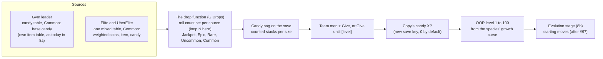
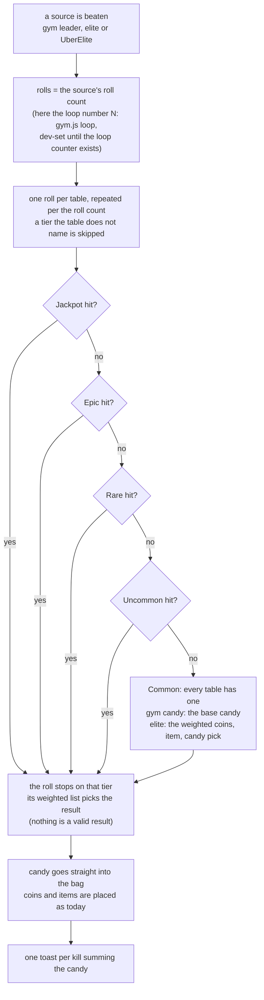
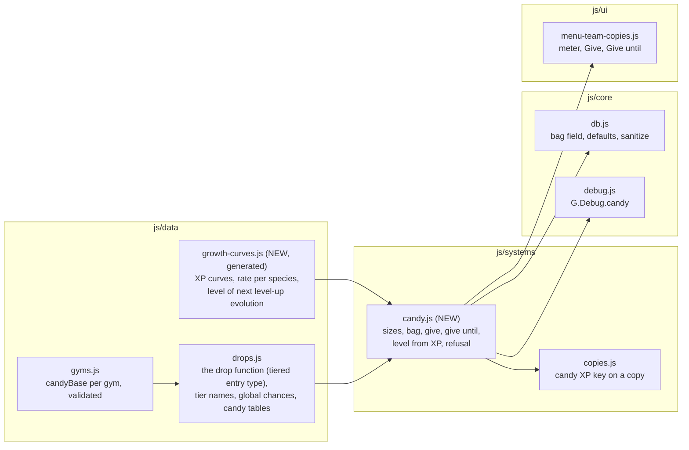
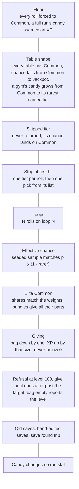

# 139a - Candy Build Plan (S8 8a of #128, 2026-11-22, APPROVED by Jess, building)

Opening, rulings and numbers: docs/AI Outputs/Issue-139/139 - Candy and Evolution Slice Opening.md and decision
2026-11-22-139-candy-target-and-drop-model. No code in this plan. Principles applied: .claude/skills/coding-principles.

# Summary of 8a: the system and the decisions

## In one paragraph
8a builds the ONE drop function every loot drop in the game will use: a table's rarity tiers are rolled rarest
first, the roll stops at the first hit (Common when nothing rarer hits), and that tier's weighted list picks the
result. Exp Candy is the first user: gym leaders, elites and UberElites roll candy tables through it, and a lucky hit
above Common simply gives that tier's bigger candy. Candy goes straight into a bag on the save.
In the Team menu you give candy to a copy (one at a time, or "Give until [level]"). The copy's out-of-run (OOR) level
and an XP meter rise along its species' mainline growth curve, up to level 100. The OOR level sets only its evolution
stage and the moves it may start a run with. It changes no stat in a run, and every run still starts at level 1.

## The whole system

## Every ruling in one place

| Topic | Ruling | Tag |
|---|---|---|
| Target | One full run (loop 6 done, 8 gyms and 4 Elite Four per loop) lets the median 3-stage, fully level-based line reach its last evolution: 40,007 XP (the Charizard line, level 36). Computed from pokeapi per evolution path (76 paths, p25 33,084, p75 74,088). | [Approved] |
| Candy sizes | Canon, never scaled: XS 100, S 800, M 3,000, L 10,000, XL 30,000 XP. | [Approved] |
| Base (the floor) | Gym leaders and Elite Four, 100%, count = loop number (21 loop-shares, 252 drops a run). Gym 8 drops S every loop, the last Elite Four beaten drops S on loop 6 only, every other source XS: 44,100 XP, 10% over target. This is every roll landing on Common; a luckier hit gives a bigger candy instead. | [Approved] |
| The drop function | The ONE flow for every loot drop in the game. Tiers rolled rarest first, stop at the first hit, then the tier's weighted list picks the result. 8a moves the candy sources only; the rest move in a later slice. | [Approved] |
| Common | Every table has one. It has no chance: the roll lands on it when nothing rarer hits. | [Approved] |
| Skipped tiers | A table may name only some tiers. A tier it does not name is never rolled, and its chance falls through to Common. | [Approved] |
| Tier lists | Every tier holds a weighted list; a candy tier is a list of one. "Nothing" is a valid result. | [Approved] |
| Roll count | Set per source. Gyms, Elite Four, elites and UberElites roll the loop number. | [Approved] |
| Tier names | Common, Uncommon, Rare, Epic, Jackpot (rolled in that reverse order). Never candy sizes; every table uses them. | [Approved] |
| Tier contents | Each table names its own. (The earlier "fixed tier to size for every source" rule is rejected: it read "upgrade" literally.) | [Approved] |
| Tier chances | One global set per roll: Uncommon 1%, Rare 0.4%, Epic 0.1%, Jackpot 0.02%. Tunable, accepted for now. | [Approved] for now |
| Tables per source | Exp Candy is its own table. Gym leaders also roll an item table (items, coins, unique drops), which stays as today's 10 coins and guaranteed item in 8a. Elites and UberElites roll one mixed table. | [Approved] |
| Elite and UberElite drop | One mixed table; its Common is the weighted pick below. It replaces the old berry, ground item and 50% item chance. | [Approved] |
| Candy tables | The tables in "Candy tables" below (Jess, 2026-11-22). | [Approved] |
| The bag | Counted stacks per size. A drop is banked the moment it is earned and kept even if the run is lost. | [Approved] |
| Giving | One candy per press, hold repeats. Refused only at OOR level 100. A copy whose next evolution has no level still levels, since the OOR level also sets its starting moves. | [Approved] |
| Give until | The largest candy that fits without overshooting, repeated, then the smallest that covers the remainder. May overshoot the target level, stops at 100, reports the level reached if the bag runs out. Its input control is decided at Part F. | [Approved] |
| Meter | The copy's card shows the OOR level, an XP bar to the next level and a tick at the next level-based evolution (none when there is none). | [Approved] |
| Scope | Candy only. The gym's 10 coins and guaranteed item stay as they are. | [Approved] |

Elite and UberElite Common tier (weights): the chances are the weight over the total of 120.

| Floor result | Weight | Share |
|---|---|---|
| Coins | 40 | 33.3% |
| Item | 30 | 25% |
| Candy (one XS) | 30 | 25% |
| Coins and an item | 15 | 12.5% |
| Coins, an item and candy | 5 | 4.2% |

## The numbers behind the target

| Fact | Value |
|---|---|
| Sources per loop | 12 (8 gyms, 4 Elite Four) |
| Loop-shares in a full run | 1+2+3+4+5+6 = 21 |
| Base drops a full run | 12 x 21 = 252 |
| Base total | 21 x 11 sources of XS plus gym 8's S (21 x 800) plus the last Elite Four's S on loop 6 (6 x 800) = 44,100 XP |
| Target | 40,007 XP (median, 3-stage, fully level-based) |
| Average a drop would need | 40,007 / 252 = about 159 XP, which is why canon sizes force a mostly-XS floor |
| Dragonite (207,968) | about 4.7 full runs on the base alone |
| Smallest floor that clears it | Gym 8 dropping XS too gives 39,900, 107 XP short, so gym 8's S Common is the smallest canon floor |

## Candy tables [Approved]

| Table | Common | Uncommon | Rare | Epic | Jackpot | Rolls |
|---|---|---|---|---|---|---|
| Gyms 1 to 7, Elite Four | XS | S | M | L | XL | loop number |
| Gym 8, the last Elite Four on loop 6 | S | (not named) | M | L | XL | loop number |
| Elite and UberElite (mixed) | the weighted pick above | S | M | L | XL | loop number |

Gym 8 does not name Uncommon, since an Uncommon S would equal its Common; that 1% falls through to Common.

| Case (gyms and Elite Four only) | Full run XP | Against 40,007 |
|---|---|---|
| Every roll lands on Common | 44,100 | +10% |
| Expected with the global chances | about 52,500 | +31% |

Expected per roll: about 134 XP on an XS table (100 on Common alone), about 825 on gym 8's table (800 alone).
Elite candy is a bonus outside the target, since the elite count per run is not fixed. If +31% is too generous,
the global chances are the dial; the tables stay.

## What 8a does not do
Evolve and the ready popup (8b), friendship and fatigue (8c, #161), the starting-move picker (after #97), evolution
materials and their shop tab (#163, #162), moving the other drop tables to the function, the Elite Four source (the Elite Four is not
built), a chance multiplier per source, a candy sprite on the map, and anything about the loop counter itself.

# Opening items

| Item | Text |
|---|---|
| Goal | The one drop function exists, and gym leaders, elites and UberElites drop Exp Candy through it into a bag; the player gives it to a copy in the Team menu; the copy's OOR level and XP meter rise along its mainline curve up to 100. |
| Done when | 1. The candy harness passes inside `node tools/check.js` and its mutants are all caught. 2. Jess feel tests: beat a gym, see the drop toast, give candy, watch the meter move, reload (it survives), load an old save (every copy at 0, bag empty). 3. #139 comment, card to Needs Playtest, spec section 6, BALANCE.md, GLOSSARY and changelog updated. |
| End-goal test | Relations, not values (docs/TEST-FIRST.md). The first one written is the floor: with every roll forced to land on Common, a full run's candy still reaches the median 3-stage fully level-based line's XP, read from pokeapi by the harness on its own. |

# Build plan

## Flow of one drop

## Where each piece lives

## Part A: the drop function (js/data/drops.js)
- What changes: one new entry type, the tiered table, built to be the flow every loot drop will use: tiers rolled
  rarest first with the one global chance set, stop at the first hit, land on Common when nothing rarer hits, then
  the tier's weighted list picks the result. A table names only the tiers it uses; an unnamed tier is skipped and its
  chance falls through to Common. A table without Common fails `validate()`. "Nothing" is a valid list entry. A
  result can be a bundle (the elite's "coins and an item" and "coins, an item and candy" give several things). The
  roll count comes from the source.
- Reuses: the existing TABLES, source names, `make`/`place` path. The old entry types and `oneOf` stay for the
  tables not moved yet.
- New: the tiered branch in `roll`, the tier-name list and global chance set (one constant each), the roll count read
  from the ctx the caller passes, the bundle result, the Common check in `validate()`.
- Not built: the chance multiplier, moving the other tables (wild drops, berries, ground items, the gym's 10 coins and
  guaranteed item) to the function (own later slice), materials tables (#163, #162).
- Where it lives: drops.js already says it is "the ONE place that decides what enemies and events drop".
- Size: drops.js 183 lines grows to about 260.

## Part B: the candy rules (js/systems/candy.js, NEW)
- What changes: nothing existing; this owns the five canon sizes, the bag, giving, giving until a level and "level
  from XP".
- Reuses: G.Copies for the copy's XP (Part C), G.DB for the bag, the growth data (Part D).
- New: G.Candy. A new file costs a dev.html entry, a NEED entry in js/main.js and a rebuild (said here so the
  approval covers it). Why nothing existing fits: no module owns a currency that raises a copy permanently.
- Rules it holds: candy is refused only at OOR level 100; a copy whose next evolution has no level still levels;
  give until picks the largest candy that fits, repeats, then the smallest that covers the rest, may overshoot the
  target level, stops at 100, and reports the level reached when the bag runs out. Candy changes no run stat.
- Not built: Evolve (8b), the starting-move picker, friendship, fatigue, any candy sprite on the map.

## Part C: the save (js/core/db.js, js/systems/copies.js)
- What changes: the bag is one new save field (counts per size). A copy gets one new compact key for its candy XP,
  left out at 0. The unused letter `c` is the candidate; the build confirms it against the key list first.
- Reuses: copies.js is the only reader of the compact form; db.js sanitize already cleans hand-edited saves.
- Old saves: an absent bag reads as empty and an absent key reads as 0, so no save has to be cleared and nothing
  else on a copy changes. Sanitize clamps both to whole, non-negative numbers (an XP above the level 100 curve
  clamps to it).
- Not built: no save version bump (the fields are backward compatible).

## Part D: the growth data (tools/growth_data.js and js/data/growth-curves.js, NEW)
- What changes: nothing existing. A generator in tools/ (the pattern of tools/evolvable_data.js) writes the data
  from pokeapi: the six XP curves, each species' curve, and the lowest level among a species' level-up evolutions.
- Reuses: the generator pattern and the "GENERATED, do not edit" header. The harness reads pokeapi on its own as the
  check on the file, and spot checks (Abra's line 2,535, Venusaur's line 27,021) come from pokeapi, not from the file.
- Not built: evolution data beyond that one level (8b brings the rest).

## Part E: wiring the sources (gym-leader.js, elite.js, uber-elite.js, gyms.js)
- What changes: the gym leader rolls its candy table beside its current drops, and the elite's and UberElite's
  mixed table replaces their current drops; each passes its roll count (the loop number). gyms.js entries get one
  new field naming which candy table the gym rolls (default the XS table, gym 8 its S table), checked by its
  `validate()`.
- Reuses: G.Drops.roll and the loop value gym.js already holds.
- Not built: the Elite Four source and the "last Elite Four beaten drops S on loop 6" line. The Elite Four is not
  built in code, so that row waits in the spec as [Approved] with a "code differs, see TODO" note. The loop counter
  is dev-set today, so a real run is loop 1 until the loop slice; the harness and G.Debug.candy drive loops 1 to 6.
- Elites still run the temporary cadence (first 2:00, then every 6:00). Not changed here.
- Behavior change [Approved]: elites and UberElites now always drop something (their mixed table), and on loop N
  they roll N times. It replaces the old berry, ground item and 50% item chance (Jess, 2026-11-22).

## Part F: the Team menu (js/ui/menu-team-copies.js)
- What changes: a copy's card shows its OOR level, an XP bar to the next level and a tick at the next level-based
  evolution (none when there isn't one). It gets a Give button (one per press, hold repeats), a size picker, and a
  Give until control. The bag's counts sit in the same panel.
- Reuses: the library pieces the Team menu rulings name (button, well, panel); no new primitive, per decision
  2026-11-21-unify-work-builds-final-building-blocks.
- Decided at this part: the Give until input (a level stepper built from the existing button piece is the
  recommendation; the library's text field is an unreviewed draft).
- Not built: the Evolve button (8b), the ready popup.
- Size: 275 lines grows to about 450.

## Part G: dev and docs
- G.Debug.candy adds candy to the bag and prints a simulated full run's all-Common total and a sampled lucky run, so tuning does
  not need a real run. Dev only.
- Docs: spec section 6, BALANCE.md (the tier chances and the elite floor weights), GLOSSARY (drop tier, tier names,
  candy size, bag), the `js/data/changelog.js` entry (free edit, parse-checked), the #139 comment, the board card.

## Tests (docs/proposals/candy-harness.js, NEW, plus candy-mutate.js)

- Every expected outcome is a relation read from the decision file, never a value copied from the code.
- This is a genuinely new system, so it gets a new harness. If a drops harness already covers G.Drops, the drop function
  cases go there instead (checked at build).
- The mutants (docs/proposals/candy-mutate.js): tiers rolled commonest first, the stop is missing, Common is
  missing, a table without Common accepted, a skipped tier's chance moved to the next named tier instead of Common,
  the roll count ignored, giving does not reduce the bag, refusal at 100 removed, the bag defaults removed.

## Risks
- The loop counter does not exist, so "N rolls on loop N" is proven by the harness and G.Debug.candy, not by a real
  run beyond loop 1.
- Elite and UberElite tables raise how much drops per kill on later loops (N guaranteed drops on loop N); the
  weights above decide how loud that is.
- The luck above Common (about 34 XP a roll on an XS table, +31% over target expected) is a first pass and tunable;
  expect a tuning pass after the first runs.
- The function is built for every drop but only candy uses it in 8a, so its fit for wild drops is unproven until the
  migration slice.

## Touched-code cleanups (listed so the approval covers them)
None planned. If the build finds a misleading name in a line it already edits, it lists it before changing it.

## Not built (deferred)
Evolve and the ready popup (8b), friendship and fatigue (8c, #161), the materials tables and shop tab (#163, #162),
moving the other drop tables to the function, the chance multiplier, the Elite Four source, the starting-move picker
(after #97).
