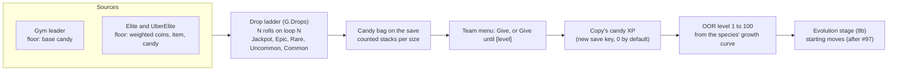
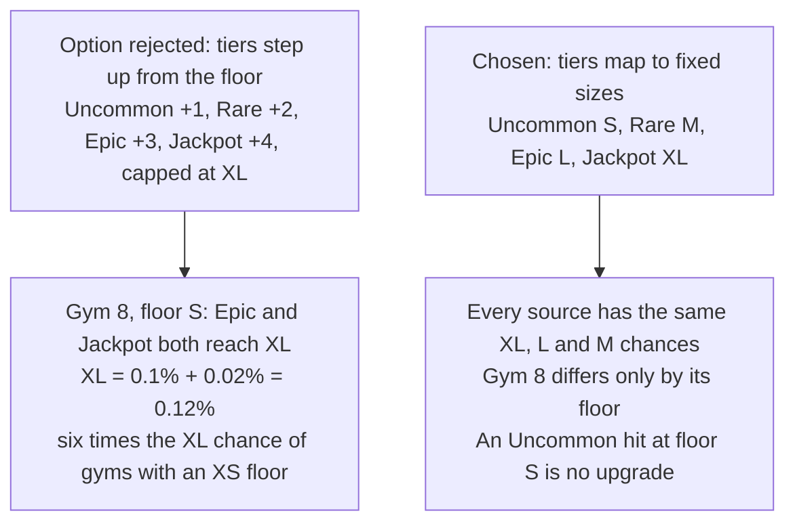
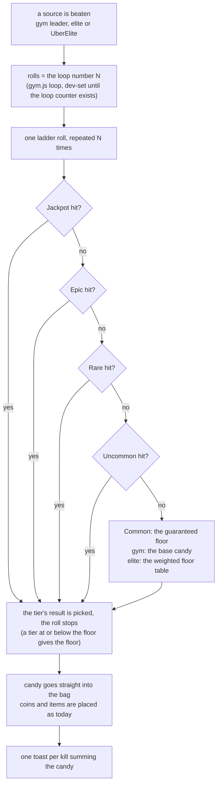
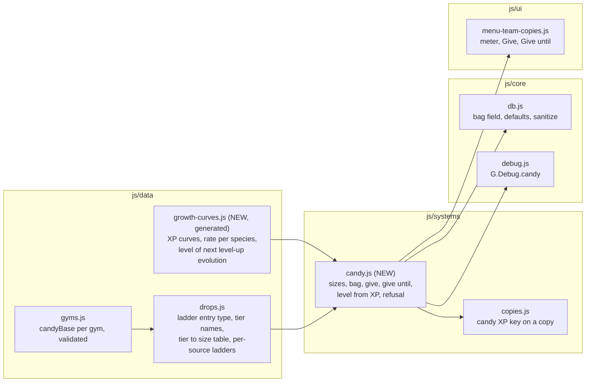
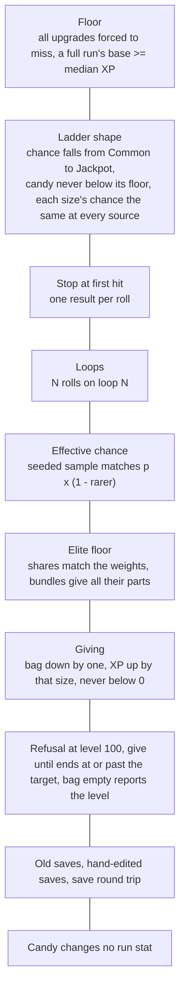

# 139a - Candy Build Plan (S8 8a of #128, 2026-11-22, PROPOSED, awaiting Jess's OK to build)

Opening, rulings and numbers: docs/AI Outputs/Issue-139/139 - Candy and Evolution Slice Opening.md and decision
2026-11-22-139-candy-target-and-drop-model. No code in this plan. Principles applied: .claude/skills/coding-principles.

# Summary of 8a: the system and the decisions

## In one paragraph
Exp Candy is the way a copy grows between runs. Gym leaders, elites and UberElites drop candy through a drop ladder:
a table of rarity tiers rolled rarest first, stopping at the first hit, with a guaranteed bottom tier. Every kill of a
gym leader gives at least its base candy, and a rare roll upgrades it. Candy goes straight into a bag on the save.
In the Team menu you give candy to a copy (one at a time, or "Give until [level]"). The copy's out-of-run (OOR) level
and an XP meter rise along its species' mainline growth curve, up to level 100. The OOR level sets only its evolution
stage and the moves it may start a run with. It changes no stat in a run, and every run still starts at level 1.

## The whole system

## Every ruling in one place

| Topic | Ruling | Tag |
|---|---|---|
| Target | One full run (loop 6 done, 8 gyms and 4 Elite Four per loop) lets the median 3-stage, fully level-based line reach its last evolution: 40,007 XP (the Charizard line, level 36). Computed from pokeapi per evolution path (76 paths, p25 33,084, p75 74,088). | [Approved] |
| Candy sizes | Canon, never scaled: XS 100, S 800, M 3,000, L 10,000, XL 30,000 XP. | [Approved] |
| Base (the floor) | Gym leaders and Elite Four, 100%, count = loop number (21 loop-shares, 252 drops a run). Gym 8 drops S every loop, the last Elite Four beaten drops S on loop 6 only, every other source XS: 44,100 XP, 10% over target. It is a hard floor: upgrades only add. | [Approved] |
| Drop ladder | A drop table is N rarity tiers rolled rarest first, each with its own chance, stop at the first hit, bottom tier guaranteed. Loop N means N ladder rolls. One new entry type in G.Drops. | [Approved] |
| Tier names | Common, Uncommon, Rare, Epic, Jackpot (rolled in that reverse order). Never candy sizes; every table uses them. | [Approved] |
| Tier to candy | Fixed for every source: Uncommon S, Rare M, Epic L, Jackpot XL. A source supplies only its floor. A tier at or below the floor is no upgrade. | [Proposed] |
| Tier chances | Per roll: Uncommon 1%, Rare 0.4%, Epic 0.1%, Jackpot 0.02%. Tunable, accepted for now. | [Approved] for now |
| Elite and UberElite floor | A weighted pick of what the kill gives (table below). Upgrade tiers replace the floor with candy. | [Approved] |
| The bag | Counted stacks per size. A drop is banked the moment it is earned and kept even if the run is lost. | [Approved] |
| Giving | One candy per press, hold repeats. Refused only at OOR level 100. A copy whose next evolution has no level still levels, since the OOR level also sets its starting moves. | [Approved] |
| Give until | The largest candy that fits without overshooting, repeated, then the smallest that covers the remainder. May overshoot the target level, stops at 100, reports the level reached if the bag runs out. Its input control is decided at Part F. | [Approved] |
| Meter | The copy's card shows the OOR level, an XP bar to the next level and a tick at the next level-based evolution (none when there is none). | [Approved] |
| Scope | Candy only. The gym's 10 coins and guaranteed item stay as they are. | [Approved] |

Elite and UberElite floor (weights, as a proposal turned ruling): the chances are the weight over the total of 120.

| Floor result | Weight | Share |
|---|---|---|
| Coins | 40 | 33.3% |
| Item | 30 | 25% |
| Candy (one XS) | 30 | 25% |
| Coins and an item | 15 | 12.5% |
| Coins, an item and candy | 5 | 4.2% |

## The numbers behind the target

| Fact | Value |
|---|---|
| Sources per loop | 12 (8 gyms, 4 Elite Four) |
| Loop-shares in a full run | 1+2+3+4+5+6 = 21 |
| Base drops a full run | 12 x 21 = 252 |
| Base total | 21 x 11 sources of XS plus gym 8's S (21 x 800) plus the last Elite Four's S on loop 6 (6 x 800) = 44,100 XP |
| Target | 40,007 XP (median, 3-stage, fully level-based) |
| Average a drop would need | 40,007 / 252 = about 159 XP, which is why canon sizes force a mostly-XS floor |
| Dragonite (207,968) | about 4.7 full runs on the base alone |
| Upgrade value | about 35 XP a gym roll with the first-pass chances (tunable) |

## Why the tier-to-size rule is fixed

## What 8a does not do
Evolve and the ready popup (8b), friendship and fatigue (8c, #161), the starting-move picker (after #97), evolution
materials and their shop tab (#163, #162), coins and items as ladders, the Elite Four source (the Elite Four is not
built), a chance multiplier per source, a candy sprite on the map, and anything about the loop counter itself.

# Opening items

| Item | Text |
|---|---|
| Goal | Gym leaders, elites and UberElites drop Exp Candy through a drop ladder into a bag; the player gives it to a copy in the Team menu; the copy's OOR level and XP meter rise along its mainline curve up to 100. |
| Done when | 1. The candy harness passes inside `node tools/check.js` and its mutants are all caught. 2. Jess feel tests: beat a gym, see the drop toast, give candy, watch the meter move, reload (it survives), load an old save (every copy at 0, bag empty). 3. #139 comment, card to Needs Playtest, spec section 6, BALANCE.md, GLOSSARY and changelog updated. |
| End-goal test | Relations, not values (docs/TEST-FIRST.md). The first one written is the floor: with every upgrade roll forced to miss, a full run's base candy still reaches the median 3-stage fully level-based line's XP, read from pokeapi by the harness on its own. |

# Build plan

## Flow of one drop

## Where each piece lives

## Part A: the drop ladder (js/data/drops.js)
- What changes: one new entry type, the ladder: tiers rolled rarest first, each with its own chance, stop at the
  first hit, the bottom tier guaranteed. An entry also carries how many times it rolls (the loop number).
  One constant lists the tier names in order, so every table spells them the same way. A tier's result can be a
  bundle (the elite floor's "coins and an item" and "coins, an item and candy" are single weighted results that
  give several things).
- Reuses: the existing TABLES, source names, `make`/`place` path and the rule that an entry with no chance is
  guaranteed. The `oneOf` shared-roll logic stays for the tables that use it.
- New: the ladder branch in `roll`, the tier-name list, the tier-to-size table, the per-roll count read from the ctx
  the caller passes, the bundle result.
- Not built: the chance multiplier, coins and the gym's guaranteed item as ladders (own later slice), a ladder for
  materials (#163, #162), per-source tier overrides nothing reads yet.
- Where it lives: drops.js already says it is "the ONE place that decides what enemies and events drop".
- Size: drops.js 183 lines grows to about 260.

## Part B: the candy rules (js/systems/candy.js, NEW)
- What changes: nothing existing; this owns the five canon sizes, the bag, giving, giving until a level and "level
  from XP".
- Reuses: G.Copies for the copy's XP (Part C), G.DB for the bag, the growth data (Part D).
- New: G.Candy. A new file costs a dev.html entry, a NEED entry in js/main.js and a rebuild (said here so the
  approval covers it). Why nothing existing fits: no module owns a currency that raises a copy permanently.
- Rules it holds: candy is refused only at OOR level 100; a copy whose next evolution has no level still levels;
  give until picks the largest candy that fits, repeats, then the smallest that covers the rest, may overshoot the
  target level, stops at 100, and reports the level reached when the bag runs out. Candy changes no run stat.
- Not built: Evolve (8b), the starting-move picker, friendship, fatigue, any candy sprite on the map.

## Part C: the save (js/core/db.js, js/systems/copies.js)
- What changes: the bag is one new save field (counts per size). A copy gets one new compact key for its candy XP,
  left out at 0. The unused letter `c` is the candidate; the build confirms it against the key list first.
- Reuses: copies.js is the only reader of the compact form; db.js sanitize already cleans hand-edited saves.
- Old saves: an absent bag reads as empty and an absent key reads as 0, so no save has to be cleared and nothing
  else on a copy changes. Sanitize clamps both to whole, non-negative numbers (an XP above the level 100 curve
  clamps to it).
- Not built: no save version bump (the fields are backward compatible).

## Part D: the growth data (tools/growth_data.js and js/data/growth-curves.js, NEW)
- What changes: nothing existing. A generator in tools/ (the pattern of tools/evolvable_data.js) writes the data
  from pokeapi: the six XP curves, each species' curve, and the lowest level among a species' level-up evolutions.
- Reuses: the generator pattern and the "GENERATED, do not edit" header. The harness reads pokeapi on its own as the
  check on the file, and spot checks (Abra's line 2,535, Venusaur's line 27,021) come from pokeapi, not from the file.
- Not built: evolution data beyond that one level (8b brings the rest).

## Part E: wiring the sources (gym-leader.js, elite.js, uber-elite.js, gyms.js)
- What changes: the gym leader's drop roll and the elite's and UberElite's roll pass the loop number. gyms.js
  entries get one new field naming the floor size (default XS, gym 8 is S), checked by its `validate()`.
- Reuses: G.Drops.roll and the loop value gym.js already holds.
- Not built: the Elite Four source and the "last Elite Four beaten drops S on loop 6" line. The Elite Four is not
  built in code, so that row waits in the spec as [Approved] with a "code differs, see TODO" note. The loop counter
  is dev-set today, so a real run is loop 1 until the loop slice; the harness and G.Debug.candy drive loops 1 to 6.
- Elites still run the temporary cadence (first 2:00, then every 6:00). Not changed here.
- Behavior change to confirm: elites and UberElites now always drop something (the floor table), and on loop N they
  roll N times. Today they give a berry, a ground item and a 50% item chance. Whether the berry and ground item stay
  beside the ladder is [Open] for Jess before this part is built.

## Part F: the Team menu (js/ui/menu-team-copies.js)
- What changes: a copy's card shows its OOR level, an XP bar to the next level and a tick at the next level-based
  evolution (none when there isn't one). It gets a Give button (one per press, hold repeats), a size picker, and a
  Give until control. The bag's counts sit in the same panel.
- Reuses: the library pieces the Team menu rulings name (button, well, panel); no new primitive, per decision
  2026-11-21-unify-work-builds-final-building-blocks.
- Decided at this part: the Give until input (a level stepper built from the existing button piece is the
  recommendation; the library's text field is an unreviewed draft).
- Not built: the Evolve button (8b), the ready popup.
- Size: 275 lines grows to about 450.

## Part G: dev and docs
- G.Debug.candy adds candy to the bag and prints a simulated full run's base and sampled upgrades, so tuning does
  not need a real run. Dev only.
- Docs: spec section 6, BALANCE.md (the tier chances and the elite floor weights), GLOSSARY (drop tier, tier names,
  candy size, bag), the `js/data/changelog.js` entry (free edit, parse-checked), the #139 comment, the board card.

## Tests (docs/proposals/candy-harness.js, NEW, plus candy-mutate.js)

- Every expected outcome is a relation read from the decision file, never a value copied from the code.
- This is a genuinely new system, so it gets a new harness. If a drops harness already covers G.Drops, the ladder
  cases go there instead (checked at build).
- The mutants (docs/proposals/candy-mutate.js): tiers rolled commonest first, the stop is missing, the floor is
  missing, the tier sizes stepped from the floor (the rejected rule), loops ignored, giving does not reduce the bag,
  refusal at 100 removed, the bag defaults removed.

## Risks
- The loop counter does not exist, so "N rolls on loop N" is proven by the harness and G.Debug.candy, not by a real
  run beyond loop 1.
- Elite and UberElite floors raise how much drops per kill on later loops (N guaranteed drops on loop N); the
  weights above decide how loud that is.
- The upgrade rate (about 35 XP a gym roll) is a first pass and tunable; expect a tuning pass after the first runs.

## Touched-code cleanups (listed so the approval covers them)
None planned. If the build finds a misleading name in a line it already edits, it lists it before changing it.

## Not built (deferred)
Evolve and the ready popup (8b), friendship and fatigue (8c, #161), the materials ladder and shop tab (#163, #162),
coins and items as ladders, the chance multiplier, the Elite Four source, the starting-move picker (after #97).
