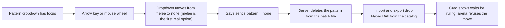

# #141 Move Review fixes (plan, 2026-11-28)

Dev tool only (tools/move-review.html, tools/move-review-server.js). Nothing here ships in the game.

## What broke on Hyper Drill

The tree still holds that save: the batch file lost `pattern: melee` and Hyper Drill is gone from
move-conversions-described.json and moves-generated.js. Repair: put the pattern back and re-run the import and export
(this rewrites js/data/moves-generated.js back to the committed Hyper Drill, so it waits for Jess's OK).

## Opening

| Item | Text |
|---|---|
| Goal | Jess can review and edit a move without the page losing data, see edits on the arena as he makes them, and hand-edit the batch as JSON |
| Done | The five changes below are in; Hyper Drill is back; Jess walks Hyper Drill, Barb Barrage and Rollout on the page |
| Test | tools/smoke-move-review.js grows: a pattern cannot be cleared on a move that has one; an out-of-range number cannot be saved; an enum field renders as a dropdown of the schema's values; a live edit changes the arena move without a Save; the JSON copy round-trips (copy, paste back, nothing changes) |

## Changes

| # | Change | Where |
|---|---|---|
| 1 | The "none" pattern option shows only for a move that has no pattern yet. The server refuses a save that clears the pattern of a move that has one. Arrow keys inside a dropdown never reach the move list | page Edit card, server save |
| 2 | Shape fields read their rule from js/data/move-attributes.js (the schema the validator uses). An enum field (shape, anchor, targeting, motion, trigger, grow dim) becomes a dropdown of its allowed values. A number field gets the schema's min and max (radArc 0 to 6.2832, falloff 0 to 1, stages -6 to 6, and so on); a value outside is marked red and Save is refused with the reason | page Edit card |
| 3 | Live preview: each change to a shape field rebuilds that move inside the arena (the raw entry with the edit on top, run through the same resolver) and restarts the dummy test, no Save needed. Save still writes the file. A field the resolver rejects shows the reason and the arena keeps the last good version | page arena |
| 4 | "Copy batch as JSON" button: the whole batch file (every move's pattern, options, hand edits, cd, note, status) to the clipboard. "Paste JSON" box: Jess pastes an edited copy, the server checks it with the same rules as a Save, writes it, re-runs the import and export, undoes everything if any move comes out invalid | page header, server |
| 5 | The page notices when the batch file changes on disk (Jess editing it in VS Code) and reloads the list, the card and the arena | server, page |

## Decisions (Jess, 2026-11-28) and result

1. JSON holds only what Jess controls (the batch file). No paste box and no file watch: Jess writes an edited copy to a
   temp file in tools/ and points the assistant at it. Changes 1 to 4 built (4 is the copy button only); change 5 dropped.
2. Real time means changes typed on the page (change 3).
3. Hyper Drill repaired: pattern back, import and export re-run, its entry identical to the committed one (it now sits
   after Rollout in the files, order only).

smoke-move-review: all passed (the new checks: no none option, server refuses a cleared pattern, shape dropdown holds the
grammar values, radArc past its max is marked and refused, live preview reaches the arena with the file untouched, the copy
matches the batch file). check.js: all passed.

Follow-up (Jess, 2026-11-28): changing the pattern or its options now rebuilds the shape numbers and the proposal at once
(server POST /api/build, in memory, writes nothing) and previews the new pattern in the arena; Save writes it, with any
fields typed on the new numbers. Smoke checks the switch and the switch back.
