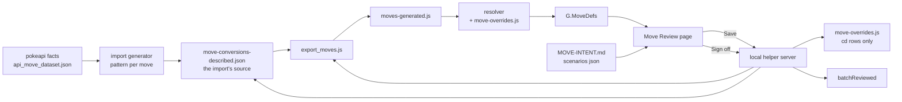
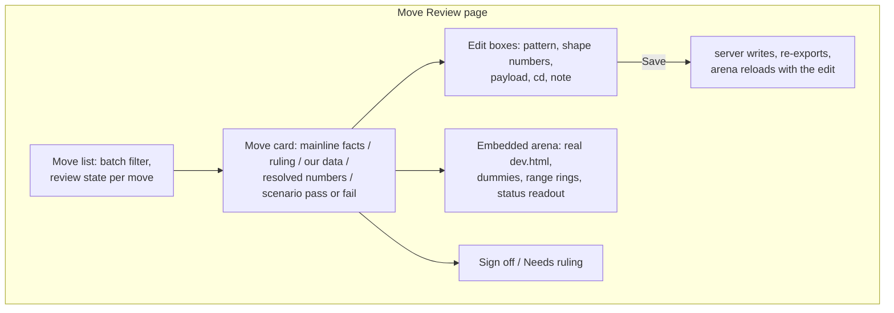

# #141 plan: the Move Review page and the 8-move import

Slice opening agreed with Jess 2026-11-27 (goal, done, test are on the issue). Manual aim is out of scope: #175.
The plan holds no code. Parts A and B are dev tools (free edit under tools/). Parts C to E change js/data and are game
changes: this plan is their approval request, and Part D comes back as its own short plan once the rulings exist.

## The flow

## The page, one move at a time

## Parts

| Part | What | Files | Kind |
|---|---|---|---|
| A0 | End-goal test first: tools/smoke-move-review.js | new tool | free edit |
| A | Local helper server and the Move Review page | new tools | free edit |
| B | General import generator (pattern table shared with Kanto batch 1) | tools | free edit |
| C | Import the 8 moves as proposals, routed, held | source json, moves-generated, scenarios | game data |
| R | One round of rulings for the 8, decided while watching them cast | MOVE-INTENT, decision file | docs |
| D | Mechanics the rulings need (only if any) | own short plan | game code |
| E | Review and close: sign-offs, report, docs, issue | docs, scenarios json | docs |

### A0. End-goal test (written first, fails until A to C land)
Headless smoke in the shape of smoke-newcombat (Playwright lookup, random port). It starts the helper server, opens the
page and checks, as relations not numbers:
- every move of the batch is listed and each shows a review state;
- picking each one casts it in the embedded arena with no page error, and a damaging move lowers the dummy's HP while a
  status move puts its status or stage on the dummy (whatever MOVE-INTENT says it does);
- a test edit sent through Save changes that move's resolved def on the next arena load, and the smoke puts the file
  back afterwards (it works on a copy of the source so a failed run leaves the repo untouched).

### A. Helper server and page
- tools/move-review-server.js: one node script with no new packages. It serves the repo folder like the python server the
  smokes use, plus three write routes: save a move's edits, save a sign-off, and re-run the export. It listens on
  127.0.0.1 only and accepts only the move ids of the open batch and only the known edit fields, so it can never write
  anywhere else. Start it with one command; the page URL prints in the console.
- tools/move-review.html: the page above. It loads the game's own move scripts (as move-lab does), so the numbers are the
  resolver's, never a copy. The card reads MOVE-INTENT entries and scenario rows the same way move_report.js does.
- The arena is dev.html in a frame with ?dev and a new query flag that boots a guest run straight into
  G.Debug.movechecker with the picked move (reusing loadSlots, the pinned dummy and the rings). Buttons: distance, awake
  or asleep dummy, one dummy or a ring of them (newcombat's layout), replay.
- Saves stay away from your real save: the server runs on its own fixed port, and the browser keeps a separate
  localStorage per port, so the arena's guest save never touches the save you play on.
- Edits: Save writes the move's fields into its entry in move-conversions-described.json, re-runs export_moves.js,
  and writes a cd change as a row in move-overrides.js (the only field that lives there). The arena reloads on success
  and the card shows what changed.
- Sign off adds the move to batchReviewed in move-intent-scenarios.json. "Needs ruling" marks it for round R instead.

### B. General import generator
- tools/kanto_batch1.js already holds the pattern table (melee, shot, beam, multi, self and the rest) and the payload
  mapping from pokeapi. Its builders move into one shared tools file. kanto_batch1.js keeps working through it (its
  output must not change; the smoke checks that by comparing a fresh run with the file on disk).
- tools/move_import.js: takes a batch list (id plus pattern and options, the same shape as Kanto's PLAN) and writes
  the proposals the page reads. Batch #141 is its first list.

### C. Import the 8 as proposals
Proposed patterns, starting points for the review only:

| Move | Pokeapi facts | Proposed pattern | Likely needs a ruling |
|---|---|---|---|
| Double Hit | Normal, 35 power, hits 2 | multi 2 of melee | no |
| Twin Beam | Psychic, 40 power, hits 2 | multi 2 of beam | no |
| Hyper Drill | Normal, 100 power | heavy melee | whether "goes through Protect" matters here |
| Barb Barrage | Poison, 60 power, double on a poisoned foe | shot plus poison chance | the double-power condition (Hex is the precedent) |
| Rollout | Rock, 30 power, grows each use | ? | how it grows and when it resets |
| Mimic | Normal, status, copies a move | ? | what it copies from a wild foe or a leader |
| Taunt | Dark, status, blocks status moves | ? | what it does to wild foes (they have no status moves) |
| Dragon Cheer | Dragon, status, raises allies' crit | ? | who the allies are in a one-Pokemon-out game |

All 8 stay out of the player pools (G.Moves.HELD) until round R settles whether they join, as Kanto batch 1 did.
Scenario rows are added only for moves whose MOVE-INTENT entry exists; the rest wait for the batch sign-off.

### R. Rulings round (asked together, no defaults)
Once A to C run, I ask in one round: the four "?" rows above, Hyper Drill and Barb Barrage's conditions, the cooldowns
the formula gives to the status moves, and whether the 8 join the player pools now or with #139 8b (the evolutions that
check them). Each ruling becomes a MOVE-INTENT entry plus one decision file.

### D. Mechanics, only if a ruling needs one
Growing power (Rollout), copying a move (Mimic), a crit stage on others (Dragon Cheer) or a status block (Taunt) may
need resolver or handler work. That comes back as its own short plan for approval; nothing in D is approved by this one.

### E. Close
Every move signed off or reviewed through its entry; move_report.js lists all 8 reviewed; check.js and the new smoke
pass; TODO, STATE, DEVLOG, KANTO-BOSS-MOVE-IMPORTS (or a new imports doc section) and the issue updated.

## Plan check (coding principles)

| | |
|---|---|
| Reuses | G.Debug.movechecker and loadSlots (arena), newcombat's dummy layout, move-lab's script loading, move_report.js's MOVE-INTENT and scenario reading, kanto_batch1's patterns and payload mapping, export_moves.js, the smoke harness shape |
| New | move-review-server.js (writes need a process, the page cannot), move-review.html, move_import.js, the shared pattern file, smoke-move-review.js, one dev query flag in debug.js |
| Not built | manual aim (#175); editing MOVE-INTENT from the page (rulings are written by me after round R); any mechanic before its ruling; a general JSON editor for every field |
| Where | everything new lives in tools/ except the dev flag, which joins the existing movechecker in js/core/debug.js (dev only, ?dev gated) |
| Size | debug.js is 1518 lines already and grows by a few lines; flagged for #129 (architecture review), not split here |
| Cleanups | none planned |

## Risks
- The dev flag in debug.js is game code (dev only). It is the one game-file touch in Parts A and B, so it is named here
  for approval.
- Writing move-overrides.js from the server edits a JS file by text. It only adds or replaces one keyed cd row and
  check.js runs after; if that proves fragile, cd moves to the source json for imported moves instead (a decision).
- The arena boot depends on a guest save on the server's port; the first load builds one.

## Decisions needed now
None beyond this plan's OK. Round R collects the move rulings.

## Build notes (2026-11-27): where the build differs from the plan

| Plan said | Built | Why |
|---|---|---|
| A dev query flag in js/core/debug.js boots the arena | No game file touched: the page drives the frame's G.Debug.movechecker and newcombat itself, as the smokes do | Fewer moving parts; Parts A and B are now tools only |
| G.Moves.HELD keeps the 8 out of pools | tools/export_learnsets.js skips the moves of a batch with "inPools": false | HELD no longer exists (pools come from learnsets since 2026-11-04); the bake tool holds them with no game code, so learnsets.js is unchanged |
| Import all 8 as proposals | 5 in the catalog (Double Hit, Twin Beam, Hyper Drill, Barb Barrage, Rollout as a placeholder); Mimic, Taunt and Dragon Cheer have no pattern and stay out until their ruling | A move with no effect fails the validators; inventing a placeholder effect would be guessing |
| Save writes cd rows into move-overrides.js | The importer owns a marked region per batch (@@IMPORT ... BEGIN / END) and rewrites only that region | One home for the rows; move_import.js --check (in check.js) catches hand edits |
| Distance box, default 150 | Blank means auto: the dummy stands inside a static swing or beam (70% of the radius, half the band), else 150 | Melee moves never reached a dummy at 150 (found by the smoke) |
| Readout: damage on the dummy | Hits and their damage, apart from status ticks | Poison takes a share of max HP, and the dummy's HP is huge, so one total hid the hits |

Found on the way: tools/kanto_batch1.js --apply is stale (ring sizes were retuned in the source json after the batch); running
it put the old sizes back. Reverted by hand the same minute; the script now says not to --apply again.
