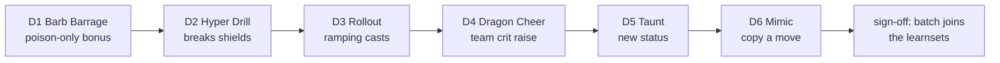

# #141 Part D plan: the mechanics the round R rulings need

Rulings: decision 2026-11-27-141-round-r-rulings-for-the-evolution-moves and the six MOVE-INTENT entries (barb-barrage,
dragon-cheer, hyper-drill, mimic, rollout, taunt). This is game code, so it waits for Jess's OK. No code in this plan.
Each part opens test first: its MOVE-INTENT scenario rows (relations read from the entry) go into
move-intent-scenarios.json and fail before the build. Each part is then reviewed in the Move Review page and signed off.

| Part | Ruling | Where | Reuses | New | Size |
|---|---|---|---|---|---|
| D1 | Double power on a poisoned foe | statusBonus in js/data/move-handler.js and its read in js/systems/move-effects.js (attackTerms) | Hex's statusBonus and G.Status.majorKind | one optional parameter: the statuses that count (absent means any status, so Hex is unchanged) | a few lines |
| D2 | Hits go through shields and ignore damage reduction | a new special handler in move-handler.js, read where move-effects deals a hit; the shield and damage-reduction step in the hit target's hurt | the special-handler table, the hit path that already counts shield damage (D34) | one handler name, one flag passed to hurt | small, touches player.js hurt |
| D3 | Each cast in a row doubles power to x16; resets after the 5th or a cast that hits nothing | a new special handler read in attackTerms; the step lives on the move's slot instance (G.Moves.instance) | the termination trigger to see a cast that hit nothing | handler with a factor and a step count (2 and 5 from the ruling) | small |
| D4 | Team-wide crit raise, +1, +2 on Dragon types | a stat payload with stat crit, side self, scope team | the team tracker store already summed into crit chance (critOf reads G.Stages.teamSum for crit, where Lansat Berry adds 0.2) | crit allowed as a stat in the grammar; the Dragon-type extra stage | small, needs the open number below |
| D5 | Hit foes rush you and lose ranged and status attacks; a leader loses status moves | a new taunt status in js/systems/status.js; enemy.js behavior and shot timers; the leader planner's move pick | the flinch hooks (a ranged unit's shot timer restart), the carrier statuses' timing | one status kind with a duration | medium, three files |
| D6 | Becomes the last move a leader hit you with; a wild target's type move otherwise | record the last leader move that hit you where move-effects deals the hit; Mimic's cast swaps its slot to that move for a while | G.Moves type pools, loadSlots-style slot swap, the swap rule's cleanup | the record and the timed swap | medium, its own sub-slice |

## Not built
- Rolling art or a rolling motion for Rollout (it stays a swing; its look is a page review item).
- A Protect move for anyone (D2 covers shields and damage reduction only).
- Crit stages for Focus Energy itself (D4 makes the store; focus-energy's own import is a later batch).

## Risks
- D2 changes the shared hit path: every other move must keep its shield behavior (the existing substitute and shield
  scenarios guard it).
- D5 touches wild enemy behavior; flinch and the other statuses keep their scenarios.
- D6 swaps a slot's move mid-run: the swap rule (moves in flight end, timers reset) applies, and a save never stores the
  copied move.

## Open numbers (asked together, no defaults)
1. Dragon Cheer: how much crit chance one stage adds (the team store holds crit as chance; Lansat Berry adds 20%).
2. Taunt: how long it lasts.
3. Mimic: how long a copy lasts, and which move of a wild target's type it picks.
4. Cooldowns for Taunt, Mimic and Dragon Cheer (status moves have no formula cooldown).
