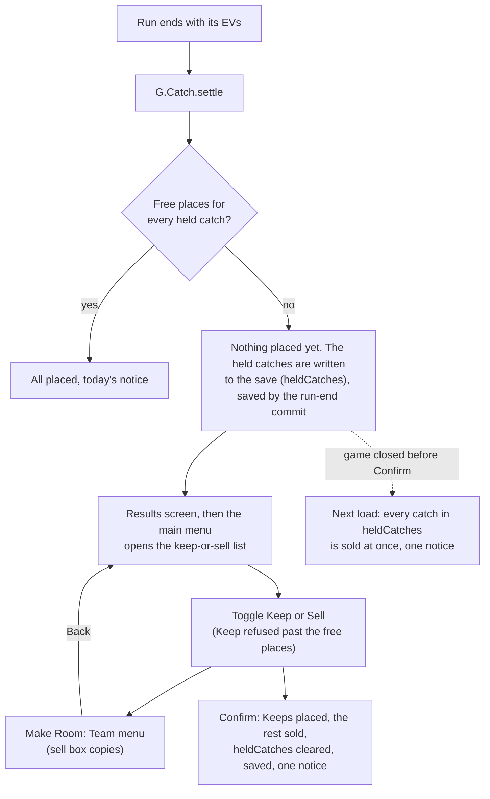
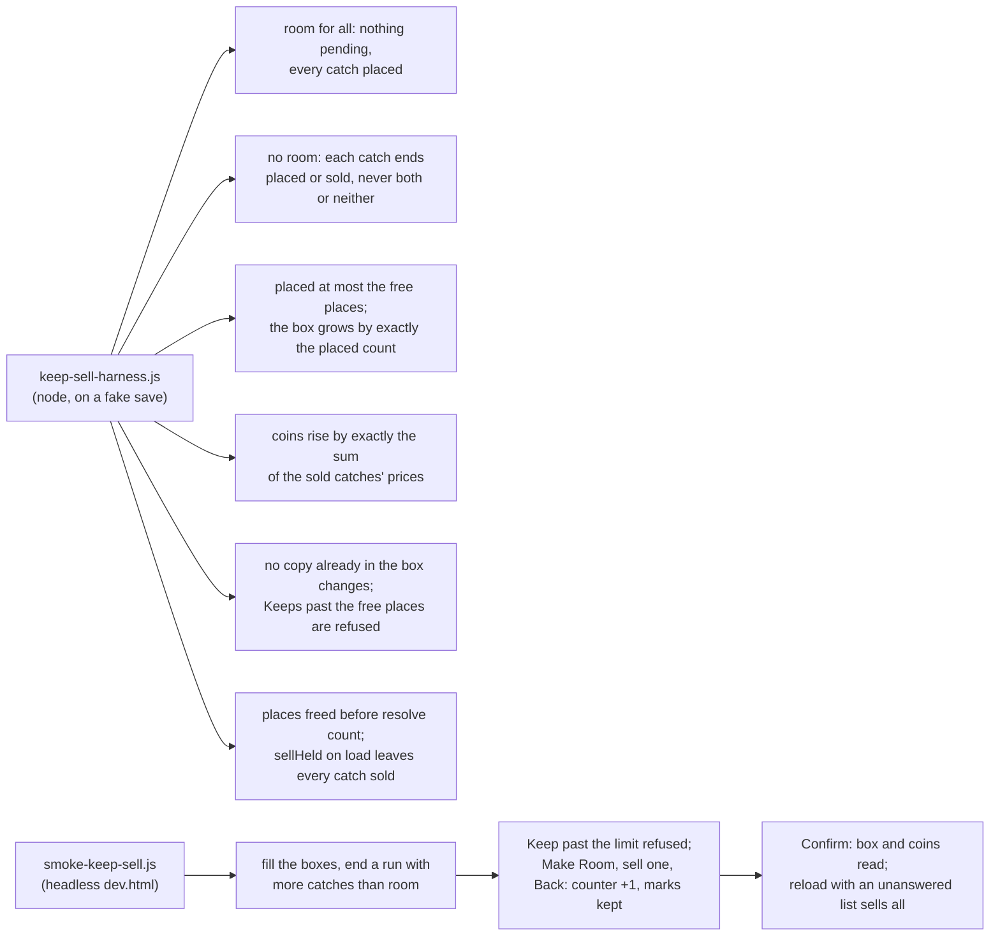

# 146 - Keep or Sell Build Plan (2026-11-26, APPROVED and BUILT 2026-11-26, feel test owed)

Opening, goal, done and test: `146 - Keep or Sell Slice Opening.md` (agreed 2026-11-26). Rulings:
decision 2026-11-26-146-keep-or-sell-open-decisions. Look: the board draft `main.keepOrSell`
(tools/library/index.html#main.keepOrSell; four states: opening, Keep refused, back from Make Room, confirm).

## Flow after the build

## Why a save field
Your ruling is "closing with the list unanswered sells them". Today the run-end commit saves the box at once, before the
list opens. If the held catches only lived in memory, closing the tab would lose them, not sell them. So the run end
writes them to a new save field (heldCatches) and the next load sells whatever is still there. The list itself never
comes back. Old saves have no field and load unchanged (absent means empty). Cloud saves are deferred (#144), so
nothing on the cloud side changes.

## The parts

| # | File, place | What changes |
|---|---|---|
| 1 | js/systems/catch.js, settle | With room for every held catch: unchanged. Without: places nothing, writes the held catches (dex, name, nature, sell price) to the save's heldCatches and returns them as "pending" beside today's placed and sold lists. |
| 2 | js/systems/catch.js, two new functions | "resolve": takes which held catches are kept; refuses if the Keeps are more than the free places; places each Keep (G.DB.obtain, which cannot sell since the room was checked), sells the rest at G.Copies.priceFor, clears heldCatches, returns the placed names and the coins. "sellHeld": sells every catch still in heldCatches (the load case); returns the same shape. Both pure on the save they are handed, so the harness drives them. |
| 3 | js/ui/keep-sell-ui.js, new file (G.KeepSellUI) | The list as the board draws it: panel.clean window, one panel.shopCard row per catch, portrait.round (a Sell row takes the sale state), toggle.power Keep or Sell, the counter, button.glitch Make Room and Confirm. Opens with the first catches that fit marked Keep. Keys: up and down move the cursor bar, Enter or Space flips a mark, then the two buttons. A refused Keep plays the error sound and the red toast. Reads free places from G.Copies.freePlaces each time it opens, so a return from Make Room shows the new count with the marks kept. |
| 4 | js/ui/menu-team.js, open and leave | open takes an optional "on leaving" callback. When set, Back and Esc go to it instead of the main menu (Make Room's way back). Nothing else in the Team menu changes. |
| 5 | js/game.js, endRun's results callback and afterLogin | After the results: when settle returned pending catches, open the list instead of today's notice. afterLogin: when the save still holds heldCatches, sell them at once and toast one line with the total. catchNotice stays for the room-for-all case and gains the Confirm's one-line totals. |
| 6 | dev.html, js/main.js NEED, tools/ui-library.html | Load keep-sell-ui.js after menu-team.js (a new file costs a script line and a NEED entry, then a rebuild). |
| 7 | docs/proposals/keep-sell-harness.js, new | The end-goal test (below). check.js picks it up by itself. |
| 8 | tools/smoke-keep-sell.js, new | The headless smoke (below), using G.Debug.fillBoxes, which already exists. |

### Reuses
G.Copies.freePlaces, priceFor and the Team menu's sell mode (Make Room adds no selling code); G.DB.obtain; G.Lib
CleanPanel, RoundPortrait (sale state), PowerToggle, GlitchButton; G.MenuWindowKit's cursor; G.UI.toast; G.Debug.fillBoxes.

### Not built
Buying a box from the list (#172). Releasing copies (the Team menu only sells today). Co-op (settle still keeps nothing
there). A list that comes back after a reload (ruled out).

### Size
catch.js 455 to about 520 lines; menu-team.js 936 to about 945; game.js grows by about 15 (already past 1000, no new
logic there beyond the calls). keep-sell-ui.js about 200 lines.

## End-goal test (written first, relations only)

## Risks
- The run-end commit now saves catches outside the box for a moment. A crash between the results screen and Confirm
  sells them on the next load (that is the ruling, but it is new behavior for a crash).
- Make Room shares the Team menu: the callback must be cleared when the list closes, or a later normal Back would
  return to a list that is gone.

## Decisions (Jess 2026-11-26; decision 2026-11-26-146-keep-or-sell-open-decisions)
1. Esc on the list acts as Confirm.
2. Make Room opens the Team menu as normal; Esc, Back or Revert (anything that leaves it) returns to the list.
3. Rarity stars stay. Comparing a catch with owned copies is #173, worked right after this slice.
4. Look approved with three fixes (title #fff000, price white in its own column, toggles in one fixed column).

## Built (2026-11-26)
As planned, with these small differences:
- A new stylesheet, css/bw-keep-sell.css (every menu window has its own), and scr-keepsell in js/ui/ui.js's screen
  list, so the Team menu covers the list during Make Room.
- A sale on load toasts "Your keep-or-sell list was left open:" before the totals.
- docs/proposals/rescue-harness.js 6d now expects a full box to hold the catch for the list (it expected a sale).
Checks: keep-sell-harness 7 parts pass; tools/smoke-keep-sell.js passes (a real fall, keys, Make Room round trip, Esc
confirm, the load sale through G.Flow.afterLogin, since a guest save is never stored); smoke-team,
smoke-team-menu-keys, smoke-upgrade-popup pass; smoke-ui keeps its 15 old failures; check.js clean.
