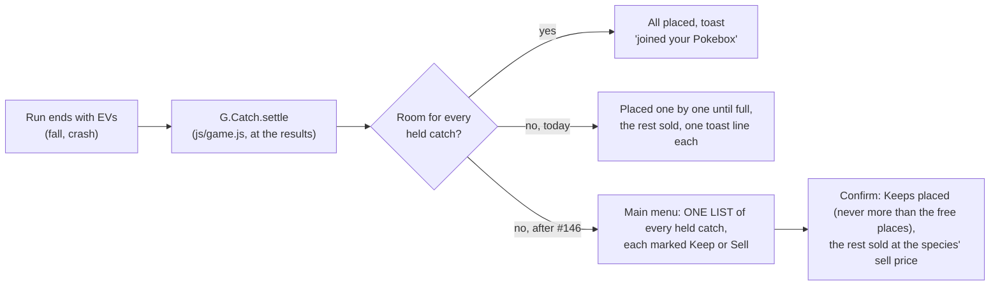

# 146 - Keep or Sell Slice Opening (child of #128, 2026-11-26, AGREED 2026-11-26)

Branch feature/138-146-lost-and-full-box. Rules: spec "docs/AI Outputs/Issue-128/Acquisition v2 - Spec.txt" section 3
("Catches are held until the run ends"), decision 2026-11-15-136-catch-on-contact-and-held-catch-rulings (C11 split this
out). Opening only: goal, done, test, and the open decisions. The prose build plan follows once these are agreed.

## What the code does today vs the slice

Context: a new save has 2 boxes of 500 (1,000 places, up to 5 boxes), so this list is rare in play. It needs a dev
hook to fill the boxes for testing.

## Goal
When a run's kept catches do not all fit the Pokebox, the player chooses which to keep and which to sell, instead of
the game selling the overflow for them.

## Done when
- With room for all, nothing changes (placed, the short notice).
- Without room, the main menu shows one list of every held catch (portrait, name, nature, star, sell price), each
  marked Keep or Sell, with a free places counter. Keep is refused once the Keeps fill the free places.
- Confirming places every Keep, sells every other one at its sell price, and shows one notice with the totals.
- An old save loads unchanged; the test passes in node tools/check.js; Jess feel-tests it.

## End-goal test (written first)
A harness on the settle step, reading relations, not numbers:
- every held catch ends up placed or sold, never both, never neither;
- placed count is at most the free places before settling, and the box grows by exactly the placed count;
- PokeCoins rise by exactly the sum of the sold catches' sell prices;
- with room for all, no list is asked for and every catch is placed;
- no copy already in the box changes.
A headless smoke drives the list: fill the boxes, end a run with more catches than room, toggle Keep past the limit
(refused), confirm, read the box and the coins.

## Answered 2026-11-26 (decision 2026-11-26-146-keep-or-sell-open-decisions)
1. The list can also free places (into the Team menu to sell or release box copies, then back).
2. Closing with the list unanswered sells every unplaced catch at once.
3. The first catches that fit start as Keep.
4. Sketched on the UI library board first.

What this adds to Done and the test:
- Done: the list has a "Make room" way into the Team menu; selling or releasing there raises the free places counter
  when the list returns, and the Keep marks are kept. Reloading with the list open sells the unplaced catches.
- Test: the settle harness also checks that freed places count (placed at most the free places after freeing), and
  that a reload with the list unanswered leaves every held catch sold. The smoke adds a Make room round trip.

## Open decisions (as asked)
1. Making room: does the list only choose among the held catches, or can it also free places (a way into the Team
   menu to sell or release box copies, then back to the list)?
2. Closing the game with the list unanswered: the list comes back on the next load (the held catches saved in a new
   save field), or every unplaced catch is sold at once?
3. How the list opens: every catch starts as Sell, or the first ones that fit start as Keep?
4. Its look: sketch it on the library board first, or build it in an existing frame (the Team menu's popup frame,
   reusing the grid cell and the box counter, as the Team Menu gap review suggests)?

Not built here: buying a box from the list (box buying moves to Character Upgrades, #172).
