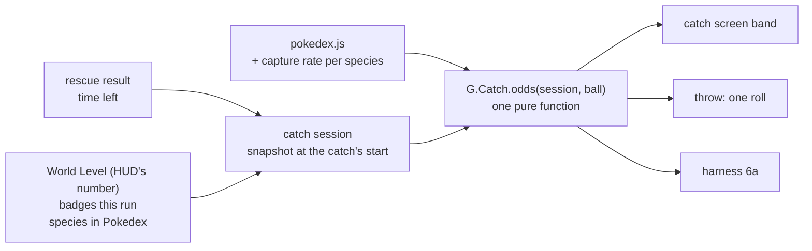
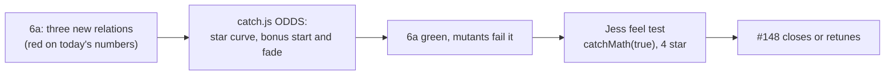

# 148 - Catch Odds Build Plan

Issue #148. Status: **built 2026-11-16**, waiting on Jess's feel test. Calls 1, 2 and 4 as picked; call 3: separate rolls plus the honest wobble count (Jess). Opening agreed 2026-11-16 (goal, done, test:
`148 - Catch Odds Slice Opening.md` section 1). Rulings: decision 2026-11-16-148-catch-odds-mainline-shake-formula.
Formula: `pokeball-math-human-made.txt`, step 1 flipped to time used. Coding principles applied (plan check, section 5).

## 1. Shape

## 2. The parts

| # | Part | Files | What changes |
|---|---|---|---|
| 1 | Capture rate data | tools/add_base_stats.py, js/data/pokedex.js | The script that already adds base stats and base experience from the local pokeapi CSVs also adds each species' capture rate (pokemon_species.csv), as a short field next to them, plus a header note. Run once; nothing else in pokedex.js changes. |
| 2 | The formula | js/systems/catch.js | The star bands, the BST helper, the base odds function and the 90% ceiling go. In their place: Jess's tables (badge caps, the over-cap penalty, the star multipliers) and named constants (fight length 60, the 255 rate cap, the World Level bonus, the 31-species critical start and the critical steps) in the file's frozen table. One odds function reads a catch's snapshot and a ball and returns the chance one throw catches it, critical catch included (the critical part is a sure catch, the rest must pass three shakes). |
| 3 | The snapshot | js/systems/catch.js | When a catch opens, the session also records the World Level (the same whole number the HUD shows), the run's badge count and the number of species in the Pokedex record. The odds read only the session, so the harness can hand them any case. |
| 4 | Callers | js/ui/catch-ui.js (1 line), tools/smoke-ui.js (1 line) | They pass the session instead of its dex and time. The screen's band is unchanged and still holds the true chance. |
| 5 | The check | docs/proposals/rescue-harness.js part 6a | Rewritten in place to the relations in the slice opening section 4, plus: every rescuable species has a capture rate from 1 to 255. The ball order and Timer Ball checks are marked blocked on #137 (only the Poke Ball exists). 6b, 6c, 6d unchanged. |
| 6 | Docs at close | catch.js header, BALANCE.md (a catch odds line), 136b plan's "Catch rate today" (points here), STATE, DEVLOG, #148 comment | The header states the formula and cites the decision. |

## 3. Calls for Jess

| # | Call | My pick |
|---|---|---|
| 1 | Your file computes in whole numbers scaled by 4096 with integer roots (mainline style). Plain decimals give the same odds to within a tenth of a point and read far simpler. | Decimals (KISS). The txt file stays the reference. |
| 2 | "Species in Dex" for the critical catch = species marked owned in your Pokedex record (save.owned), counted across all runs. | Yes |
| 3 | One roll per throw against the combined chance, or a separate critical roll then three shake rolls? Same odds either way; separate rolls only matter if the screen shows shakes or a "critical!" moment, which nothing draws yet. | One roll now; split when a shake animation is wanted |
| 4 | Badges this run (the gym list resets per run). Your cap table runs to 12 badges; Kanto has 8 gyms, so the 9 to 12 entries wait for the Elite Four. | This run's badges, table kept whole |

## Built differently from the plan

| What | Why |
|---|---|
| js/ui/catch-ui.js grew past one line: the wobble plays once per passed shake (half the wobble strip each, alternating sides, 60 ms frames), none when it breaks out at once, one on a critical, with a "Critical catch!" note | Call 3 (Jess): separate rolls plus the honest wobble count |
| G.Catch.lastThrow ({ critical, shakes, caught }) holds the last roll; throwBall still returns its word | Keeps every caller and the harness's outcome checks unchanged |
| Critical chance = rate x multiplier / 6, out of 256 (mainline) | The txt's step 7 divides two 4096-scaled numbers by 24576 only, which leaves it 4096 times too big (every throw would be critical from 31 species) |
| Harness 6a also checks the early World Level bonus exists and is gone from WL 13 | A mutant that removed the bonus passed "a lower World Level never lowers the odds" |

## 4. Not built (YAGNI)

| Left out | Where it goes |
|---|---|
| Great, Ultra, Timer, Heavy balls and weight data | #137 (the decision records the Timer Ball rule) |
| The other special balls (fishing, night, gender, sleep, level) | A new issue, filed with #137 |
| Shake animation or a critical catch moment on screen | Not filed; ask when the screen wants it |
| A fallback capture rate in code | None: the harness proves every rescuable species has one |

## 5. Plan check (coding principles)

| Part | Reuses | New | Lives in, why | Size |
|---|---|---|---|---|
| 1 | add_base_stats.py's CSV reading and in-place patch | One field and its note | The data script that already owns pokeapi additions | pokedex.js +1 short field per species |
| 2 | catch.js's frozen K table and BALLS table | The cap, penalty and star tables; one odds function | catch.js owns every catch rule | catch.js about 215 to 245 lines |
| 3 | G.Enemies.levelForTime (the HUD's World Level), G.Gym.badges, the Pokedex record | Three session fields | The session already snapshots the catch | small |
| 4 | Existing calls | none | | 2 lines |
| 5 | Part 6a's loop over the rescue pool | Relation checks only | The existing harness, no new one | 6a about the same length |

Touched-code cleanups: none beyond removing the replaced band code. Save: no new save fields (the session is not saved).

## 6. Open tuning (decided 2026-11-16, see section 7)

Typical rescue capture rate by star (the real pool's median): 1 star 190, 2 star 180, 3 star 60, 4 star 45, 5 star 5 (the
four Paradox Pokemon). One throw / whole encounter (3 throws), half the clock left, Poke Ball:

| Star curve (1 to 5 star) | WL | 1 | 2 | 3 | 4 | 5 |
|---|---|---|---|---|---|---|
| Now 1 / .75 / .5 / .25 / (.25) | 1 | 100/100 | 100/100 | 48/86 | 27/62 | 8/22 |
| | 20 | 67/97 | 56/91 | 24/56 | 14/36 | 4/12 |
| Steeper 1 / .6 / .35 / .15 / .08 | 1 | 100/100 | 98/100 | 39/77 | 21/50 | 4/12 |
| | 20 | 67/97 | 49/87 | 20/48 | 10/28 | 2/6 |
| Steep 1 / .5 / .25 / .1 / .05 | 1 | 100/100 | 88/100 | 32/69 | 16/41 | 3/9 |
| | 20 | 67/97 | 44/83 | 16/41 | 8/23 | 2/5 |

- The star curve only bites from 3 star up; at World Level 1 the early bonus (x3.4) caps most 1 and 2 stars at a sure
  catch. Levers: a steeper curve with its own 5 star entry (my pick: Steeper), a smaller early bonus (say x2 at WL 1).
- Badge cap penalty (Jess asked why 0 badges costs nothing): it is for the World Level outrunning your badges, so it is x1
  under the cap. Options shown: A, the 0 badge cap at WL 5; B, no 4-level grace; or a flat x0.85 for no badges.
- Test species (4 star): Scyther 123 (cr 45), Cryogonal 615 (cr 25), Shuckle 213 (cr 190); `G.Debug.catchMath(true)` first.

## 7. Tuning slice 148c (Jess's picks 2026-11-16; built 2026-11-16, waiting on Jess's feel test)

Ruling: decision 2026-11-16-148-catch-tuning-steep-curve-x2-fading-bonus. Steep curve, x2 bonus fading, badges as built.

**Opening (goal, done, test)**

| | |
|---|---|
| Goal | Rescue catches feel earned: a 4 star is about 1 in 3 per encounter at World Level 1, about 1 in 4 later |
| Done when | The ODDS table holds the Steep curve and the fading x2 bonus; harness 6a is green with the new relations; Jess feel-tests a 4 star with `G.Debug.catchMath(true)` |
| Test (written first) | Harness 6a gains three relations from the ruling, each failing on today's code (below) |

**New relations in harness 6a** (docs/proposals/rescue-harness.js, kept as relations, no copied numbers)

| Relation | Fails today because | Mutant it catches |
|---|---|---|
| A Pokemon's rate at World Level 1 is at most twice its rate at World Level 13 (bonus no more than x2) | x3.4 | a start above x2 |
| The bonus shrinks at every level from 1 to 13 (strictly, not flat then falling) | (passes today) | a clip at x2 (flat to WL 8) |
| A 5 star is below a 4 star of the same capture rate | 5 star uses the 4 star value | the 5 star entry dropped |

The existing relations stay: higher star never higher odds, bonus gone from WL 13, a 4 star at capture rate 45 or less never sure.

**Code change** (js/systems/catch.js, the ODDS table and the bonus function only)

| Where | Change |
|---|---|
| ODDS starMult | Five entries, Steep: 1, 0.5, 0.25, 0.1, 0.05 (5 star gets its own value) |
| ODDS early bonus numbers | Replace base 36 / per level 2 / divisor 10 with a named start (x2) and the level it ends at (13) |
| earlyLevelBonus | Falls in equal steps from the start at WL 1 to x1 at WL 13, x1 after; same name and callers |
| Comments | The step notes name the new numbers and the ruling |

No other file changes behavior. G.Debug.catchMath already prints the bonus and star factor, so it shows the new values as is.

**Expected odds** (formula, Poke Ball, half the clock left, one throw / whole encounter)

| WL | 1 star | 2 star | 3 star | 4 star |
|---|---|---|---|---|
| 1 (x2) | 100/100 | 65/96 | 24/56 | 12/32 |
| 8 (x1.42) | 82/99 | 54/90 | 20/48 | 10/27 |
| 13 and up (x1) | 67/97 | 44/83 | 16/41 | 8/23 |

**Risks:** none for saves (no stored odds). Rescues only roll 1 to 4 star, so the 5 star value only shows through
`G.Debug.catch` on a 5 star for now. Then: check.js, npm run format, smoke-ui (catchMath), comment on #148.
