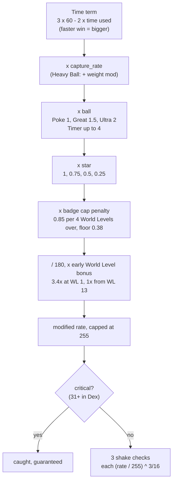

# 148 - Catch Odds Slice Opening

Issue #148 (parent #136). Branch feature/128-acquisition.
Formula: Jess's, in `docs/AI Outputs/Old txt files/pokeball-math-human-made.txt`, with the rulings in decision
2026-11-16-148-catch-odds-mainline-shake-formula. Options A to C (star bands retuned) were dropped for it.

## 1. Slice opening (agree these three before any build)

| Item | Proposal |
|---|---|
| Goal | The catch chance follows Jess's shake formula: capture_rate, star rarity, time used, ball, badge cap, early World Level bonus, critical catch. |
| Done when | catch.js uses it; harness 6a checks the relations in section 4; the screen's band still holds the true chance; Jess's feel test says 1 to 4 stars feel right. |
| End-goal test | `docs/proposals/rescue-harness.js` part 6a, rewritten in place (no new harness). |

## 2. The formula as ruled

## 3. Worked odds (one throw / whole encounter, 3 throws, Poke Ball)

Time left when the guard fell: 5 s (slow win), 30 s, 55 s (fast win). Badges kept up unless noted.

| Species (capture rate, star) | WL 3: 5 / 30 / 55 s | WL 12, 1 badge: 5 / 30 / 55 s | WL 25, 3 badges: 5 / 30 / 55 s | Ultra, WL 25, 30 s |
|---|---|---|---|---|
| Caterpie (255, 1) | 100/100, 100/100, 100/100 | 65/96, 88/100, 100/100 | 59/93, 80/99, 97/100 | 100/100 |
| Bulbasaur (45, 1) | 41/80, 56/91, 68/97 | 25/57, 33/70, 40/79 | 22/53, 30/66, 36/74 | 44/83 |
| Abra (200, 2) | 81/99, 100/100, 100/100 | 48/86, 65/96, 80/99 | 44/82, 59/93, 72/98 | 87/100 |
| Dratini (45, 3) | 28/62, 38/76, 46/84 | 17/42, 23/53, 27/62 | 15/39, 20/49, 25/57 | 30/66 |
| Lapras (45, 4) | 19/47, 26/59, 31/67 | 11/30, 15/39, 19/46 | 10/27, 14/36, 17/42 | 20/49 |

What moves the odds (Jess's question 3): mid-run, with badges kept up, the levers are **capture rate, star, time and
ball**. The World Level bonus only acts before WL 13; the badge penalty only when you fall behind (0.85x per 4 levels
over the cap). Critical catches start at 31 species in the Dex. Odds stay flat from WL 13 to the end otherwise.

## 4. End-goal test: harness 6a relations (no copied numbers)

| Relation | Replaces |
|---|---|
| Less time used never lowers the odds | "more time left never lowers" (same meaning, kept) |
| Higher capture_rate never lowers the odds (same star, time, ball) | BST inside a band (retired) |
| A higher star never raises the odds (same capture_rate) | the drop between bands |
| Ultra above Great above Poke wherever the better ball is below a sure catch | new |
| Going further over the badge cap never raises the odds; at or under it, no penalty | new |
| A lower World Level never lowers the odds | new |
| 30 or fewer in the Dex: never critical; a critical catch always catches | new |
| The Timer Ball never passes 4x | new |
| A 4 star at capture rate 45 is never a sure catch with a Poke Ball | "never past the ceiling" (the feel bug, as a check) |

The 6b flee, 6c belt and 6d held checks stay as they are.

## 5. What the build needs (for the prose plan, after section 1 is agreed)

| Need | Note |
|---|---|
| capture_rate per species | Not in js/data/pokedex.js today. Comes from pokeapi-master pokemon_species.csv through tools/fetch_pokedex.py. |
| weight per species | Only for the Heavy Ball; can wait for #137. |
| World Level and badges at catch time | World Level is G.Enemies.levelForTime; badges from the run. |
| Species in Dex | For the critical catch. |
| The screen's band | Stays per throw, holding the new true chance. |
| Timer Ball direction | [Open], see section 6. |

## 6. Open

Resolved 2026-11-16 (Jess): the Timer Ball is the ball for a fight that went long (strongest on a slow win, built with
#137); section 1 agreed. Build plan: `148 - Catch Odds Build Plan.md`.
