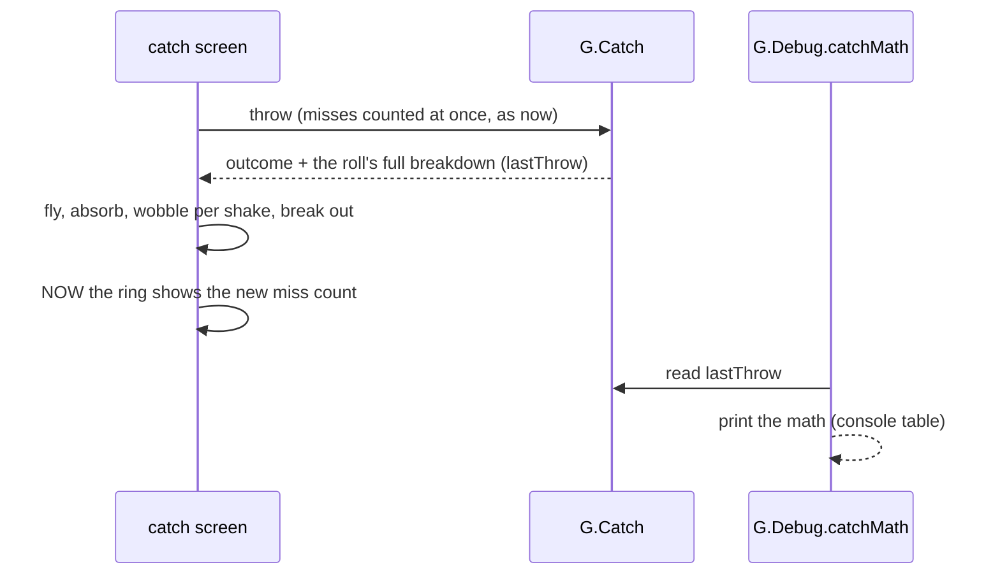

# 148b - Flee Ring Timing and Catch Math Debug Plan

Follow-up to #148 (Jess, 2026-11-16). Status: **built 2026-11-16** (console only, Jess), waiting on the feel test. smoke-ui pins its rescue to Bulbasaur: a random high-capture-rate pick is a sure catch at World Level 1, so a forced miss could not miss.

## 1. Opening

| Item | Proposal |
|---|---|
| Goal | The flee ring fills only after the throw's wobbles and break-out; one debug command shows each throw's math. |
| Done when | A miss's ring step lands after the ball breaks open; `G.Debug.catchMath` prints every part of a throw's roll; Jess's feel test. |
| Test | smoke-ui's catch flow, in place: the ring has not moved when the throw starts and has moved one step after it ends; the debug command prints for a throw. No new harness. |

## 2. Shape

## 3. Parts

| # | Part | Files | What changes |
|---|---|---|---|
| 1 | Ring after the shakes | js/ui/catch-ui.js | The ring stops reading the live miss count. The screen keeps its own shown count: set when the catch opens, and moved to the real count after the break-out (a miss) or when the catch closes (fled). The rules in catch.js do not change. |
| 2 | The roll's breakdown | js/systems/catch.js | The last throw's record grows from critical / shakes / caught to every number that made it: capture rate, time term, ball, star, badge penalty (with the World Level, badges and cap), early bonus, the rate, the critical chance and its roll, the shake chance and each shake's roll. The rate math is written once and both the odds and the breakdown read it. |
| 3 | The debug command | js/core/debug.js | `G.Debug.catchMath()` prints the last throw as a console table. `G.Debug.catchMath(true)` prints every throw as it happens until `catchMath(false)` or a reload (not saved). Listed in the file's command list. |

## 4. Plan check (coding principles)

| | |
|---|---|
| Reuses | The lastThrow record from #148, the screen's existing signals, debug.js's `on` guard and command list |
| New | One shown-misses signal in the screen; a breakdown on lastThrow; one debug command with an on/off |
| Not built | No on-screen math panel (console only); nothing saved |
| Where it lives | Timing is presentation (the screen); the numbers are the catch rules (catch.js); the printing is a dev tool (debug.js) |
| Size | catch.js about +15 lines, catch-ui.js about +8, debug.js about +30 (already 1346 lines; #121 moves dev tools out later) |

## 5. Call for Jess

| # | Call | My pick |
|---|---|---|
| 1 | Console only, or also a small on-screen readout on the catch screen? | Console only |
