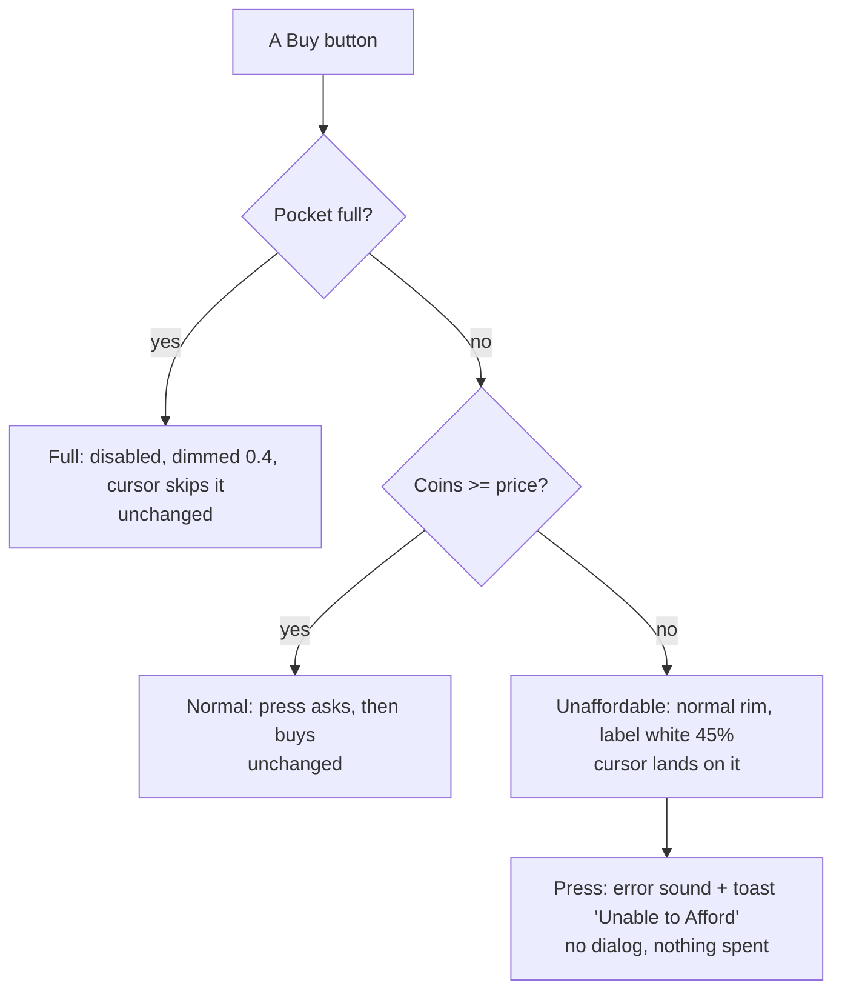
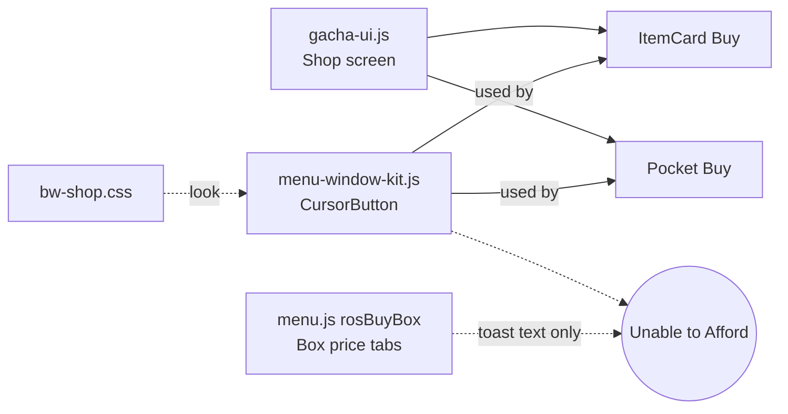

# #151 + #152: unaffordable buy buttons (plan, 2026-11-17)

Branch rework/shop. Rule: decision 2026-11-17-unaffordable-buttons-take-the-cursor. No code in this plan.

**Jess's answers (2026-11-17):** 1. A Full pocket Buy follows the unaffordable path, with the toast "All belt slots are full."
2. Yes. 3. Yes. Because of that, the kit option became "refusal" (the toast text a press shows instead of acting), one option
for both cases in place of an "unaffordable" flag. The kit handles both a click and Enter on a refusing button.

## Slice opening (agree before build)

| | |
|---|---|
| Goal | A Buy you cannot afford looks greyed but works like any button: the cursor reaches it, and pressing it says "Unable to Afford" and spends nothing. Pocket and card Buys look the same. |
| Done when | At 0 PokeCoins, in both Shop tabs, the arrows land on every Buy. Each one keeps its normal rim with a label in white at 45%, and Enter or a click shows "Unable to Afford" with coins and slots unchanged and no confirm dialog. A Full pocket is still skipped. |
| End-goal test | smoke-ui's Shop pass, with its two "disabled and skipped" checks rewritten in place (cards near line 971, pockets near line 1272) to check the relations in the row above. The Full check (near line 1262) stays as it is. |

## How a Buy behaves after the change

## Parts

| # | File, place | Change |
|---|---|---|
| 1 | js/ui/menu-window-kit.js, CursorButton | Gains one option, "unaffordable". When it is set, the button still takes the cursor and mouse hover, the label is greyed, and a press plays the error sound and shows the toast "Unable to Afford" instead of calling the screen's press. That puts the rule in one place, the place the decision names as canonical. ItemCard passes the option through. The doc comments for disabled and unaffordable are updated. |
| 2 | js/ui/gacha-ui.js, Team Items cards | Card Buys pass "unaffordable" instead of "disabled". The cursor's list of reachable items (eligibleItems) always includes the card Buys. |
| 3 | js/ui/gacha-ui.js, pockets | Each pocket's view gets "full" and "affordable" in place of "canBuy". The Buy is disabled only when full, and marked unaffordable when not full and too expensive. The cursor's list leaves out only Full pockets. |
| 4 | css/bw-shop.css | The greyed-label rule moves from "a card Buy that is disabled" to "any unaffordable Buy", so cards and pockets share it (#152). The 0.4 dimming stays for disabled buttons, which now means Full only. |
| 5 | Toast wording | Every remaining "Not enough PokéCoins" toast becomes "Unable to Afford": the failure after the dialog in buyItem, buySlot and buyBerrySlot (gacha-ui.js), and the Box price tab in rosBuyBox (menu.js, 2 lines). The Box tab already takes presses while dimmed, so the wording is its only change. |
| 6 | tools/smoke-ui.js | The rewritten checks from the slice opening, plus the header comments that describe the Shop pass (lines 20, 783 to 790). |
| 7 | js/ui/hud-kit.js, TeamButton comment | One comment line that says an unaffordable Buy is disabled. It is corrected. |

## Plan check (coding-principles)

| | |
|---|---|
| Reuses | CursorButton, ItemCard and createMenuCursor (kit), G.UI.toast, the existing error sound, and the card-label CSS rule (#152 is that rule, applied more widely) |
| New | One CursorButton option, "unaffordable". Nothing existing fits: "disabled" uses the browser's own disabled state, which blocks every press, and that is the opposite of what this needs. |
| Not built | The in-run Move Trainer and TM Mart (shop-ui.js, Silver; their offer rows already read "Can't afford" and do not use the kit's cursor). The Inventory, which has no buys. Both are #126 territory. |
| Where it lives | The kit owns how a button behaves. The Shop only says whether a button is affordable. |
| Size | gacha-ui.js and the kit each grow by a few lines. menu.js stays 1784 (#154 is the split). |
| Touched-code cleanups | Item 5 (one toast wording everywhere) and item 7 (stale comment) |

## Decisions for Jess

| | Default if you say nothing |
|---|---|
| #151 open: a Full button takes the cursor? | No. Full stays skipped and dimmed. |
| Item 5: the Box tab and the after-dialog failures also say "Unable to Afford" | Yes (the decision says every menu) |
| Leave the in-run Move Trainer and TM Mart rows out of scope | Yes |

Risk: low. The only behavior changes are the cursor stops and the toast. Purchases still go through G.Items and G.Grounds and are unchanged.
