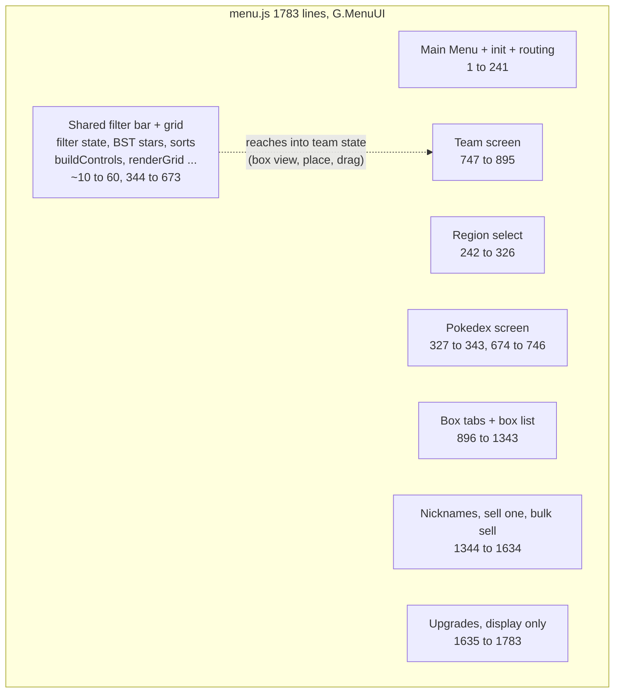
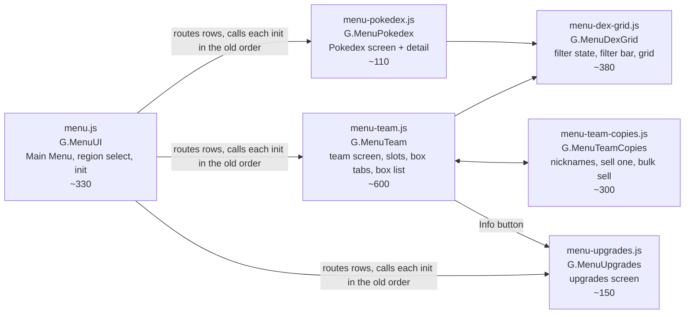

# #154 Split js/ui/menu.js by duty: slice plan

Behavior-neutral refactor. No code in this plan. Precedent: the hud-overlay.js split (#112, #116).

## Slice opening (agree before any build)

| Item | Proposal |
|---|---|
| Goal | menu.js (1783 lines) becomes six files, one duty each, with `G.MenuUI` keeping its four exports (init, open, GEN_NAMES, REGION_NAMES) so no caller changes. |
| Done when | Every file from the split is under about 1000 lines and its header names its one job; ONBOARDING.md's module map lists them; the game behaves as before. |
| End-goal test | The existing behavior checks, unchanged: `node tools/check.js` clean, `tools/smoke-ui.js` and `tools/smoke-team.js` pass with no edits to their expected results. Baseline run on the current tree first, so any failure after the split is ours. No new harness (behavior-neutral, existing smokes cover these screens). |

## Today: one closure, eight sections

## After: six files

Load order in dev.html, all between menu-window-kit.js and shop-balls.js: dex-grid, pokedex, team, team-copies, upgrades, then menu.js last (it wires the others). Five new NEED names in js/main.js. build.js reads dev.html, so the rebuild needs no other change.

## Parts

| Part | Moves | Reuses | New | Notes |
|---|---|---|---|---|
| 1 menu-dex-grid.js | Filter state factory, BST bands and star helpers, sorts, stat index, buildControls, filterSortDex, fillCell, markGrid, renderGrid, refreshCells, move-search helpers | The "view" object both screens already pass in | Two view hooks for the team view (show the box list instead; place or drag a cell into a slot), replacing renderGrid's direct reach into team state | Hooks are only filled by the team view; the Pokedex view leaves them empty, same as today's checks |
| 2 menu-pokedex.js | browseDex, openDex, showDetail, the dex view and its selection, shiny toggle | Grid module | None | |
| 3 menu-team.js | Team state, open, commit, back, slots, detail, tab row, box buy, box list, copy cells, the Enter-places key listener, the save listener that redraws tabs | Grid module | A small shared handle for the copies module (team state plus the redraw calls it already uses) | Biggest file, about 600 |
| 4 menu-team-copies.js | Rename, sell one, bulk sell bar, select repeats, sell ticked, info rows | Team handle | None | Calls back into team redraws exactly as today |
| 5 menu-upgrades.js | Upgrade columns table, open, step, render, select, key listener | None | None | Open question 1 |
| 6 menu.js (what stays) | Header, region names, Main Menu cursor and keys, init, open, social line, region picker, logout | All of the above | Each module exposes an init; MenuUI.init calls them | game.js keeps calling only G.MenuUI.init |

## Open questions from the issue, with recommendations

| Question | Recommendation | Why |
|---|---|---|
| Move upgrades now or wait for #97? | Move now (part 5) | 150 lines, no ties but the Info button; #97 then swaps one file instead of carving it out of menu.js |
| Filter state: own module or with the Pokedex? | With the shared grid (part 1), not its own module | The state is only read by the filter bar and grid; a separate 30-line module would be a second file for one job (YAGNI) |

## Risks

| Risk | Handling |
|---|---|
| Key listener order (STATE "Watch": a key a window handles goes no further) | MenuUI.init calls the modules' inits in the same order the listeners register today: Main Menu keys, team Enter, upgrades keys; Shop and Inventory still register after |
| Load-time reads (a module grabbing another at load) | Cross-module calls resolve at call time, not load time; only G.Copies.BST_BANDS is read at load, and copies.js loads earlier |
| Team and copies call each other | Same as hud-overlay's kit: team exposes its handle, copies reads it at call time |
| Shared state copied instead of shared | Team state stays one object, passed by reference; never duplicated |

## Plan check

- Reuses: the existing view-object pattern, the hud-overlay split's handle pattern, build.js's dev.html script list.
- New: five files, five G names, two view hooks, one team handle, an init per module. Nothing else.
- Not built: no renames inside the moved code, no Spanish-key changes, no cleanup of the 9-branch Main Menu routing (that is #127's job), no new harness.
- Size: largest file about 600; menu.js drops to about 330.
- Touched-code cleanups: menu.js's header line updated ("main menu, collection and upgrades" becomes the Main Menu only). Nothing else.

## As built (2026-11-17)

| File | Lines |
|---|---|
| menu.js | 234 |
| menu-dex-grid.js | 386 |
| menu-pokedex.js | 111 |
| menu-team.js | 685 |
| menu-team-copies.js | 273 |
| menu-upgrades.js | 160 |

Differences from the plan (all small, none change behavior):
- Load order: menu.js stays first, the five new files load right after it. Each new file reads G.MenuUI.GEN_NAMES and the modules before it once at load; only the calls into later files (team to copies, team to upgrades, menu.js to all) look them up when they run.
- The team view gives the grid three hooks, not two: draw the box list, place a cell in the targeted slot, and set what is being dragged.
- The detail column's info rows (nature, ability, size, EVs) went to menu-team.js, not menu-team-copies.js: the detail column is their only caller.
- The upgrades screen's Back still defaults to the Main Menu.

Checks: check.js all passed (207 files, 60 harnesses); smoke-team all passed; smoke-ui all passed twice. One earlier smoke-ui run failed only "shop: no console or page errors", the known asset-load flake in STATE "Watch". No expected results edited.
