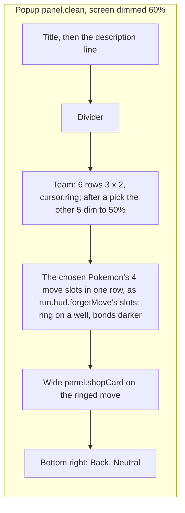
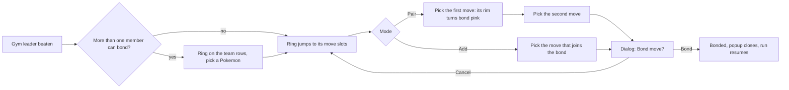

# 155 - Bond Selection Layout (2026-11-21)

Slice opening for `run.hud.bondSelection`, the popup that spends a gym win's bond. Source: js/ui/run-ui.js
(showBond, the scr-bond screen), js/game.js offerBond, js/entities/player.js bondOptions and fuse, Jess's brief of
2026-11-21. Board page only; the game changes at #126.

## Slice opening (to agree)

| | |
|---|---|
| Goal | `run.hud.bondSelection` on the board (Composites, HUD), built from approved pieces only |
| Done when | the page draws the popup on its move step (Pokemon chosen, others dimmed, ring on a move, wide card), the Bond ask is on it, Jess approves, a decision file is written |
| Test | Jess reloads the board and feel-tests it; `node tools/check.js` passes; no file under js/ or css/ changes |

## How a bond works today (code)

- A gym win gives the team one bond. Any living member can spend it.
- Two modes per member. **Pair**: no group yet, two loose moves join a new slot. **Add**: a group of 2 or 3 exists, one
  loose move joins it (max 4). A skill never bonds.
- A member with no option is dimmed and cannot be picked. With one eligible member the Pokemon step is skipped.
- Today there is Back (one step) but no way to leave without bonding.

## Layout (Jess 2026-11-21)

## Flow

## Rulings (Jess 2026-11-21: opening and B1 to B7 agreed as recommended)

| # | Question | Ruling |
|---|---|---|
| B1 | Bond's intent in the ask. It is the first ask whose confirm is a gain; the dialog rule asks it because it cannot be undone | Positive (green), opening on Cancel (Neutral) |
| B2 | Pair mode takes two picks. How does the first pick show while the ring moves on? | ~~A bond-pink ring~~ Revised: the first pick's rim turns bond pink, one ring only; the ask comes after the second pick |
| B3 | In Add mode, the existing bond slot | Drawn in bond pink as the target, not pickable; the ring moves over the loose moves only |
| B4 | Leaving without bonding | No leave, as today. Back steps from moves to team (hidden when the team step was skipped) |
| B5 | The team row piece | moveMart's team row (portrait, name, type chips); a member that cannot bond darker (25%), the ring skips it |
| B6 | Text (English, new) | Title "Bond moves". Line "Pick a Pokemon, then the moves that will cast together. A bond is permanent." Card line on the 2nd or Add pick: "Casts together with X." |
| B7 | Page states | One page state, the move step (it shows every piece); the ask sits on it as a sample |

## Drafted (2026-11-21, Quick)

Board: tools/library/bond-draft.js (Composites, HUD, after run.hud.forgetMove). Two stages: the move step (Pikachu
picked, Quick Attack first in a pink ring, the yellow ring on Thunder Shock, Gyarados disabled) and the same with the
Bond ask over it. Reused from run-shops-draft.js: the team rows (now take a brightness), the forget popup's slot
sizes and wide card (now takes a move, a line and a width). Waiting on Jess's feel test, then a decision file.

Feel pass 1 (Jess 2026-11-21): the four slots in one row, not 2 x 2. 4 x 210 + 3 x 6 (the HUD's column gap) = 858 px,
exactly the window inside its 24 px insets, so the row lines up with the team grid's edges; the card spans it too.

APPROVED (Jess 2026-11-21): decision 2026-11-21-155-run-hud-bond-selection-look.

Revised after approval (Jess 2026-11-21): B2's pink ring read as a second cursor. The first pick's rim turns bond
pink instead (a preview of the bond), so only the yellow ring is ever on screen.
