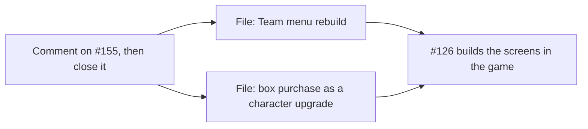

# 155 - Close-out Drafts (2026-11-21)

For Jess to apply on GitHub. The assistant cannot write to GitHub from Quick.

## 1. Comment on #155, then close it

> The board is done. Approved on it: every primitive page, run.hud (playerActive.bar and .area, teamSlot, teamItems,
> gymLeader, worldInfo, runInfo, moveMart, trMart, forgetMove, bondSelection), main.shop (pokeball, character, items,
> tms) and catch.window, with a decision file for each in docs/decisions/ (2026-11-18 to 2026-11-21).
>
> Ruled 2026-11-21 (decision 2026-11-21-155-board-ends-at-primitives): the board stops at the primitives and these
> composites. Pause, Team, Pokedex and the other screens are built in the game at #126 from the primitives.
>
> Moved to #126: the Inputs review (field.text, field.dropdown, scroll.bar), the tooltip pin and close icons, the
> colour names, the Tokens and Fonts feel test, the 155c-4 ask dialog UX list, and the Ancient Power description feel
> test. Before closing: `node tools/check.js` ends with "check: all passed" (smoke-ui-library included).

## 2. New issue: Team menu rebuild from the mockup

- Title: Team menu rebuild from the 2026-11-21 mockup
- Labels: feature, area:ui, ready
- Body:

> Child of #126. Mockup: assets/excalidraw/team-menu.excalidraw. Rulings: decision
> 2026-11-21-team-menu-rebuild-rulings. Notes: docs/AI Outputs/Issue-155/155 - Team Menu Rebuild Opening.md.
>
> Built in the game from the #155 primitives, with no board page first (decision
> 2026-11-21-155-board-ends-at-primitives). Move List mode and the copy actions come after the default screen.
>
> ## Done when
> Goal, done-condition and end-goal test are agreed at the slice opening.

## 3. New issue: buying another Pokebox box becomes a character upgrade

- Title: Pokebox boxes are bought as a character upgrade, not in the Team menu
- Labels: feature, area:items, needs-triage
- Body:

> Ruled by Jess 2026-11-21 (decision 2026-11-21-team-menu-rebuild-rulings). Today the next box is bought from its
> price tab in the Team screen (js/ui/menu-team.js). It moves to Character Upgrades (main.shop.character).
>
> ## Done when
> Goal, done-condition and end-goal test are agreed at the slice opening. Old saves keep the boxes they own.
