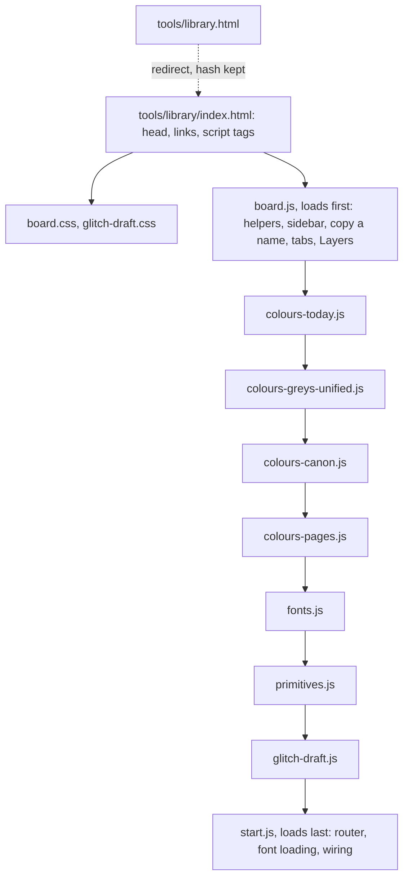

# 155, split tools/library.html into tools/library/ (built 2026-11-18)

tools/library.html is about 1,830 lines: 160 of CSS, 20 script tags, about 1,600 lines of one inline script.
It is a dev tool, so it is free-edit, and nothing in the game changes.

## Goal, done, check

| | |
|---|---|
| Goal | The board lives in tools/library/, one file per page area, none over about 400 lines |
| Done | Every page and tab draws the same as before the move; the old address still opens the board |
| Check | Jess reloads the new address and clicks through every page and tab (no smoke run, per Jess) |

## New layout

- Already there and kept: tools/library/doc-colours.js and idea-holding/.
- **Plain scripts, not modules.** You run from file://, and modules do not load from disk. Top-level names in plain
  scripts are shared, so the files load in the old order and nothing registers anything.
- Paths: the game scripts become ../../js/... . board.js loads first and start.js last, so every page has registered
  before anything draws.
- References: tools/smoke-ui-library.js and any tools/check.js line point at the new path (text only, not run). The
  docs that cite tools/library.html stay as history, apart from STATE and the 155 plan.
- The move is behaviour-neutral: code only moves, nothing is rewritten on the way.

## Risks

| Risk | Handling |
|---|---|
| A shared helper is used before its file loads | Helpers go in board.js, which loads first. Pages register functions and run nothing until the wiring |
| git sees a delete plus new files, not a rename | Fine for a tool. The old file stays as the redirect |
| The 1,000-line rule (#129) | This settles it for the board. Note it on #129 |

## Result

| File | Lines |
|---|---|
| colours-today.js, the largest | about 340 |
| every other file | under 280 |

One regression, open: the Portraits page Pikachu loads ../assets/... from js/ui/lib/primitives/portrait/portrait.story.js,
which now points at tools/assets. Fixing it touches js/, so it waits for Jess.
