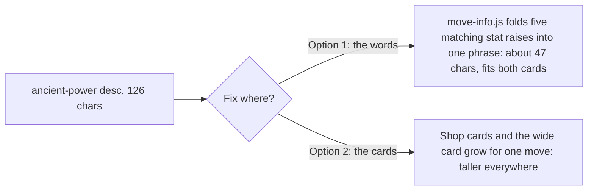

# 155 - Move Description Length (2026-11-21, Option 1 APPROVED and applied, sheet folds too)

Do the run shops' cards and run.hud.forgetMove's wide card hold every generated move description (G.MoveInfo.desc)?
Measured with tools/move_desc_lengths.js (178 moves, Jess's run 2026-11-21).

## What fits

| Card | Room (Michroma 12, 16 px lines) | About |
|---|---|---|
| Shop offer and TR card (166 px text width) | 5 lines, about 20 characters each | 100 characters |
| forgetMove wide card (316 px text width) | 3 lines, about 38 characters each | 114 characters |

| Description | Characters | Shop card | Wide card |
|---|---|---|---|
| ancient-power | 126 | no (about 7 lines) | no (4 lines) |
| everything else (hex, fly, cross-poison and down) | 69 or less | yes (4 lines) | yes (2 lines) |

Fly and Surf print "Effect:" in the tool because it stubs G.MoveEffects; in the game they read "Press its key:" (76)
and "Passive:" (57). Both still fit.

## The one outlier

Ancient Power lists five separate stat raises that are the same raise on every stat:
"Shot: damage, 10% team Attack +1, 10% team Defense +1, 10% team Sp. Atk +1, 10% team Sp. Def +1, 10% team Speed +1,
knockback."

## Option 1 (recommended): fold matching stat raises in the description

- File: js/ui/move-info.js, the effects list that desc() joins. Game code, so it waits for Jess's OK.
- Change: when a move's stat effects all share one side, scope, chance and stage count and cover all five stats
  (Attack, Defense, Sp. Atk, Sp. Def, Speed), they print as one phrase, "10% team all stats +1", in the first stat's
  place. Anything short of all five prints as today.
- Result: "Shot: damage, 10% team all stats +1, knockback." (47 characters).
- Decision: should the pause sheet (js/ui/sheet.js reads the same effects list) fold too, or only the one-line
  description? Folding both keeps one wording; the sheet has room either way.
- Test (relations, not values): a made-up move with five matching raises gives one phrase and a shorter description
  than the same move with one raise removed, which still lists four. Added to docs/proposals/ui-readers-harness.js.
- Applied: harness checks (five fold to one; four stay four; another chance keeps five apart; a missed stat does not
  fold; the fold keeps chance and side) plus a shape check that every real description is at most 100 characters.
  Mutants in docs/proposals/ui-readers-mutate.js: the fold skipped, the fold ignoring the chance.
- Changelog: one "chg" line, English.
- Risk: low. Display text only; nothing reads it for gameplay.
- Not built: a general "fold any repeated phrase" rule (one move needs it).

## Option 2: size the cards for 126

Shop cards would need about 2 more lines (32 px taller, 288 px) and the wide card one more (112 px). Every card
grows to serve one move.

## Either way

- tools/move_desc_lengths.js stays as a dev tool (never ships). The board's forgetMove sample can carry the longest
  real description so a future overflow shows on the board.
