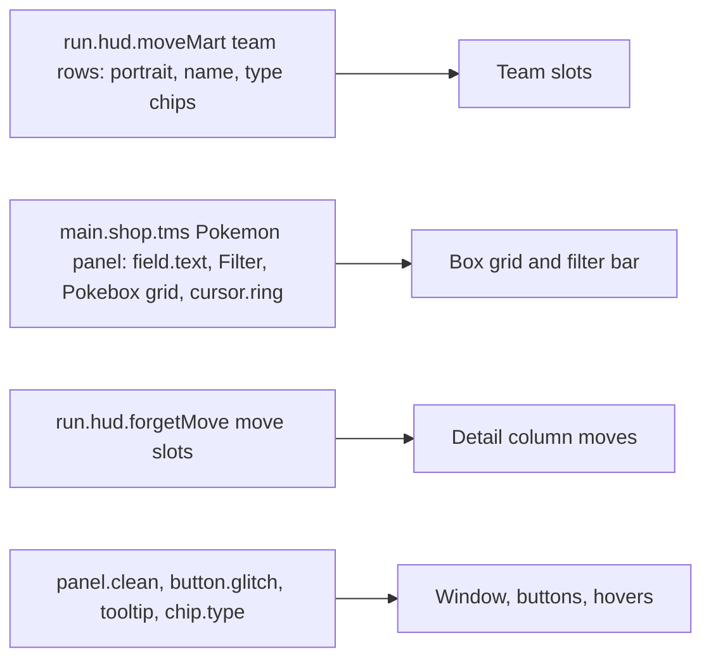
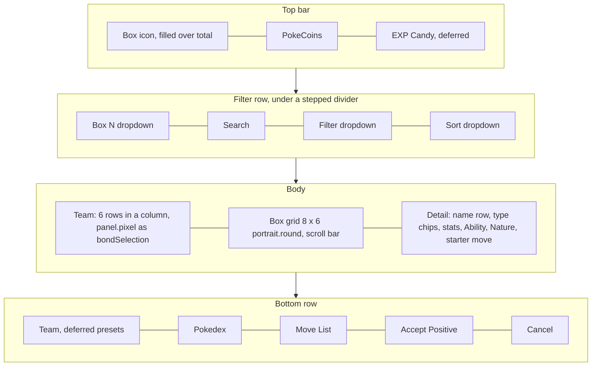

# 155 - Team Menu Rebuild Opening (2026-11-21)

No board page (Jess 2026-11-21, decision 2026-11-21-155-board-ends-at-primitives): the first pass was deleted and
the screen is built in the game at #126. The rulings stand (decision 2026-11-21-team-menu-rebuild-rulings).

Slice opening for `main.team`, a full rebuild of the Team screen. Source: js/ui/menu-team.js, menu-team-copies.js,
menu-dex-grid.js (the grid shared with the Pokedex). Board page only; the game changes at #126.

## Slice opening (to agree)

| | |
|---|---|
| Goal | `main.team` on the board (Menus), a new layout built from approved pieces |
| Done when | the page draws the default state, Jess approves, a decision file is written |
| Test | Jess reloads the board and feel-tests it; `node tools/check.js` passes; no file under js/ or css/ changes |

## What the screen does today (keep or drop each)

| # | Job | Today |
|---|---|---|
| T1 | Six fixed team slots | Slot 1, the lead, is never empty. Highlight a slot; Enter, a double-click or a drag puts a Pokemon in |
| T2 | Draft and commit | Edits a copy of the team; Commit Team saves, Back discards. An "Unsaved team" message exists today |
| T3 | Detail column | Name (nickname, gender), rarity, types, BST and the stat hex, nature, ability, height, weight, EVs, moves; a Normal or Shiny look toggle. No buttons |
| T4 | List tabs | A Pokedex tab (species; placing one asks for a copy) and the box tabs (copies); buy the next box from its price tab |
| T5 | Filter bar | Shared with the Pokedex: region, owned, search, types, rarity, BST stars, sort and direction; fav and lock marks on box tabs |
| T6 | Box cell | Number, team badge or shiny mark, sprite, name with gender, rarity |
| T7 | Copy actions | Rename in place; sell one (asks); bulk sell (asks) |
| T8 | Upgrades | Opens Upgrades and comes back with the draft kept |

## Approved pieces likely reused

## The mockup (assets/excalidraw/team-menu.excalidraw, Jess 2026-11-21)

Drawn 1615 px wide for the 1920 x 1080 menu stage, so every size scales by about 1.19. Colours are hints, not tokens.

Settled by the mockup:
- T1 six slots: kept, a column of panel.pixel rows (bondSelection's). T2 draft: kept (Accept, Cancel).
- T3 detail: rarity icon and name, gender and favourite; two type chips; six stat rows (base on the left, a 2 px
  two-band bar: IV 0 to 31 on top, EV 0 to 252 under it, IV / EV on the right), a HEX toggle for the dual-layer hex;
  Ability; Nature; the starter move (name, prose description, the game's short line).
- T4 list: box tabs become the Box N dropdown (locked boxes disabled, an All Boxes option); the Pokedex tab becomes a
  Pokedex button that swaps the grid to the Pokedex, as today.
- T5 filters: one Filter dropdown of indeterminate checkboxes (Type, Rarity, BST, Region) plus plain Favorite and Locked;
  Sort up and down for each, plus Dex # and Region.
- Move List mode: the stats through Nature slide off right, a large box with the learnset slides in (unbought TMs
  dimmed), and the starter move box becomes the move detail window.
- Deferred: EXP Candy (the evolution system) and Team presets (the Team button).

## Today vs the mockup (read 2026-11-21 against assets/screenshots/screenshotteammenu.png)

The rebuild is a cut in density, not a re-skin. What the mockup drops is dropped on purpose.

| Area | Today | Mockup |
|---|---|---|
| Team | Six tall cards: number, name, type chips, big sprite; empty slots dashed with + | Six panel.pixel rows (bondSelection's), portrait.round |
| Filters | Search, Region, Owned and Sort selects, a direction button, Clear; three chip rows (18 types, 5 rarities, 5 BST stars) and the marks | One row: Box N dropdown, Search, one Filter dropdown (all of it as checkboxes), Sort with its direction |
| Grid | 19 columns of cards (number, sprite, name, rarity dot, fav star), about 170 visible | 8 x 6 portrait.round circles, 48 visible, a scroll bar |
| Box tabs | A tab row, a price tab to buy | The Box N dropdown |
| Detail | Big sprite with Upgrade on it, Normal and Shiny toggle, rarity stars, types, the stat hex, Ability, two columns of moves, Already in Slot and Free Slot buttons | Name row, type chips, six stat bars (hex behind a toggle), Ability, Nature, the starter move box; no sprite, no buttons |
| Moves | Always shown | Move List mode (learnset slides in) |
| Bottom | A hint line, Back, Commit Team | Team (deferred presets), Pokedex, Move List, Accept, Cancel |
| Top | The main menu's counters | Box count (X / 500), PokeCoins, EXP Candy (deferred) |

## Questions for Jess (what the mockup really leaves open)

| # | Question | Recommendation |
|---|---|---|
| N1 | Placing a Pokemon: the slot buttons are gone | Pick a cell, then a slot (cursor.ring moves to the team column); drag and double-click stay for the mouse |
| N2 | Freeing a slot (slot 1 never empties) | Pick a filled slot, then the grid's empty side; or drop it: an emptied slot is rare enough to skip |
| N3 | No sprite in the detail column | As drawn: the portrait in the grid and the team rows is enough |
| N4 | Sell, rename, lock, favourite and bulk sell | Out of this page; a follow-up page (main.team.copyActions) once the layout is approved |
| N5 | Buying the next box | A locked box in the Box N dropdown shows its price; picking it buys (no ask) |

## Rulings (Jess 2026-11-21)

- Take the pieces one at a time; a first whole-screen pass first (tools/library/team-draft.js).
- N1: agreed (pick a cell, then a slot; drag and double-click for the mouse).
- N2: mouse drags and drops or double-clicks to move Pokemon around. Keys: Enter on a slot lifts it, Up and Down move
  it, moving it right onto the grid removes it.
- N3: only portraits; no sprites anywhere in the Team menu.
- N4: copy actions (sell, rename, lock, favourite, bulk sell) after this page is going.
- N5: buying another box becomes a character upgrade (main.shop.character), not part of the Team menu.
