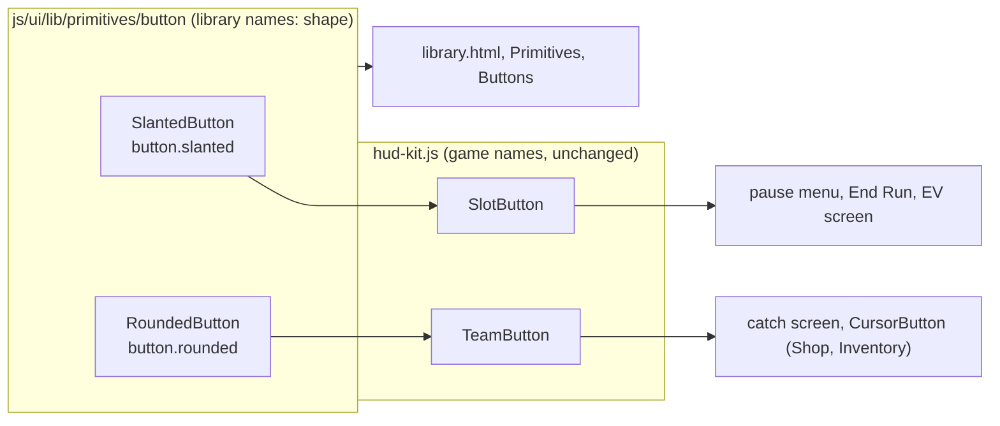

# #155 155b follow-up: name the buttons by shape (plan for Jess's OK, 2026-11-18, Quick)

Goal: the library's buttons are named by their shape, not by the screen they came from, so more styles can join later.
Done when the board, the stories, the library code and the docs use `button.slanted` and `button.rounded`, and every
screen looks and works as before. Test: smoke-ui-library (keys renamed), smoke-hud-overlay and smoke-ui unchanged,
a short feel test. No code here.

## The names

| Today | New board name | New library name | Shape |
| --- | --- | --- | --- |
| `button.slot` (SlotButton) | `button.slanted` | `SlantedButton`, sizes `SLANTED_BUTTON` | The run screen's move slot: angled ends to a point |
| `button.team` (TeamButton) | `button.rounded` | `RoundedButton`, sizes `ROUNDED_BUTTON` | The B/W bag button: rounded ends |

## Parts

| Part | File and spot | Change |
| --- | --- | --- |
| A. Library | js/ui/lib/primitives/button/button.js | SlotButton to SlantedButton, TeamButton to RoundedButton, SLOT_BUTTON to SLANTED_BUTTON, the team grid's names to rounded. Header and section comments follow. `moveSlotRow` keeps its name (the run HUD's move slots paint with it; it is the move slot's row) |
| B. Kit | js/ui/hud-kit.js, the line that reads G.Lib.Button | Reads the new names and passes them on under the old ones, so no screen file and no kit name changes (hud-overlay.js's kit list and smoke-hud-overlay stay as they are) |
| C. Story | button.story.js | Names `button.slanted`, `button.rounded`; component fields follow |
| D. Board | tools/library.html | One comment naming the components |
| E. CSS comments | button.css, bw-shop.css, hud-overlay.css, pause-menu.css; menu-window-kit.js comment | Comments only: the new board names. Classes stay `pm-button`, `hud-team-button` (155b decision 3) |
| F. smoke-ui-library | tools/smoke-ui-library.js, BUTTON_STATES and BUTTON_RIMS keys, the `team` helper | Keys renamed; the relations stay the same |
| G. Docs | UI Component Inventory.md (button rows), 155 Build Plan and 155b plan (a dated rename note, history kept), a new docs/decisions file plus its DECISIONS.md index line | The naming rule below |

## Decisions for Jess

| # | Question | Default |
| --- | --- | --- |
| 1 | Mapping: slot becomes slanted, team becomes rounded (your message had team twice) | As in the table |
| 2 | The naming rule, as a ruling: library primitives are named by their look (`button.slanted`), never by a screen or job; place names (`pause.menu.resume`) say where they are used. This replaces the Slice Opening's `button.menu` example | Yes |
| 3 | How far the rename goes. Default: the library and the board only; the game kit keeps SlotButton and TeamButton as its names for them. Option: also rename the five screen files' imports and the kit's names (pause-menu, end-run, ev-screen, catch-ui, menu-window-kit, hud-overlay's kit list, smoke-hud-overlay, the old ui-library page), so one name is used everywhere | Library and board only |
| 4 | CSS class names (`pm-button`, `hud-team-button`) stay; renaming them touches four screen stylesheets and the smokes that read the label class. A later slice under #126 | Keep, issue draft |

## Plan check

| | |
| --- | --- |
| Reuses | 155b's pattern: the kit passes library pieces on under the game's names |
| New | No new code; one decision file |
| Not built | Screen-side renames (decision 3 option), class renames (decision 4), any new button style |
| Size | Renames in 2 code files, comments in 6, keys in 1 smoke |
| Risk | A missed name on the board throws while drawing; smoke-ui-library's no-errors check catches it |

## Tests
- smoke-ui-library (changed): only its keys; the five Buttons page checks keep their relations.
- smoke-hud-overlay, smoke-ui (unchanged): the kit's names do not change, so they prove no screen broke.
- No new harness, mutant, intent scenario or debug set: nothing the game does changes. No changelog line: players see no change.

## Feel test (hard reload)
library.html, Primitives, Buttons: the two buttons show as `button.slanted` and `button.rounded` with every state.
One pause menu open and one Shop open, to see the screens still draw their buttons.

## As built (2026-11-18, Quick; approved with decision 3 as "rename everywhere")

| Part | Built |
| --- | --- |
| A | button.js: SlantedButton, RoundedButton, SLANTED_BUTTON, ROUNDED_BUTTON and its grid names; the header names the rule |
| B (widened) | hud-kit.js reads and exports the new names; hud-overlay.js KIT_NAMES lists them; the screens import them: pause-menu.js (with SLANTED_BUTTON), end-run.js, ev-screen.js, catch-ui.js, menu-window-kit.js; the old tools/ui-library.html page too |
| C, D | Story names, component fields, stage classes and ids; the board's stage CSS and one comment |
| E | Comments in button.css, bw-shop.css, hud-overlay.css, pause-menu.css, bw-catch.css, menu-window-kit.js; HUD-STYLE.md's Buttons row |
| F | smoke-ui-library keys and its rounded helper; relations unchanged |
| G | Decision 2026-11-18-155-library-pieces-named-by-look and its index line; the inventory's two rows; dated notes in the opening, the 155 build plan and the 155b plan |

smoke-hud-overlay needed no edit: it reads the names each screen takes from the kit out of the files themselves. `moveSlotRow` kept its name.
Class names stay (decision 4); the issue draft is in chat.
