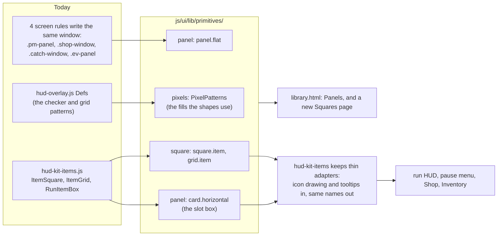

# #155 155c-2: the flat panel, the item squares and the slot box (plan for Jess's OK, 2026-11-18, Quick)

Follow-up to 155c (Panels). No code here.
Goal: the pause menu's flat window, the berry and team item squares and the team item slot box live in the library,
take props only, and show on the board in every state. Done when the board draws them all with no game scripts, and
every screen that uses them looks and works as before. Test: smoke-ui-library (new checks), smoke-ui, smoke-pause-menu,
smoke-hud-overlay unchanged, your feel test.

## What moves where

## What I found in the code

| Finding | Effect |
| --- | --- |
| The flat window is three values (#181818 body, 1 px #212121 frame, 2 px #101010 outline) repeated in .pm-panel (Run Info, Pokemon detail), .shop-window (Shop and Inventory), .catch-window and .ev-panel | One `panel-flat` class in the library; the four elements take it and their rules keep only place, size and motion |
| The squares' body and the slot box's body are SVG patterns (the B2 checker and the slot grid) defined once by hud-overlay.js. The board has none, so these pieces would draw with no body | The pattern definitions move into the pixels primitive; hud-overlay draws them from there, the board draws them once |
| ItemSquare draws its icon with the game's icon code (G.Icons, the Pokesprite sheet); ItemGrid wires the game's tooltip layer | The library pieces take the picture as content and the slot's attributes as given; the kit's ItemSquare, ItemGrid and RunItemBox stay as adapters that add the icon canvas and the tooltip handlers. Their props do not change, so no screen changes |
| The square's rim is yellow when it holds something, slate when empty; a locked slot is the grid's job (opacity 0.3) | square.item has filled and empty; grid.item shows locked |
| RunItemBox's live text uses a raw #00baf3 | Becomes the token color.hud.expFill (same value) |
| No mutant matches any moved line | No mutate file to update |

## Parts

| Part | Files and spot | Change |
| --- | --- | --- |
| A. Patterns | js/ui/lib/primitives/pixels/pixels.js, pixels.css; js/ui/hud-overlay.js (Defs, line 30); css/hud-overlay.css (.hud-defs, line 38) | The three pattern definitions (bar checker, type checker, slot grid) move to the pixels primitive as `PixelPatterns`, with the .hud-defs rule. hud-overlay draws the library's piece where Defs was. Pattern ids stay, so every url(#...) in the kit still works |
| B. Flat panel | panel.js, panel.css; css/pause-menu.css (.pm-panel 276, .ev-panel 774), css/bw-shop.css (.shop-window 12), css/bw-catch.css (.catch-window 45); js/ui/pause-menu.js (4 panel divs), dev.html (2 .shop-window divs), js/ui/catch-ui.js (the window div), js/ui/ev-screen.js (the panel div) | `panel.flat` (FlatPanel and the `panel-flat` class) holds the look from tokens. Each element adds the class; its own rule drops the three look lines and keeps place, size and the slide. The team and inventory panels' "no background" override still wins (it is more specific) |
| C. Squares | new js/ui/lib/primitives/square/square.js, square.css, square.story.js | The bag button shape, `square.item` (ItemSquare: picture as content, filled or empty) and `grid.item` (ItemGrid: columns, half a square between, each slot filled, empty or locked; slot attributes passed through). CSS: .hud-item-square, .hud-item-icon, .hud-item-grid, .hud-grid-slot, .is-locked (hud-overlay.css 249 to 265 and 584 to 592) |
| D. Slot box | panel.js, panel.css | The run item box shape and RunItemBox move as `card.horizontal` (HorizontalCard): picture, name squeezed to fit, text, live text, dimmed, any art width and art pixel. CSS: .hud-run-item, .hud-run-icon, .hud-run-name, .hud-run-text (hud-overlay.css 655 to 698); the run HUD column's own rules stay |
| E. Kit adapters | js/ui/hud-kit-items.js | ItemSquare, ItemGrid and RunItemBox become adapters (icon to IconCanvas, tip to the tooltip handlers) over the library pieces; RUN_BOX_ROWS passes on. IconCanvas, the tooltip layer, ScrollBox, SearchBar and BallSprite stay. Kit names unchanged |
| F. Loading | dev.html, tools/ui-library.html | square.css with the library links, square.js after panel.js |
| G. Board | tools/library.html | The pattern definitions once; panel.flat and card.horizontal on the Panels page; a new Primitives, Squares page; square.story.js. Pictures are placeholders (the board has no icon code) |
| H. smoke-ui-library | tools/smoke-ui-library.js | New checks (Tests below); the raw-colour check covers square.css |
| I. Docs | UI Component Inventory.md (panel.window, grid.item, square.item rows), the 155 build plan | Names and an as-built note |

## Stories

| Piece | States |
| --- | --- |
| `panel.flat` | `rest` |
| `square.item` | `filled` (yellow rim), `empty` (slate rim) |
| `grid.item` | `twoColumns` (the pockets: filled, empty and locked slots), `fourColumns` (the Shop's owned items) |
| `card.horizontal` | `filled`, `live` (a live tracker, EXP blue), `empty`, `dimmed` (not bought), `large` (the Inventory's size) |

## Decisions for Jess

| # | Question | Default |
| --- | --- | --- |
| 1 | Board name for the slot box (RunItemBox), by look: `card.horizontal` (picture on the left, name and text beside it), the partner of card.vertical. Code name HorizontalCard; the kit keeps RunItemBox | card.horizontal |
| 2 | `panel.flat` is a class the screens' elements add (their markup stays theirs), plus a FlatPanel component for the board and new screens | Class plus component |
| 3 | The squares get their own folder (`primitives/square/`); the flat panel and card.horizontal join panel.js. panel.js grows from about 230 to about 420 lines | As listed |
| 4 | Class names stay (hud-item-square, hud-grid-slot, hud-run-item, pm-panel and the rest): the smokes read them. They join the class rename issue | Keep |

None of these change what the game does.

## Plan check

| | |
| --- | --- |
| Reuses | The shapes, patterns and CSS, moved not rewritten; the existing tokens (outline, body, frame, slate, checker, lv*, paper*, typeBody*, expFill); 155c's adapter pattern; the board's story table |
| New | PixelPatterns, FlatPanel and the panel-flat class, the square folder, HorizontalCard; one new board page |
| Not built | Real icons on the board (they need the game's icon code), the run HUD panels themselves (composites, later), the berry bag panel layout (a composite), class renames |
| Where it lives | js/ui/lib/primitives (drawing only); icon drawing and tooltips stay in the kit, which owns the game's icon code and tooltip layer |
| Size | hud-kit-items.js about 546 to about 330; hud-overlay.js about 146 to about 125; panel.js about 420; square.js about 110. Nothing near 1000 |
| Touched-code cleanups | The live text's raw #00baf3 becomes its token |

## Tests

| File | What | Why |
| --- | --- | --- |
| tools/smoke-ui-library.js (changed) | Every new state draws under its full name; the board defines the three patterns and a square's body uses one; a filled square's rim is the Lv fill token and an empty one the slate token; a locked grid slot is fainter than a filled one; grid.item lays out 2 and 4 per row; card.horizontal's live text uses the EXP token and its dimmed state is fainter; panel.flat's body, frame and outline are the body, frame and outline tokens; raw-colour check covers square.css | The board half of done |
| Two deliberate breaks, run once and reverted | A raw hex in square.css; a story with a state removed | Proves the checks catch them |
| smoke-ui, smoke-pause-menu, smoke-hud-overlay (unchanged) | The Shop windows and pockets, the catch window, the pause panels and Run Inventory, the run HUD's berry bag and run item column | The game half: no visible change |
| No new harness, mutant, intent scenario or debug set | No game rule changes | |

## Risks

| Risk | Handling |
| --- | --- |
| The patterns are defined later than a shape that uses them | They draw first in the HUD root, as today; smoke-hud-overlay and the feel test |
| A flat window rule changes order against its screen's rule | Same values, library loads first; feel test on the pause menu's slide, Shop, Inventory, catch and EV screens |
| An adapter misses a prop (overlay, attrs, className) | The kit adapters pass every prop on; smoke-pause-menu covers lifted and pulsing pocket slots |

## Feel test (hard reload, save untouched)
Pause menu: Run Info and Pokemon detail slide in with their frames; the Run Inventory's berry, team item and pocket
squares (drag one, the pulse on Destroy). Run HUD: berry bag, held item squares, the run item column (a live tracker).
Shop: window frame, Character Upgrades pocket squares, Team Items' owned squares. Inventory window and its slot boxes.
Catch and EV screens' frames. The board's Panels and Squares pages.

## As built (2026-11-18, Quick; approved as written)

| Part | Built |
| --- | --- |
| A | pixels.js: PATTERNS and PixelPatterns (the three patterns, same ids and colours); .hud-defs into pixels.css. hud-overlay.js draws it as Defs; hud-kit.js reads BAR_CHECKER and SLOT_GRID from PATTERNS (one home for the ids) |
| B | panel.js FlatPanel and .panel-flat (tokens body, frame, outline). Added to the four pause panels, both .shop-window divs, the catch window and the EV panel; their rules keep place, size and motion |
| C | js/ui/lib/primitives/square/ (square.js, square.css, square.story.js): bag button shape, ItemSquare (filled, picture), ItemGrid (slots with filled, picture, locked, attrs, overlay) |
| D | panel.js HorizontalCard and HORIZONTAL_CARD; the shape keeps its RUN_BOX_* names; its painter is letterRows; live text colour is the expFill token |
| E | hud-kit-items.js 546 to 369 lines: ItemSquare, ItemGrid and RunItemBox are adapters (icon canvas, tooltip handlers); IconCanvas, the tooltip layer, ScrollBox, SearchBar, BallSprite unchanged |
| F, G | dev.html, ui-library.html, library.html load square.css and square.js; the board draws the patterns once, Panels gains panel.flat and card.horizontal, a new Squares page |
| H | smoke-ui-library: 3 Panels checks (flat tokens, live text token, dimmed slot) and 5 Squares checks |

Checked from Quick: every file parses; the old and new ItemSquare, ItemGrid and RunItemBox draw identical trees in 26
cases (sizes, filled, empty, locked, tooltips, attributes, overlays, live, dimmed); the patterns match the old Defs; every
story draws.

Differences from the plan:
- The EV panel never had the 2 px outline, so .ev-panel keeps `box-shadow: none` after taking panel-flat (no visible
  change). Whether it should get the outline like the others is a question for Jess.
- The team and inventory pause panels take panel-flat too; their existing "no background" rule still wins.
- hud-kit.js now reads the two pattern ids from the pixels primitive (2 lines), so the ids have one home.

Follow-up 2026-11-18 (155c-2b, Jess approved): the EV panel takes the whole panel.flat look, outline included.
