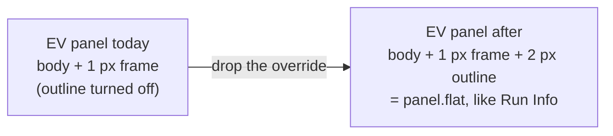

# 155c-2b: the EV panel gets the windows' outline (plan for Jess's OK, 2026-11-18, Quick)

Follow-up to 155c-2. No code here. A visible change (small): the EV screen's panel gains the 2 px dark outline every
other window has.
Goal: the EV panel looks like the other flat windows. Done when it shows panel.flat's whole look (body, frame and
outline) and nothing else on the EV screen moves. Test: your feel test; the look itself is already checked on the board.

## Parts

| Part | File and spot | Change |
| --- | --- | --- |
| A. Style | css/pause-menu.css, the .ev-panel rule (line 772) | Remove the one line that turns the outline off, and its comment. The panel then takes panel.flat as it is |
| B. Changelog | js/data/changelog.js, today's chg list | "The EV screen's panel now has the same dark outline as the other windows." |

## Decisions for Jess

| # | Question | Default |
| --- | --- | --- |
| 1 | The outline is drawn outside the panel (2 px each side, as on the others), so the panel looks 4 px wider and taller; nothing moves | Yes |

## Plan check

| | |
| --- | --- |
| Reuses | panel.flat as built in 155c-2 |
| New | Nothing |
| Not built | Any other EV screen change |
| Size | One line removed |

## Tests

| File | What | Why |
| --- | --- | --- |
| No new or changed harness, smoke, mutant, intent scenario or debug set | No smoke reads .ev-panel today (searched tools/). The panel.flat look is already checked on the board by smoke-ui-library ("a flat panel paints the body, frame and outline tokens"); the EV panel only takes that class | A one-line style change; the feel test covers it |
| node tools/check.js | Changelog still parses | Standard gate |

## Feel test (hard reload)
End a run with EVs to spend, choose Learn from the Loss: the EV panel has a dark outline like Run Info's; the rows, the
step buttons, Learn and Go Home sit where they did.

## As built (2026-11-18, Quick; approved)

Parts A and B as planned; no differences.
