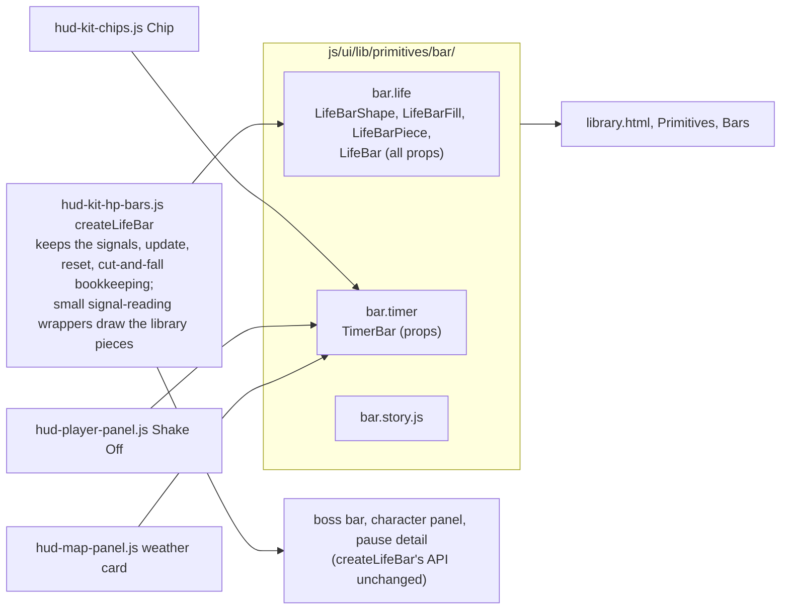

# #155 155c-3: Bars (plan for Jess's OK, 2026-11-18, Quick)

Follow-up to 155c and 155c-2. No code here.
Goal: the game's bars live in the library, take props only, and show on the board's Bars page in every state. Done when
the board draws them with no game scripts, and every screen that uses them looks and moves as before (the life bar's
cut-and-fall and heal growth included). Test: smoke-ui-library (new Bars checks), smoke-hud-overlay, smoke-pause-menu
and smoke-ui unchanged, your feel test.

## The bars in the game today

| Bar | Lives in | Used by | In this step |
| --- | --- | --- | --- |
| The B2 life bar: tab, "HP" label, dark track, a fill in the HP band colour, cut-and-fall pieces, heal growth | hud-kit-hp-bars.js `createLifeBar` (signals and a per-frame update) | Boss name bar, character info panel, pause Pokemon detail | Yes |
| A thin draining timer | Written out three times: hud-kit-chips.js (chip timers, 2 px white), hud-player-panel.js (Shake Off, 4 px white), hud-map-panel.js (weather card, 6 px two-tone, drains toward the screen edge) | Chips, Shake Off prompt, weather card | Yes (the third repeat) |
| The roster card's small HP fill | Inside RosterCard, stamped into the card's own shape | Run HUD roster, pause team cards | No: part of a composite (run.hud.teamSlot) |
| The EXP ring around the portrait | CSS conic gradient | Character panel, pause detail | No: a ring, not a bar (a later ring piece) |
| `.bar` in goals-ui.js and menu-pokedex.js | The old pre-fork menus | Goals, old Pokedex | No: those screens retire with #127 |

## What moves where

## What I found in the code

| Finding | Effect |
| --- | --- |
| createLifeBar is a controller (signals, update each frame, the falling pieces' list) wrapped around a view. Its view already reads each signal in a small child (Shape, Fill, Pieces), so a hit redraws only the fill | The library gets the view as props-only pieces; the kit keeps the controller and its three small wrappers, so the redraw stays as narrow as today (the STATE rule on signals) |
| The life bar's colours are all tokens already (color.hp.*, color.hud.*, the bar checker pattern) | No new colour tokens |
| `.hud-hp-label` (the italic HP label) is shared by the life bar and the roster card; its outline is a raw #101010 | It moves to bar.css with the outline token; bar.css loads on every page, so the roster card keeps it |
| The three timers each set their own size, colour and drain side; the smokes read their classes, the inline scaleX and the computed colours | TimerBar takes the fraction, height, colours and drain side as props and keeps each caller's class; the inline transform and the colours come out the same |
| No mutant matches a moved line (run-info-mutate targets pause-pokemon.js, which does not change) | No mutate file to update |

## Parts

| Part | Files and spot | Change |
| --- | --- | --- |
| A. Life bar | new js/ui/lib/primitives/bar/bar.js, bar.css | The span tables and the shape's rectangles, the track and label sizes, and four pieces: `LifeBarShape` (art width, art pixel), `LifeBarFill` (fill pixels, band, growing), `LifeBarPiece` (left, width, band, when it has fallen), and `LifeBar`, which draws them all from props (the board, new screens). A layout helper gives the track's left, inner width and right edge for an art width. CSS: .hud-lifebar, .hud-hp-label, the fill and piece rules and the fall keyframes (hud-overlay.css 73 to 117) |
| B. Timer bar | same files | `TimerBar`: fraction (0 to 1), height, a colour or a light / base pair (two rows), drains from the left or toward the right, place, class. CSS `.bar-timer` (position, origin); colours from the props (white is the token color.text.label) |
| C. Story | new js/ui/lib/primitives/bar/bar.story.js | The states below, placeholder values, place names |
| D. Life bar controller | js/ui/hud-kit-hp-bars.js createLifeBar | Keeps its signals, update(), reset() and rightEdge(); its Shape, Fill and Pieces wrappers read their signals and draw the library pieces. Its API and the three callers do not change. About 120 lines move out |
| E. Timer callers | hud-kit-chips.js (Chip), hud-player-panel.js (ShakePrompt), hud-map-panel.js (weather card); css/hud-overlay.css (.hud-chip-timer 270, .hud-prompt-timer 324, .hud-weather-timer 693) | Each draws TimerBar with its own numbers, colours and class; each CSS rule drops the lines TimerBar now sets (background, origin, height) and keeps its comment pointer |
| F. Loading | dev.html, tools/ui-library.html | bar.css with the library links, bar.js after square.js |
| G. Board | tools/library.html | Loads bar.js and the story; the Bars entry shows the page |
| H. smoke-ui-library | tools/smoke-ui-library.js | Bars checks (Tests below); the raw-colour check covers bar.css |
| I. Docs | UI Component Inventory.md, the 155 build plan | The two pieces' names and an as-built note |

## Stories

| Piece | States |
| --- | --- |
| `bar.life` | `high` (75%, green), `middle` (35%, yellow), `low` (10%, red), `empty` (fainted, no fill), `cut` (a hit just taken: the lost piece holds 1 s, then falls), `narrow` (the boss bar shrunk for a small window) |
| `bar.timer` | `chip` (2 px white, half left), `prompt` (4 px white, most left), `weather` (6 px two-tone, draining toward the right) |

## Decisions for Jess

| # | Question | Default |
| --- | --- | --- |
| 1 | Names. Jess named the squares by job (square.item), so: `bar.life` (the B2 HP bar) and `bar.timer` (a thin draining strip). By-look option: `bar.tabbed` and `bar.strip` | bar.life, bar.timer |
| 2 | The `cut` story plays its fall once when the page opens (the real piece's 1 s hold, then the fall); opening the page again replays it. No replay button | Yes |
| 3 | Out of this step: the roster card's HP fill (a composite), the EXP ring (a later ring piece), the old menus' `.bar` (retires with #127) | Out |
| 4 | Class names stay (hud-lifebar, hud-lifebar-fill, hud-lifebar-piece, hud-hp-label, hud-chip-timer, hud-prompt-timer, hud-weather-timer): the smokes read them. They join the class rename issue | Keep |

None of these change what the game does or shows.

## Plan check

| | |
| --- | --- |
| Reuses | The life bar's shape, fill, pieces and CSS, moved not rewritten; the HP band, HUD and text tokens; the bar checker pattern (155c-2); 155c's controller-plus-view split; the board's story table |
| New | The bar folder (two pieces, a story); TimerBar replaces three hand-written strips (the third real repeat) |
| Not built | See decision 3; also the life bar's numbers as tokens (they stay in bar.js's frozen table) |
| Where it lives | js/ui/lib/primitives/bar, drawing only; the cut-and-fall bookkeeping and the per-frame read stay in the kit, which owns the game's per-frame sync |
| Size | hud-kit-hp-bars.js about 335 to about 220; bar.js about 230; the three callers each lose a few lines. Nothing near 1000 |
| Touched-code cleanups | .hud-hp-label's raw #101010 becomes the outline token |

## Tests

| File | What | Why |
| --- | --- | --- |
| tools/smoke-ui-library.js (changed) | Every Bars state draws under its full name; the fill shrinks from high to middle to low, and empty has none; each fill's colour is its band's fill token; `cut` draws a lost piece; the bar's shape paints the bar checker fill; `narrow` is narrower than `high`; a timer's length follows its fraction; `weather` drains toward the right and paints its two token colours; the raw-colour check covers bar.css | The board half of done |
| Two deliberate breaks, run once and reverted | A raw hex in bar.css; a story with a state removed | Proves the checks catch them |
| tools/smoke-hud-overlay.js, smoke-pause-menu.js, smoke-ui.js (unchanged) | The boss bar's size, its pieces after a hit and its growth on a heal; the chips' timers; the Shake Off bar white, full, then draining; the weather timer's two colours; the pause detail fill | The game half: no visible change |
| No new harness, mutant, intent scenario or debug set | No game rule changes | |

## Risks

| Risk | Handling |
| --- | --- |
| A wrapper reads a signal one level too high and the whole bar redraws on every hit | The kit keeps one wrapper per signal group, as today; smoke-hud-overlay's piece and growth checks |
| The weather timer's gradient changes form, so its colours read differently | Same two colours in the same order; smoke-hud-overlay reads both rgb values |
| The pieces' fall no longer removes them | The piece still reports when its animation ends; smoke-hud-overlay counts pieces |

## Feel test (hard reload, save untouched)
Run: take a hit (the boss bar and yours cut, the piece holds then falls), heal (the fill grows), drop under half and a fifth
(yellow, red). A status chip's timer drains; the Shake Off bar drains; a weather card's timer runs toward the screen edge.
Pause menu: the Pokemon detail's life bar. The board's Bars page.

## As built (2026-11-18, Quick; approved as written)

| Part | Built |
| --- | --- |
| A, B | js/ui/lib/primitives/bar/bar.js (G.Lib.Bar): LIFE_BAR, lifeBarLayout, lifeBarFill, LifeBarShape, LifeBarLabel, LifeBarFill, LifeBarPiece, LifeBar, TimerBar. bar.css: the life bar, HP label (outline token) and fall rules; .bar-timer and .is-drain-right |
| C | bar.story.js (G.Lib.BarStories): bar.life high, middle, low, empty, cut, narrow; bar.timer chip, prompt, weather |
| D | hud-kit-hp-bars.js 335 to 246 lines: createLifeBar keeps its signals, update, reset, rightEdge; its Shape, Fill and Pieces wrappers draw the library pieces; the fill's pixels come from lifeBarFill (one home for the rounding). It also passes TimerBar on to the kit |
| E | hud-kit-chips.js Chip, hud-player-panel.js ShakePrompt, hud-map-panel.js weather card draw TimerBar with their own height, colours and class; their three CSS rules are gone (pointers left). hud-overlay.js KIT_NAMES lists TimerBar |
| F, G | dev.html and ui-library.html load bar.css and bar.js; the board's Bars page is live |
| H | smoke-ui-library: 9 Bars checks; the raw-colour check covers bar.css |

Checked from Quick: every file parses; the old and new life bars give identical trees through 40 steps (hits, heals, a
faint, a swap, a resize, four sizes and two art pixels); chip timers match the old ones once the class and the height and
colour that moved from CSS are allowed for; every story draws.

Differences from the plan: none in scope. TimerBar paints white from the color.text.label token by default.

