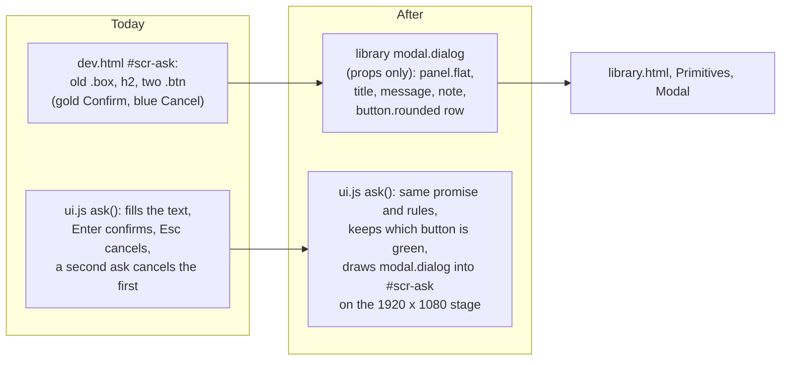

# #155 155c-4: Modal, the ask dialog in the pixel-art look (plan for Jess's OK, 2026-11-18, Quick)

Follow-up to 155c, 155c-2 and 155c-3. No code here. A visible change: every confirm in the game (G.UI.ask, 20 callers)
moves from the old pre-fork box and buttons to panel.flat and button.rounded.
Goal: a `modal.dialog` piece in the library, shown on the board in every state, and G.UI.ask drawing it. Done when the
board draws it with no game scripts, every ask in the game opens, answers and closes as today (plus the key rules
below), and the smokes that click through asks pass unchanged. Test: smoke-ui-library (new Modal checks), smoke-ui (one
new ask section), smoke-berry-slots and smoke-pause-menu unchanged, your feel test.

## Today and after

## What I found in the code

| Finding | Effect |
| --- | --- |
| G.UI.ask (js/ui/ui.js 92) is a promise around fixed markup in dev.html (#scr-ask with ids ask-title, ask-msg, ask-note, ask-ok, ask-no). Options used by the 20 callers: title, ok, cancel, note, noCancel | The options stay as they are; no caller changes |
| The smokes click #ask-ok and #ask-no, read #ask-msg, and check #scr-ask's hidden class; G.UI.isOpen('scr-ask') gates the menus' keys | Those ids and the section stay on the new elements |
| Sounds come from the page's click and hover wiring, which knows .btn, not the pixel buttons; Confirm plays 'confirm', Cancel 'click', hover 'hover' | ask plays the same three sounds itself |
| The longest button label is "Keep editing" (12 characters); "Sell Pokeball" (13) fits 186 px today | Both buttons 186 px (art width 62 at 3 px), as Sell |
| ui.js loads before the HUD kit, so its stage fit (fitToStage) is not there yet when ui.js runs | ask takes it from the kit the first time it opens |
| No mutant matches a line that changes (shop-screens-mutate's ui.js target is the SCREENS list; pokebox-evs-mutate's is a line in ev-screen.js) | No mutate file to update |

## Parts

| Part | Files and spot | Change |
| --- | --- | --- |
| A. Modal | new js/ui/lib/primitives/modal/modal.js, modal.css | `modal.dialog` (ModalDialog): a panel.flat box centred on the stage, title, message, optional note, a row of button.rounded (one or two); takes which button is green and calls back on press and hover. Props only. CSS from tokens: box width, padding, text sizes and colours, the button row |
| B. Story | new modal.story.js | The states below, placeholder text |
| C. ask | js/ui/ui.js ask() | Keeps the promise, the one-at-a-time rule and the Esc and Enter rules; adds the key rules in decision 2; keeps a "green" button (Confirm when it opens); plays the three sounds; draws ModalDialog into #scr-ask on a scaled stage. About 30 lines grow |
| D. Markup | dev.html #scr-ask (line 758) | The old box goes; the section keeps its id and classes, with one stage element for the dialog |
| E. Old style | css/style.css (.box.ask, .ask-msg, .ask-note, 3380 to 3390) | Removed; #scr-ask's layer rule stays |
| F. Loading | dev.html, tools/ui-library.html, tools/library.html | modal.css with the library links, modal.js after bar.js; the board loads the story; the Modal entry shows the page |
| G. Changelog | js/data/changelog.js, today's chg list | "Confirm windows now use the game's pixel-art look. Arrow keys pick the button, Enter or Space presses it, Esc cancels." |
| H. Docs | UI Component Inventory.md, the 155 build plan | modal.dialog's row and an as-built note |

## Stories

| State | Shows |
| --- | --- |
| `confirm` | Title, message, Confirm green, Cancel at rest |
| `withNote` | The Shop's buy ask: message and the "You will have" note |
| `cancelFocused` | Cancel green (after Right or a hover) |
| `notice` | One button (noCancel, the new-save notice) |
| `longMessage` | A message that wraps to three lines |

## Decisions for Jess

| # | Question | Default |
| --- | --- | --- |
| 1 | Name: `modal.dialog` (the sidebar entry is Modal) | modal.dialog |
| 2 | Keys and mouse, a behavior change. Today Enter always confirms and Esc cancels. Default, as the menu windows: the green button is the one Enter or Space presses; it opens on Confirm; Left and Right move it (hover sound); the mouse over a button makes it green; Esc still cancels. The other option keeps today's rule (Enter confirms whatever is green) and only adds Space | Green is what Enter presses |
| 3 | Look: the box is panel.flat 720 px wide; the title in Michroma (font.hudModule, the game talking), the message in the Shop's font at 27 px, the note at 20 px in color.text.secondary; buttons 186 px, 24 px apart | As listed |
| 4 | The page behind keeps today's dim (the blue-black radial wash), so nothing else changes with this step | Keep |
| 5 | No separate red Confirm for a destructive ask (Sell, Discard, Sign out) in this step; that needs a per-call option and joins the colour pass | Not now |

## Plan check

| | |
| --- | --- |
| Reuses | panel.flat, button.rounded and its focus rims, G.UI.ask's promise and options, the kit's fitToStage, the existing #scr-ask layer and dim, the board's story table |
| New | The modal folder (one piece, a story); ask's green-button state and its key handling |
| Not built | A red Confirm (decision 5), a dim in the pixel look (decision 4), inline asks like the pause menu's End and No (they are not dialogs), a fallback for a page where the library did not load (main.js's NEED check already stops the game there) |
| Where it lives | Drawing in js/ui/lib/primitives/modal; the asking (promise, keys, sounds) stays in ui.js, which owns G.UI.ask |
| Size | ui.js about 475 to about 505; modal.js about 80; dev.html loses about 9 lines |
| Touched-code cleanups | None |

## Tests

| File | What | Why |
| --- | --- | --- |
| tools/smoke-ui-library.js (changed) | Every Modal state draws under its full name; the box paints the panel.flat tokens; exactly one button is green and it draws color.rim.focus; `notice` has one button; title, message and note show; `longMessage` wraps; the raw-colour check covers modal.css | The board half of done |
| tools/smoke-ui.js (changed: one new section, "the ask dialog") | On the game page: Enter on a fresh ask resolves true; Right then Enter resolves false; Space resolves true; Esc resolves false; a second ask resolves the first false; noCancel shows one button; the #ask-* ids are on the new elements | Proves decision 2 and that ask's rules hold; no existing check covers keys inside the ask |
| Two deliberate breaks, run once and reverted | A raw hex in modal.css; Enter wired to always confirm | Proves both new check groups catch them |
| tools/smoke-berry-slots.js, smoke-pause-menu.js (unchanged) | They click Confirm and Cancel by id and read the message | The callers' half: every ask still opens, answers and closes |
| No new harness, mutant, intent scenario or debug set | No game rule changes | |

## Risks

| Risk | Handling |
| --- | --- |
| A smoke presses Enter in an ask after the mouse came to rest over Cancel | The smokes click the answer by id; the new smoke-ui section moves the mouse away first |
| An ask opens during a run (catch screen, EV screen) and the stage scale is not set yet | ask fits the stage each time it opens |
| The i18n observer rewrites the dialog's text | The text is the callers' own, as today; the dialog root keeps translate as the section has it |

## Feel test (hard reload, save untouched)
Shop: buy a TM, an item, a berry slot, a ball unlock (the note line); Left and Right move the green, Enter and Space
press it, Esc cancels, the mouse makes a button green. Team screen: Sell a Pokemon, leave with unsaved changes ("Keep
editing" fits). Catch screen: Let it go. EV screen: Go Home. A fresh save's notice (one button). The board's Modal page.

## As built (2026-11-18, Quick; approved as written)

| Part | Built |
| --- | --- |
| A, B | js/ui/lib/primitives/modal/ (modal.js G.Lib.Modal: MODAL_BUTTON, ModalDialog; modal.css; modal.story.js with the five states) |
| C | ui.js ask(): same promise, options and one-at-a-time rule; the green button, arrows, Enter or Space, Esc, hover; confirm, click and hover sounds; draws ModalDialog into #ask-stage, fitted with the kit's fitToStage once and refitted on each open |
| D, E | dev.html #scr-ask holds one #ask-stage (a pm-stage); style.css keeps only #scr-ask's layer |
| F | dev.html, ui-library.html, library.html load modal.css and modal.js; the board's Modal page |
| G | Changelog 2026-11-18 chg line |
| H | Inventory note; decision 2026-11-18-155-ask-dialog-keys and its index line |
| Tests | smoke-ui-library: 6 Modal checks. smoke-ui: new askFlow (keys, second ask, notice and ids), run after onboarding |

Differences from the plan: the ruling in decision 2 got its own decision file (it changes how every ask behaves).

