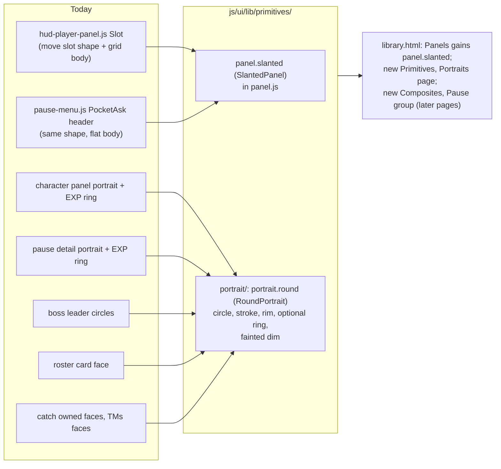

# #155 155c-5: panel.slanted and portrait.round (plan for Jess's OK, 2026-11-18, Quick)

Follow-up to 155c to 155c-4. No code here. No visible change intended.
Goal: the move slot frame and the round portrait live in the library, take props only, and show on the board; the
sidebar gains the Pause composite group Jess chose. Done when the board draws both pieces in every state with no game
scripts, and every screen that draws them looks as before. Test: smoke-ui-library (new checks), smoke-hud-overlay,
smoke-pause-menu, smoke-pause-inventory and smoke-ui unchanged, your feel test.

## What moves where

## What I found in the code

| Finding | Effect |
| --- | --- |
| The move slot shape (moveSlotRow, in button.js) is drawn as a non-pressable frame twice: the run HUD's move slots (type rim, slot grid body, flat body when empty) and the pause menu's "Destroy Items in Pocket?" header (white rim, flat body). SlantedButton is the third user | panel.slanted: the frame with a rim, a body and contents. SlantedButton keeps drawing its own (it is a button) |
| The round portrait is written six ways in five files: two 116 px faces with an EXP ring (character panel, pause detail), 48 px boss circles (4 px stroke, type rim when active, fainted dim, a swap flicker), 44 px roster faces (2 px stroke, fainted dim), and the catch and TMs owned faces (inset 4 px, 2 px light grey rim) | portrait.round takes size, stroke, rim colour, an optional ring (fraction and colours), fainted, and the picture. Each screen keeps its own state rules on top (boss active and flicker, the pause menu's shimmer, TMs chosen and hover) |
| The picture is the game's portrait file, picked by the kit's portraitSource (it knows which shinies have no portrait) | portrait.round takes the image source and the fallback as props; the kit keeps portraitSource. The board can show real portraits (assets/pokemon/25/Portrait.png exists) |
| The smokes read the portraits' classes (hud-portrait, hud-portrait-face, hud-exp-ring, hud-circle, hud-roster-face, catch-owned-face, shop-tms-face), the --exp and --ring-base variables, and .hud-slot | Every class and variable stays; the primitive adds one shared class beside each caller's |
| Raw colours in the moved rules: #101010 (outline), #00baf3 (EXP), #7f7f7f (track light), #c1c2c1 (the Normal type's light) | Become those tokens, same values |
| No mutant matches a line that changes (run-info-mutate targets pause-pokemon.js lines this step does not touch) | No mutate file to update |

## Parts

| Part | Files and spot | Change |
| --- | --- | --- |
| A. Slanted panel | js/ui/lib/primitives/panel/panel.js, panel.css | `panel.slanted` (SlantedPanel): the move slot frame at any art width, rows and art pixel; a rim ramp, a body (a colour or a pattern), contents, class and place. Uses button.js's moveSlotRow |
| B. Its callers | js/ui/hud-player-panel.js Slot (line 263); js/ui/pause-menu.js PocketAsk header (line 160) | Each draws SlantedPanel with its own size, rim, body and contents; classes hud-slot and pm-pocket-header stay |
| C. Portrait | new js/ui/lib/primitives/portrait/portrait.js, portrait.css, portrait.story.js | `portrait.round` (RoundPortrait): size, stroke, rim colour, ring ({ fraction, fill, track } or none), fainted, image source and fallback, class, place, contents (a cursor). CSS: the shared circle, stroke, background, crisp image, fainted dim, ring band, from tokens |
| D. Its callers | hud-player-panel.js Portrait; pause-pokemon.js detail portrait (line 558); hud-boss-panel.js Circles; hud-kit-hp-bars.js RosterCard face; catch-ui.js owned cells; shop-tms.js Face | Each draws RoundPortrait with its numbers and keeps its class; the kit passes RoundPortrait on (KIT_NAMES) |
| E. Screen CSS | css/hud-overlay.css (163 to 190, 108 to 146, 456 to 478), css/bw-catch.css (182 to 195), css/bw-shop.css (342 to 355) | The lines portrait.css now holds go; each screen keeps place, size and its own states (active rim, flicker, shimmer, chosen, hover) |
| F. Loading | dev.html, tools/ui-library.html | portrait.css and portrait.js after the panel files |
| G. Board | tools/library.html | Panels gains panel.slanted; a new Primitives, Portraits page; a new Composites, Pause group: `pause.pokemonDetail`, `pause.runInfo`, `pause.inventory`, each marked "later" |
| H. smoke-ui-library | tools/smoke-ui-library.js | New checks (Tests below); the mockup-entries list gains Portraits and the Pause group; the raw-colour check covers portrait.css |
| I. Docs | UI Component Inventory.md, the 155 build plan, the slice opening (the Pause group) | Names and as-built notes |

## Stories

| Piece | States |
| --- | --- |
| `panel.slanted` | `typeRim` (a move slot: Fire rim, slot grid body), `empty` (an empty slot: the dim rim, flat body), `header` (the pocket prompt: white rim, flat body, a line of text) |
| `portrait.round` | `exp` (116 px, EXP ring at 60%), `leader` (48 px, 4 px stroke), `leaderActive` (its type rim), `leaderFainted`, `roster` (44 px, 2 px stroke), `owned` (the catch and TMs faces, light grey rim), `shiny` (a shiny's portrait) |

## Decisions for Jess

| # | Question | Default |
| --- | --- | --- |
| 1 | Names: `panel.slanted` (the slanted frame, partner of button.slanted) and `portrait.round` | As listed |
| 2 | The EXP ring is a prop of portrait.round (a ring around the face), not its own primitive | Prop |
| 3 | The board shows real portraits (Pikachu, and its shiny) from assets/pokemon, not placeholders | Real portraits |
| 4 | The Pause group's three entries show on the sidebar now, as "later" pages, so the board's map matches your plan | Show now |
| 5 | Out of this step: the move slot's wells, key label and cooldown (they make run.hud.moveSlot, a composite); the boss bar's circles row; the bond pink rim (raw in hud-player-panel, a token in the colour pass) | Out |
| 6 | Class names stay (hud-slot, hud-portrait and the rest): the smokes read them | Keep |

None of these change what the game does or shows.

## Plan check

| | |
| --- | --- |
| Reuses | moveSlotRow, PixelShape, the slot grid pattern, the kit's portraitSource and fallback, the existing tokens, the board's story table |
| New | SlantedPanel; the portrait folder (one piece, a story); one sidebar page and one composite group |
| Not built | See decision 5; the composites themselves |
| Where it lives | js/ui/lib/primitives (drawing only); which portrait file to load stays in the kit |
| Size | panel.js about 368 to about 400; portrait.js about 70; each caller loses a few lines; hud-overlay.css loses about 60 lines. Nothing near 1000 |
| Touched-code cleanups | The moved rules' raw colours become tokens (same values) |

## Tests

| File | What | Why |
| --- | --- | --- |
| tools/smoke-ui-library.js (changed) | panel.slanted's states draw under their full names; `typeRim` paints the Fire ramp and the slot grid, `empty` and `header` a flat body. portrait.round's states draw; each portrait's size is the size asked for; `exp` draws a ring and the others none; the ring's colours are the EXP and track tokens; `leaderFainted` is darker than `leader`; each portrait's image loads. The sidebar holds Portraits and the Pause group | The board half of done |
| Two deliberate breaks, run once and reverted | A raw hex in portrait.css; a story with a state removed | Proves the checks catch them |
| smoke-hud-overlay, smoke-pause-menu, smoke-pause-inventory, smoke-ui (unchanged) | The character panel portrait and EXP ring, boss circles (active, fainted, flicker), roster faces, the move slots, the pause detail portrait, the pocket prompt, the catch and TMs faces | The game half: no visible change |
| No new harness, mutant, intent scenario or debug set | No game rule changes | |

## Risks

| Risk | Handling |
| --- | --- |
| The six portraits differ in small ways (inset, stroke, where the dim sits) and one shared rule shifts a pixel | Each size and stroke is a prop with the caller's current number; smoke-hud-overlay reads the circles' sizes and strokes |
| The boss circle's flicker or the pause menu's shimmer loses its target | Those rules stay in their screens' CSS on the same classes |
| A portrait image is missing on the board | The smoke checks each image loads |

## Feel test (hard reload, save untouched)
Run: the character panel portrait and EXP ring, the move slots (filled, empty, the active one), a gym leader's circles
(active, fainted, the swap flicker), the roster faces. Pause menu: the detail portrait, a fainted roster face, the
pocket prompt header. Catch screen and the Shop's TMs tab: the owned faces (chosen, hover). The board's Panels and
Portraits pages and the Pause group.

## As built (2026-11-18, Quick; approved as written)

| Part | Built |
| --- | --- |
| A | panel.js SlantedPanel (moveSlotRow under it); panel.css `.panel-slanted > svg` |
| B | hud-player-panel.js Slot and pause-menu.js PocketAsk draw SlantedPanel; `.hud-slot svg` and `.pm-pocket-header svg` rules gone; pause-menu no longer imports PixelShape or moveSlotRow |
| C | js/ui/lib/primitives/portrait/ (portrait.js G.Lib.Portrait: RING, RoundPortrait; portrait.css; portrait.story.js with 7 states and real Pikachu portraits) |
| D | The character panel and pause detail portraits (ring), boss circles, roster faces (hud-kit-hp-bars RosterCard), catch and TMs owned faces draw RoundPortrait; hud-kit.js passes SlantedPanel and RoundPortrait on; KIT_NAMES lists them |
| E | The moved portrait rules left hud-overlay.css, bw-catch.css and bw-shop.css; each screen keeps position and its own states (.hud-circle position, active rim, flicker and fade; the pause shimmer; TMs chosen and hover) |
| F, G | dev.html and ui-library.html load portrait.css and portrait.js; the board's Panels gains panel.slanted, a new Portraits page, and the Composites' Pause group |
| H | smoke-ui-library: 1 Panels check (slanted) and 5 Portraits checks; the sidebar list gains Portraits, Pause and pause.pokemonDetail |

Checked from Quick: every file parses; the old and new markup are the same for the move slots, the pocket header, the
roster card, the boss circles, both EXP portraits and the catch and TMs faces, once the library's own classes and
variables are set aside, and the sizes the CSS used to give are now written inline with the same values; the EXP ring's
angle is exact for every whole degree; every story draws.

Differences from the plan:
- A leader circle now has the panel body's dark colour behind its portrait (the other faces already did); it only
  shows while a portrait image is still loading.
- The fainted dim now comes from the face itself (a fainted prop) instead of the roster row's class; same look.
- The ring's filled angle keeps the variable name `--exp` (smoke-hud-overlay reads it).

