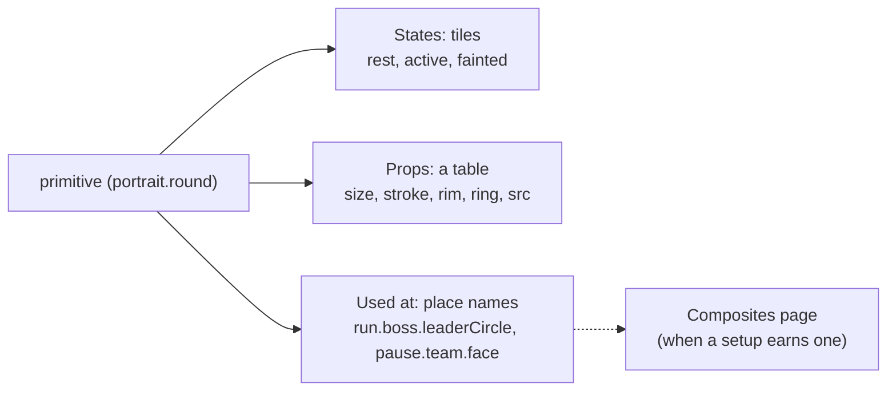

# 155c-6: Primitive States and Props (plan and as-built)

Jess, 2026-11-18: the primitive pages drew a tile for every place a screen uses a piece ("leader", "roster", "owned",
"exp"), so the board read as many primitives where there is one. Rule recorded in
docs/decisions/2026-11-18-155-primitive-states-vs-props.md.

## Tiles after

| Piece | States (tiles) | Old tiles that became props |
| --- | --- | --- |
| portrait.round | rest, active, fainted | leader, roster, owned (rim), exp (ring), shiny (src); size and stroke |
| button.slanted | rest, focusPositive, focusNegative | focused own rim, red at rest (rim, focusRim, focusBody) |
| button.rounded | rest, focusPositive, focusNegative, refused, refusedFocus, disabled | none |
| panel.pixel | rest, fainted | type and dualType (rim, rimRight), lightBody (body) |
| card.horizontal | filled, empty, dimmed | large (artWidth, artPixel), live (item.live) |
| bar.life | high, middle, low, empty, cut | narrow (artWidth) |
| bar.timer | rest | chip, prompt, weather (height, colour, light / base, drainsRight) |
| modal.dialog | focusConfirm, focusCancel | withNote (note), longMessage (message), a notice (buttons) |
| panel.slanted | rest | move slot, prompt (artWidth, artRows, artPixel, rim, body) |

Squares, panel.thin, panel.flat and card.vertical already fit. 34 tiles in all.

## Files (tools and board only; the game never loads them)

- js/ui/lib/primitives/*/\*.story.js: each story has `states` (tiles) and a new `props` list ({ name, values, does }).
- tools/library.html: each piece shows "States" (tiles) then "Props (a screen sets these)" as a table, then tokens,
  font, size, files and places as before.
- tools/smoke-ui-library.js: the six per-page checks became one `checkPrimitivePages` with a `PRIMITIVE_STATES` list;
  it fails on an extra or missing tile and on a piece with no props table, then checks what each state means (rims and
  fills are their tokens, refused is fainter and pressable, disabled is not, dimmed and fainted are fainter or darker,
  bands shrink and paint their token, a cut leaves a piece, a timer follows its fraction, one dialog button is green, a
  portrait is its size, takes its rim and loads).

Dropped checks (their tiles became props): dual-type blend, lighter body, narrow boss bar, weather timer's right end
and two colours, notice has one button, long message wraps, owned and ringed portraits. The game's own smokes
(smoke-hud-overlay, smoke-pause-menu, smoke-ui) still cover those setups where screens use them.

## As-built (2026-11-18, Quick)

Sandbox: every story draws (34 tiles), each piece's states match the smoke's list, every props table is filled, and
every class the smoke reads is drawn. Syntax checked for the six story files, the smoke and library.html. Untested in
a browser: Jess runs `npm run format`, `node tools/check.js` and `node tools/smoke-ui-library.js`.

Deliberate break for Jess: add a tile back to portrait.story.js (say `owned`) and rerun smoke-ui-library; it must fail
"exactly its states".
