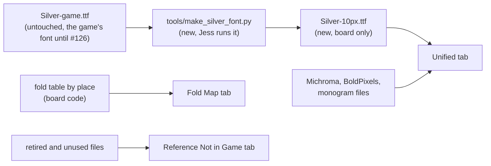
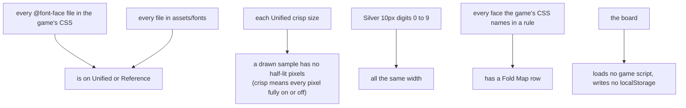
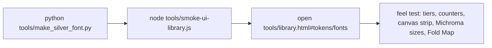

# 155e - Silver Re-grid and Fonts Board Plan (#155)

Scheme: docs/decisions/2026-11-18-155-font-scheme-three-tiers.md. Board only, like Colours: the game keeps loading
today's fonts until #126. Status: BUILT 2026-11-18 (Quick), untested: P1 new file, P2 to P4 as recommended.

## Opening (agree before build)

| | |
| --- | --- |
| Goal | A re-gridded Silver file exists, and Tokens, Fonts shows the three-tier scheme drawn in its real faces, plus where every font use today lands |
| Done when | (1) assets/fonts/Silver-10px.ttf is built by a tools script from Silver-game.ttf (untouched). (2) Fonts has three tabs: Unified, Fold Map, Reference Not in Game. (3) No game file changes, and the game loads no new file |
| Test | smoke-ui-library font checks (below), then Jess's feel test |

## Flow

## Part 1: the Silver patch (asset, needs your OK)

Model: tools/make_hud_font.py, which did the same job for Truth And Ideals.

| Change | From | To | Why |
| --- | --- | --- | --- |
| Units per em | 1900 (19 font pixels) | 1000 (10 font pixels); outlines not moved | Crisp at 10, 20, 30, 40, no size-adjust needed |
| Line metrics | 1200 up, 900 down, fixed by CSS overrides (67%, 19%) | 12 font pixels up, 3 down (P2) | Capitals (9 tall) stay centred like today, baseline on a whole pixel |
| Digit widths | 4 and 6 pixels | all 6; narrow digits get 1 pixel each side | Lv and HP stop twitching |
| Family name | Silver | "Silver 10px" | Never collides with the game's GameFont |

- Needs Python with fontTools, which Quick's runner lacks, so you run it once: `python tools/make_silver_font.py`.
- Silver is CC BY 4.0: changes allowed with credit; CREDITS.md gets one line for the modified file.
- At the same font size, Silver gets about 1.9x larger than raw Silver and matches today's GameFont at 27.1429 when set to 20.

## Part 2: the board (tools/library.html, free-edit)

| Tab | Shows |
| --- | --- |
| Unified | One card per tier: face, file, crisp sizes on screen and on the 2x canvas, what it covers, samples at each crisp size, a ticking counter (Silver's fixed digits), Michroma at candidate sizes 14, 18, 24, 32 for you to pick, a 2x canvas strip with a damage number at canvas 8 and a crit at canvas 16 |
| Fold Map | One row per text place today (pause menu buttons, roster names, timer, tooltips, Main Menu rows, Settings, damage numbers, ...): face and size today, tier, face and size it lands on, change. A tally per tier |
| Reference Not in Game | Truth And Ideals (both files), PokeBW, PixelifySans and PixelifyPS (credits only), Silver.ttf (source), Silver-game.ttf (until #126) |

The board declares the new faces itself (Silver 10px, monogram at its grid); tokens.js is untouched (its pokeBW and
michroma job text is backwards, left for #126 since both tokens go then).

## End-goal test (relations, not values)

Feel test: Tokens, Fonts. Read each tier's samples, watch the counters tick, compare the damage and crit strip, pick
Michroma's sizes, then scan the Fold Map for anything that lands wrong.

## Decisions needed

| # | Question | Recommend |
| --- | --- | --- |
| P1 | New file Silver-10px.ttf (game unchanged until #126), or overwrite Silver-game.ttf (the game changes now and its CSS sizes break) | New file |
| P2 | Line metrics 12 up, 3 down (line height 1.5 em, capitals centred as today) | Yes |
| P3 | Fold Map by place, a hand table of about 40 rows, or a scanner over all 243 CSS font rules | By place (KISS); the coverage check catches a face it misses |
| P4 | Fluid sizes (calc, clamp, vw) on pixel faces land on the nearest crisp size in the Fold Map | Yes; Michroma keeps fluid |

## Risks

- Michroma is about 1.5x wider than the pixel faces: the pause menu's 400 px box and Settings' paragraphs may not fit.
- monogram's and BoldPixels' line metrics are not whole font pixels (monogram ascent 10.66), so their baseline can land
  on a half pixel. The crisp-sample check will show it; the fix would be a metrics patch like Silver's.
- The game caps the canvas pixel ratio at 1.5, so on a display scaled to 125% or 150% no pixel face is crisp.
- smoke-ui-library still fails its Colours checks until its rewrite; the font checks sit beside them.

## As built (2026-11-18)

| Planned | Built |
| --- | --- |
| Silver patch | tools/make_silver_font.py: em 1900 to 1000, line metrics 1200 up / 300 down / no gap (hhea and OS/2), narrow digits padded evenly to the widest (6 pixels), family "Silver 10px", stale pixel-size tables (hdmx, LTSH, VDMX) dropped. Not run yet: needs fontTools |
| Credit | CREDITS.md "Font": one line for Silver 10px |
| Unified tab | FONT_TIERS in tools/library.html: one card per tier (face, file, crisp sizes on screen and canvas, covers, samples), ticking counters for Silver and BoldPixels, Michroma at 14, 18, 24, 32, the 2x canvas strip |
| Fold Map tab | FONT_FOLDS: 40 places by hand, grouped by tier plus "decided per call"; change computed (new face, size only, unchanged); 9 rows marked inferred |
| Reference tab | REFERENCE_FONTS: 8 files with the token they carry today and what each is |
| Board faces | Silver 10px, Monogram 16px (the token's Monogram face covers only weights 551 to 900), and the reference files with no token |
| Test | smoke-ui-library checkFontsPage: 6 checks, the relations above; board hooks libFontScheme, libSchemeFontsReady, libFontChecks |
| Not built | tokens.js and every game file (until #126); a CSS scanner for the Fold Map (P3) |

Found while building: monogram and BoldPixels both sit on 64 of 1024 units (16 per em) for every letter and digit,
so monogram's 16, 32, 48 is confirmed from the file. tools/library.html is now about 1,680 lines (over the
1,000-line review mark; a split is #129's call).

## Open from the build

- Move and stat tooltips land on Silver 20, the catch screen's look: about 36% larger than today's GameFont 20. The
  only smaller crisp step is 10 (one screen pixel per font pixel). Jess decides at the feel test (2026-11-18).
- The 9 inferred Fold Map rows (dialog text and buttons, inventory, pocket headers, search, Shop, FPS, wayfinding, "!").
