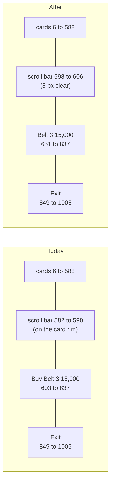

# Pokeballs tab: right card cut off (plan for Jess's OK, 2026-11-18, Quick)

Shop, Pokeballs tab (js/ui/shop-balls.js). No code here.
Goal: the right column's cards show whole, and the belt button is shorter. Done when the scroll bar clears the cards,
the belt button's label fits, and smoke-ui passes with the new layout check. Test: smoke-ui (two edits below), feel test.

## Cause
The card list box is 584 px wide; three cards and two gaps fill 582. The 8 px scroll bar sits on the box's right edge,
so it covers the third card's right rim. Team Items uses the same cards in a 600 px box, so its bar clears them.

## Bottom row today and after (pane pixels, 0 to 1005)

## Parts

| Part | File and spot | Change |
| --- | --- | --- |
| A. List box | js/ui/shop-balls.js, the sizes block (GRID) | Width 584 to 600, the Team Items sale box's width |
| B. Belt button | js/ui/shop-balls.js, BELT_BUY and the Pane's belt button | Label "Belt N price" (drops "Buy"); art width 78 to 62 (234 to 186 px, Sell's width); still 12 px left of Exit. Comments at the top of the file and on BELT_BUY follow |
| C. smoke-ui | tools/smoke-ui.js, the belt label check (about line 1782) and two comments | Expects "Belt N " instead of "Buy Belt N " |
| D. smoke-ui | tools/smoke-ui.js, the Pokeballs layout check (about line 1561) | New relations: the scroll track starts right of every card's right edge, and the belt button starts right of the track |
| E. Changelog | js/data/changelog.js, today | fix: the right column of ball cards is no longer cut off by the scroll bar; chg: the belt button reads "Belt N price"; chg: Shop button prices read 9k, 7.5k |
| F. Short prices | js/core/util.js `G.U.compact` (line 69) | Takes the size it starts shortening from. Default stays 10,000, so the pause menu's stats (91d P4) do not change |
| G. Shop buttons | js/ui/shop-balls.js, gacha-ui.js, shop-tms.js: the button labels only | Buy, Unlock, Belt, berry and team item slot Buy, TM Buy show the short price from 1,000 ("Buy 9k", "Unlock 15k", "Belt 2 10k"). The Spend asks, their "You will have" notes and the Sold toast keep the full number |
| H. Smokes | tools/smoke-ui.js `priceOn`; tools/smoke-berry-slots.js (the "Buy 9,000" and "Buy 23,000" checks) | priceOn reads "k". Coin checks compare coins spent with the real price from the data; label checks compare the label with G.U.compact of that price, not a typed string |
| I. Board story | js/ui/lib/primitives/button/button.story.js placeholders | "Buy 9k", "Buy 23k", so the board shows the new look |

## Decisions for Jess

| # | Question | Default |
| --- | --- | --- |
| 1 | The belt button's label drops "Buy" ("Belt 2 10,000"); the shop's other buttons keep their verb (Buy, Unlock, Sell) | Yes, your call |
| 2 | 186 px, the same as Sell, so the two line up. "Belt 3 15k" is 10 characters, so it fits with room | 186 |
| 3 | Where short prices apply: the Main Menu Shop's buttons only. Asks, notes and toasts keep the exact number; the coin counter, the in-run shop (shop-ui.js) and the pause menu stats stay as they are | Shop buttons only |
| 4 | Threshold: 1,000 and up shortens ("1k"); under 1,000 stays ("Buy 150") | 1,000 |
| 5 | One decimal, a trailing .0 dropped (G.U.compact's rule): 7,500 reads "7.5k", 10,000 "10k", 100,000 "100k", 1,000,000 "1M". A price like 1,250 would read "1.3k"; every Shop price today is a whole thousand, and the ask before buying shows the exact amount | One decimal |

## Plan check

| | |
| --- | --- |
| Reuses | Team Items' 600 px box width; Sell's width; G.U.compact (the k and M rule already in the game); smoke-ui's labels-fit and Exit-row checks |
| New | One parameter on G.U.compact (two real callers with different thresholds: pause stats 10,000, Shop buttons 1,000); one layout relation in smoke-ui |
| Not built | No change to the cards, gaps, belts, Sell or Exit; no short prices outside the Shop's buttons; no new formatting helper (the three files' own `fmt` stays for the full numbers) |
| Size | A few lines in util.js, shop-balls.js, gacha-ui.js, shop-tms.js and the two smokes |
| Risk | A smoke that read a typed price ("Buy 9,000") now reads the data's price, so it no longer breaks when prices are retuned |

## Feel test (hard reload, save untouched)
Pokeballs tab: the right cards show their whole rim at the top and after scrolling; "Belt 2 10k" fits its button; the
arrows still walk cards, belt button, Sell, Exit; buying a belt still asks with the full price. Team Items, Character
Upgrades and TMs: prices read "Buy 9k" style; Poke Ball still reads "Buy 150"; an unaffordable Buy still greys and toasts.

## As built (2026-11-18, Quick; approved as written)

| Part | Built |
| --- | --- |
| A, B | shop-balls.js: GRID width 600; BELT_BUY art width 62 (186 px); label "Belt N" + short price |
| F | G.U.compact(n, shortFrom = 10000); every existing caller passes one argument, so the pause stats are unchanged |
| G | shop-balls.js (Buy, Unlock, Belt), gacha-ui.js (item card Buy, pocket Buy), shop-tms.js (TM Buy) |
| H | smoke-ui: priceOn reads k and M; every label check compares the label with the game's own short form of the data's price, every coin check with the short form of the coins actually spent; the new bar-clears-cards and Buy-clears-bar relations. smoke-berry-slots: its two typed labels now read the next slot's price from the game |
| I | Story placeholders "Buy 9k", "Buy 23k" |
| E | Changelog 2026-11-18: two chg lines, one fix line |

Difference from the plan: the 1,000 threshold lives once, as G.MenuWindowKit.SHORT_PRICE_FROM, which all three Shop
files read (the plan did not name its home; three copies would have been three places to change).

Found, not in scope: the TMs tab (shop-tms.js GRID) uses the same 584 px list, so its third column is probably clipped
the same way.

