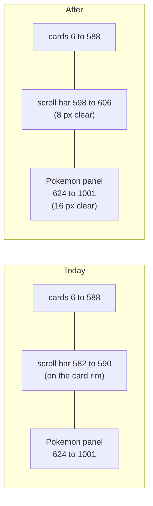

# TMs tab: right card cut off (plan for Jess's OK, 2026-11-18, Quick)

Shop, TMs tab (js/ui/shop-tms.js). Same cause as the Pokeballs tab (Pokeballs Tab Card Clip Fix Plan.md). No code here.
Goal: the TM cards' right column shows whole. Done when the scroll bar clears the cards and the Pokemon panel, and
smoke-ui passes with the new relation. Test: smoke-ui (one new check), feel test.

## Cause
The card list and its scroll box are 584 px wide; three cards and two gaps fill 582, and the 8 px bar sits on the box's
right edge, over the third card's rim.

## Today and after (pane pixels)

## Parts

| Part | File and spot | Change |
| --- | --- | --- |
| A. List box | js/ui/shop-tms.js, the sizes block (GRID, line 29) | Width 584 to 600, as the Pokeballs tab now and the Team Items sale side. Its comment says why |
| B. smoke-ui | tools/smoke-ui.js, the TMs tab section (by tmsNow) | New relations: the card list's scroll bar starts right of every TM card, and the Pokemon panel starts right of the bar |
| C. Changelog | js/data/changelog.js, the 2026-11-18 fix list | "TMs tab: the right column of TM cards is no longer cut off by the scroll bar." |

## Decisions for Jess

| # | Question | Default |
| --- | --- | --- |
| 1 | The search bar row above the cards stays as it is (its widths are its own: search 250, type filter, Able to Learn) | Keep |

No behavior changes; layout only.

## Plan check

| | |
| --- | --- |
| Reuses | The Pokeballs fix's width (600) and its smoke relation, the same way, on this tab |
| New | One smoke check |
| Not built | A shared card-list width in menu-window-kit: the Pokeballs and TMs grids now repeat it, Team Items holds it differently (a 600 side with a 584 box). Two real copies, so they stay copies until a third grid of this shape comes |
| Size | One number and a comment in shop-tms.js; about 15 lines in smoke-ui.js |
| Risk | The thumb's right edge (608) against the panel's rim (624): 16 px, checked by part B |

## Feel test (hard reload, save untouched)
TMs tab: the right TM cards show their whole rim at the top and after scrolling; the scroll bar drags; the Pokemon panel
is untouched; the arrows still move from the cards to the panel and back.

## As built (2026-11-18, Quick; approved as written)

| Part | Built |
| --- | --- |
| A | shop-tms.js GRID width 600, comment says why |
| B | smoke-ui, right after the first tmsNow: the bar starts right of every TM card, the Pokemon panel right of the bar |
| C | Changelog 2026-11-18 fix: the TM cards' right column |

No differences from the plan.

