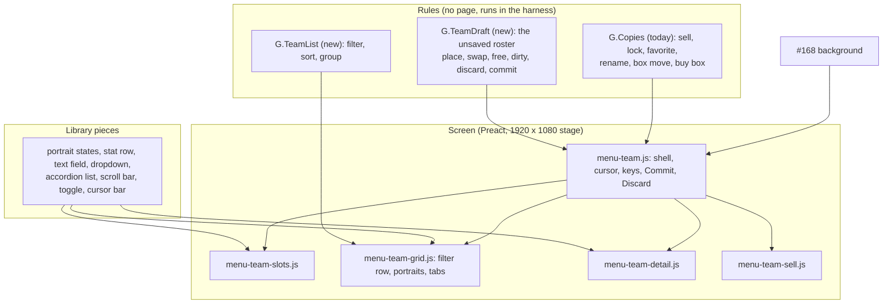

# 167 - Team Menu Slice A Plan

Goal, done-condition and end-goal test: on #167, agreed. Rules: decision
2026-11-23-97-139-team-menu-and-upgrade-popup-rulings. Sketch: assets/excalidraw/team-menu.excalidraw.
Stat rows: assets/screenshots/reference-for-team-menu.jpg. No code here.

## Shape

## Build order (one commit each, test first)

| # | Part | What changes |
|---|---|---|
| 1 | End-goal test | New docs/proposals/team-menu-harness.js, the four relations on #167, red first. New system, so a new harness |
| 2 | Rules | G.TeamDraft and G.TeamList in js/systems. Roster logic moves out of the screen; G.Copies stays the one home for sales, flags, names and boxes |
| 3 | Library pieces | The pieces in the diagram, each whole with every approved state |
| 4 | Screen, read only | Shell, counters, six slots, portrait grid, filter row, tabs, detail panel |
| 5 | Screen, acting | Place, swap, free, drag, keys, box moves, buy box, rename, lock, favorite, Commit, Discard |
| 6 | Sell | Single and bulk, as the sketch note |
| 7 | Swap over | Old screen markup, js/ui/menu-team-copies.js and the unused css/bw-team.css rules are removed |
| 8 | #168 | Mosaic as a library piece, its two settings, its own test; the tuning page uses the piece |

## What each area does

| Area | Behavior |
|---|---|
| Team slot | Pixel panel, portrait, name, type chips, lock and favorite toggles, Upgrade (opens today's popup until slice C). Team N header is drawn and does nothing |
| Grid | Portraits only, 8 x 6 shown, scrolls. Team members show their slot number, all show lock and favorite |
| Tabs | Pokedex and boxes under the grid, price tabs for locked boxes. Dropping a copy on a tab moves it |
| Detail | Name and rename pencil, level, types, stat rows with nature arrows or the hex (CRT flip), nature, ability, starting move, Moves (opens the learnset) |
| Save | Everything at once, except the roster (Commit). Esc steps back one thing, then discards with a toast |

## Where the edges are

- **Reuses:** createMenuCursor and CursorButton (menu-window-kit), fitToStage, ScrollBox, G.UI.ask, G.MoveInfo,
  G.StatChart, G.Copies, the species filter in menu-dex-grid.js (the Pokedex screen keeps it).
- **Not built:** XP bar, Level Up, EXP Bag (slice B); the new Upgrade popup and starting move picks (slice C, #150);
  Evolve (space only); Team N; friendship, fatigue, use-item; Select repeats.
- **Save:** no new save fields, so old saves load unchanged.
- **Files:** every new screen file stays well under 1000 lines. New files need a dev.html entry and a NEED entry.
- **Touched-code cleanups:** menu-upgrades.js reads the roster from G.TeamDraft instead of the old screen; smoke-ui.js
  follows the new screen; the `ros` names go with the old files.

## Assumptions (say so if wrong)

- The base stat number is the plain base stat until slice C adds upgrades to it.
- The selected portrait and the cursor use yellow.base (the library's approved look).
- Double-click places in the highlighted slot; right-click frees a slot; moving slot 1 always swaps, never empties it.
- Keys typed into Search or Rename never reach the menu.
- The field, dropdown, scroll bar and toggle looks are the ones approved with main.shop.tms.
- The sell dialog keeps today's warnings (EVs lost, TMs lost, last copy, favorite).
- The starburst is built and tested in #168, and first plays in slice B, when Level Up exists.

## Risks

| Risk | Guard |
|---|---|
| 500 portraits in one box make the grid slow | Lazy images, lists computed once per change, checked with a full box of 500 |
| A roster edit and an instant save disagree | Sales take the unsaved roster as protected; harness covers both orders |
| Mosaic frame cost at 1440p | Part 8 is measured with the GPU on, before it is called done |

## Answered

All six questions: decision 2026-11-23-167-slice-a-plan-rulings. Plan approved by Jess, 2026-11-23.
