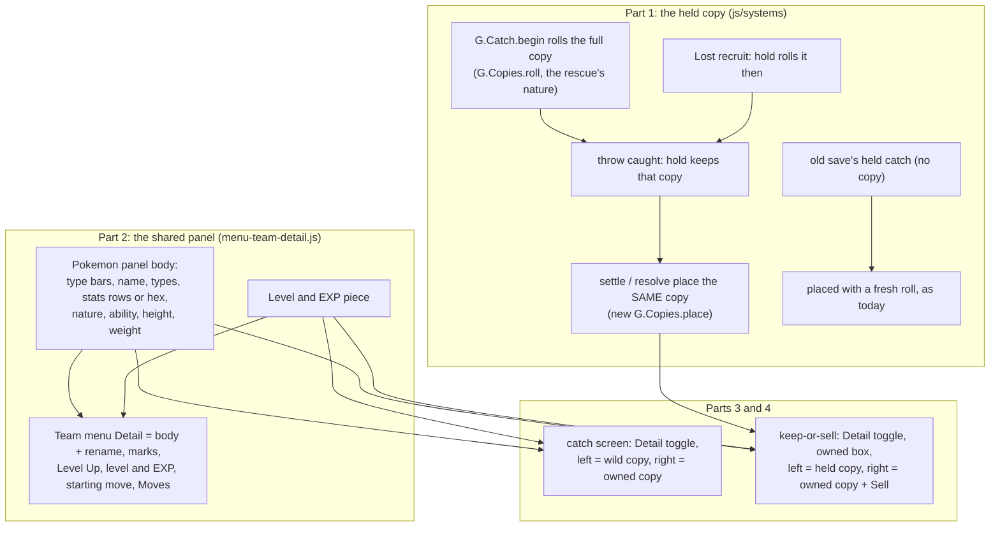

# 173 - Held Catch Compare Plan (2026-11-27, BUILT, awaiting feel test)

Opening (goal, done, test): `173 - Held Catch Compare Slice Opening.md`, agreed by Jess 2026-11-27. Rulings: decisions
2026-11-27-173-held-catch-fully-rolled-and-owned-box and 2026-11-27-173-mockup-short-detail-panels. Mockups: this folder.
No code here. Decisions answered at the end.

## The shape

## Part 1: a held catch is a whole copy (js/systems/catch.js, js/systems/copies.js)

| | |
|---|---|
| What changes | `begin` rolls the wild Pokemon's compact copy once, with the rescue's nature, and keeps it on the session. A caught throw holds that copy. `hold` (the Lost recruit's path) rolls one when the Pokemon it gets has none. A flee or Let It Go drops the session, so its roll goes with it. `settle` and `resolve` place the held copy as it is. A held catch with no copy (an old save) goes through `G.DB.obtain` as today. |
| Held entry | keeps dex, name, nature and natureName as now (the list's row and the notices read them), plus the compact copy. The save's `heldCatches` grows by that one field; old entries lack it and stay valid. |
| Reuses | `G.Copies.roll` (unchanged), `G.Copies.freeBox`, `G.Copies.read` (the screens read the compact copy into full field names), `G.DB.obtain`'s Pokedex bookkeeping. |
| New | `G.Copies.place(save, compact)`: puts an already rolled copy in the first box with room (the same box choice as `add`, which then calls it). `G.DB.obtain` gains an optional ready copy: given one, it places that copy instead of rolling, and keeps every other step (Pokedex record, sold on arrival when full). Nothing existing places a ready copy. |
| Save safety | an old held catch without a copy is placed with a fresh roll; a held copy is checked on load like a box copy (the same `G.Copies.clean` range clamps, run over the held list), so a hand-edited save cannot place a bad one. |
| Size | catch.js about +20 lines, copies.js about +10, db.js about +5. |

## Part 2: the Team detail panel, split into shared pieces (js/ui/menu-team-detail.js)

The panel's Pokemon data is already read live. What ties it to the Team menu is the wiring: the cursor, the selected
slot, rename, Level Up, the Moves popup, the layout and the Hex state all come from the Team menu's state object.

| | |
|---|---|
| What changes | The panel body (type bars, name text, type chips, the stats box with its Hex toggle, nature, ability, height and weight rows) becomes its own component. It takes the copy itself (a full copy, not a UUID to look up), the species, the panel's size, the Hex state and its toggle, the cursor, and a slot for the caller's extra pieces. The level line with its EXP bar becomes a small piece too. The Team menu's Detail is then the body plus its own extras, so it looks and works as now. |
| Why a slot, not switches | each screen adds different things (Team: rename, marks, Level Up, starting move, Moves; owned copy: level, EXP, marks, Sell; catch: nothing). One body that takes the caller's extras avoids a list of on/off switches (coding principles: a helper needing several flags is worse than copies). |
| A catch's panel | a copy that is not in the save (wild or held) shows its own IVs, nature, ability and size; its EVs are zero, so the EV part of each stat row shows empty. A held catch from an old save (no copy) shows the species view (abilities listed, no nature), the panel's existing path for a copy it does not have. |
| Reuses | everything already in the file: TypeBar, StatRows, StatHex, the CRT switch, InfoRow, MarkToggle's look, lib.Bar.ExpBar, G.Candy for the level. The panels' CSS stays team-menu.css's. |
| Not built | rename, Level Up, the EXP Bag's candy drop, the starting move and Moves on the new panels (the mockup leaves them out). |
| Size | menu-team-detail.js stays about 400 lines (moved, not added). menu-team.js unchanged except where it hands the panel its copy. |
| Risk | this is the part that can break the Team menu. smoke-pause-menu.js and smoke-team-menu-keys.js must still pass their detail checks (the #170 failures aside), and Jess's feel test covers the Team menu too. |

## Part 3: the catch screen (js/ui/catch-ui.js, css/bw-catch.css)

| | |
|---|---|
| Detail toggle | a power toggle under "with a {ball}" in the Pokemon panel. On, the left panel shows the wild copy. Remembered per device: new setting `catchDetail` in G.Settings (off by default). |
| Owned faces | the hover tooltip goes (its `ownedTooltip` and `STAT_ORDER` are removed). The cursor resting on a face (keys or mouse) previews that copy's panel on the right: body plus level, EXP bar, favorite and lock (see decision 2). A click, Enter or Space pins it: the panel stays after the cursor leaves the box (decision 4). |
| Hex | each panel's Hex toggle is this screen's own, remembered: setting `catchHex`, one value for both of this screen's panels, off by default. |
| Keys | the cursor already moves into the owned box. Right from the box's last column goes to the owned panel's Hex; Left from the belts' first column, when the left panel is open, goes to its Hex. Enter on Throw, the belts and Let It Go are unchanged; the 1 to 6 keys still throw. |
| Space | beside the 980 px window there is 470 px a side; the Team panel is 549 px wide (decision 3). |
| Reuses | the screen's focus model, OwnedGrid, inputMode, PowerToggle, the shared panel. |
| Size | catch-ui.js 671 to about 760 lines. |

## Part 4: keep-or-sell (js/ui/keep-sell-ui.js, css/bw-keep-sell.css)

| | |
|---|---|
| Window | widens to hold the owned box right of the list (4 x 4 faces of 48 px, scrolling past 16, the catch screen's grid look); the list itself scrolls past five rows (it overflows today with six or more). Rows keep portrait, name, stars, price and the Keep or Sell toggle. |
| Owned box | the selected row's species, every copy owned (team copies included), best IV + EV total first as on the catch screen; "None owned yet" when empty; it follows the row. |
| Detail toggle | beside Make Room; on, the left panel shows the selected row's held copy and follows the row. Setting `keepSellDetail`, off by default. Hex: setting `keepSellHex`. |
| Owned panel | the same preview and pin as the catch screen, plus a Sell button. Sell asks first (G.UI.ask, the Team menu's warnings: favorite, EVs, candy levels, learned TMs, last of its species), refuses a locked copy ("Unlock it first."), and on a sale saves, refreshes the coins, rebuilds the owned box, counts the free places again and raises the Keep counter's room. |
| Team copies | refused, as in the Team menu (decision 1): "Remove it from your team first." (G.TeamDraft.sellRefusal's wording). |
| Cursor | the menu cursor's eligible list gains the Detail toggle, the owned faces, the panels' Hex toggles and Sell. Arrows between the list, the box and the panels follow the screen's layout. |
| Reuses | the sell warnings: moved from menu-team-sell.js into a shared function there (two callers now, one home for the wording); `G.Copies.sell` with the team rule handled per decision 1; G.UI.ask; the free-place count `reopen` already does. |
| Size | keep-sell-ui.js 287 to about 430 lines. |

## Tests (written first, from the opening)

| Where | Checks (relations only) |
|---|---|
| docs/proposals/keep-sell-harness.js | a held catch has every compact field in range; Keep places the same UUID, nature, ability, IVs, gender and scales; Sell leaves no copy with that UUID; two held catches of one species differ in UUID; an old held catch (no copy) still places and sells; a Lost recruit is held with a copy; a rescue's copy keeps the rescue's nature; the copy placed after a catch is the one rolled when the window opened (rescue-harness's catch path). |
| tools/smoke-keep-sell.js | the owned box lists exactly the owned copies of the selected row's species and changes with the selection; Enter on a face opens its panel naming nature and ability; Detail opens the held copy's panel and it follows the row; selling an unlocked owned copy removes it and raises the free places; a locked one is refused; reopening keeps Detail as left. |
| tools/smoke-catch-detail.js (new) | Detail shows the wild copy's nature and ability; hovering a face previews its panel, Enter pins it, no tooltip shows; Hex flips only this screen's setting. smoke-ui.js keeps its catch checks (its 15 old failures are outside this slice). |
| Team menu | smoke-pause-menu.js and smoke-team-menu-keys.js detail checks unchanged and passing. |

`node tools/check.js` clean, `npm run format`, then Jess feel-tests: a catch with Detail, a run ending full with the
keep-or-sell list, an owned sale, and the Team menu's detail panel.

## Not built
Shiny catches and Lost shinies (#174). Moving copies between boxes from these screens. Bulk sell here. A Settings
screen entry for the four new settings (they are remembered silently; an issue if Jess wants them listed).

## Decisions answered (Jess, 2026-11-27; decision 2026-11-27-173-mockup-short-detail-panels)
1. Team copies are NOT sold from keep-or-sell, the same as the Team menu ("Remove it from your team first."). This
   replaces the earlier yes; Part 4's "Team copies" row now refuses them.
2. The favorite and lock marks on the owned panel switch, as in the Team menu (saved at once). The flip-and-save step
   moves from menu-team.js into one shared function (its third caller), used by the Team menu and both screens.
3. The catch window narrows from 980 to 920 px (the Pokemon panel 340 to 280) and the side panels draw at 88 percent
   (549 to about 483 px), so each fits its 500 px side. Designed for a maximized 1920 x 1080 window only; other sizes
   are later polish, no issue.
4. Hovering another face previews it; the pin comes back when the cursor leaves. Pressing the pinned face again
   unpins it; pressing another face pins that one. Esc with a face pinned unpins it first; only the next Esc does
   the screen's usual thing (Let It Go on the catch screen, Confirm on keep-or-sell).

Risk added by 2: a mark switched on the catch screen saves mid-run (G.DB.commit), as the pause menu's own saves do.

## Built (2026-11-27, home), where it differs from the plan
| Item | Plan | Built, and why |
|---|---|---|
| Catch window | 920 px, Pokemon panel 280, panels 88% | 948 px: the Pokemon panel needs 320 px ("with a Great Ball" is 280 px of Silver 30) and the belts-to-owned gap went from 28 to 16 px; panels at 85% with a 10 px gap. Decision file updated. |
| Keep-or-sell window | widens | 948 x 600, the same width as the catch window, so its panels sit the same way; list rows 600 px wide. |
| Rarity name | | the panel footer's rarity now goes through G.T: both new screens are translate="no", so it showed in Spanish. |
| Selected row | | a signal set after each draw (the cursor asks for its items, which need the row: reading the cursor there looped). |
| Sell dialog | shared warnings | G.MenuTeamSell.askToSell (the whole one-copy dialog), used by the Team menu and keep-or-sell. |
| Sizes | catch-ui about 760, keep-sell-ui about 430 | 815 and 595 after formatting; menu-team-detail 460. All under 1000. |

Tests: keep-sell-harness 13 sections (6 new), smoke-keep-sell (#173 part added), new tools/smoke-catch-detail.js.
