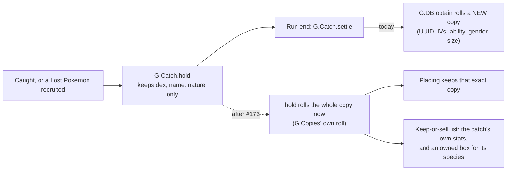

# 173 - Held Catch Compare Slice Opening (child of #128, follow-up to #146, 2026-11-27, PROPOSED)

Branch feature/138-146-lost-and-full-box. Rulings: decision 2026-11-27-173-held-catch-fully-rolled-and-owned-box.
Opening only: goal, done, test, and the open decisions. The prose build plan follows once these are agreed.

## What the code does today vs the slice

| Part | Today | After #173 |
|---|---|---|
| Held catch | dex, name, nature | a full compact copy (the save's box shape) |
| Placing | rolls everything but the nature | places the held copy as it is |
| Keep-or-sell row | portrait, nature and name, rarity stars, price | the same, plus its own tooltip (open decision 2) |
| Comparison | none | an owned box beside the list for the selected row's species, a tooltip per copy |
| Old saves | | a held catch saved before #173 has no roll: it rolls when placed, as today |

## Goal
Before choosing Keep or Sell, the player can see a held catch's own rolls and compare them with the copies of that
species they already own.

## Done when
- A held catch carries its whole roll from the moment it is held (catch and Lost recruit alike); placing it keeps the
  same UUID, nature, ability, IVs, gender, height and weight.
- Both screens (mockups in this folder) have a Detail toggle (remembered) that opens a short detail panel on the left
  for the wild or held catch: name, gender, types, the six stat rows (IV plus EV, the EV part empty) or the hex,
  nature, ability, size. On keep-or-sell it follows the selected row.
- The keep-or-sell list shows a small owned box for the selected row's species (every copy you own of it, team copies
  included, scrolling past 16); it follows the selection, and shows an empty state when you own none.
- Hovering a face in either owned box previews a short detail panel on the right (adds out-of-run level, EXP bar,
  favorite and lock); a click, Enter or Space keeps it open. The catch screen's hover tooltip is gone.
- On keep-or-sell, the owned panel's Sell asks first, follows the Team menu's lock and favorite rules, and frees a
  slot (Keep N rises).
- The Team menu's own detail panel looks and works as before.
- An old save's held catches still place and sell; the #146 harness and smoke still pass; check.js clean; Jess feel-tests.

## End-goal test (written first)
Harness (extends docs/proposals/keep-sell-harness.js), relations only:
- a held catch has every field a box copy has, and its IVs, nature, ability, gender and scales are in range;
- after Keep, the placed copy equals the held one field for field (same UUID); after Sell, no copy with that UUID exists;
- two held catches of one species roll independently of each other (their UUIDs differ);
- a held catch without a roll (an old save) still places, with a fresh roll, and still sells;
- a Lost Pokemon recruit is held with a full roll, same as a catch.
Smoke (extends tools/smoke-keep-sell.js): fill the boxes with copies of one species, end a run holding that species
and another; the owned box lists exactly the owned copies of the selected row's species and changes when the
selection moves; Enter on a face opens the owned panel naming its nature and ability; Detail opens the held catch's
panel and it follows the row; selling an unlocked owned copy removes it and raises Keep N, a locked one refuses.
The Team menu smoke (tools/smoke-pause-menu.js) still passes its detail panel checks (known #170 failures aside).
Mockup rulings: decision 2026-11-27-173-mockup-short-detail-panels.

## Answered 2026-11-27 (decision 2026-11-27-173-held-catch-fully-rolled-and-owned-box)
1. The roll is made when the catch window opens (the rescue keeps its nature); a flee or Let It Go discards it. A Lost
   recruit rolls when held.
2. and 3. (the catch's own rolls in its row, the tooltip contents): decided on the sketch.
4. The selection cursor moves into the owned box, as on the catch screen.
6. The roll exists before you throw so BOTH screens show it: the catch screen shows the wild Pokemon's rolls, and the
   keep-or-sell list shows the held catch's. Jess mocks up both. The owned box includes team copies. Shiny: #174.
5. Sketched on the UI library board first; Jess may draft an Excalidraw mockup before that.

What this adds to the test: the harness checks that a rescue's rolled copy keeps the rescue's nature, and that the
copy placed after a catch is the one rolled when the window opened. The smoke moves the cursor into the owned box by keys.

## Next
Jess agrees goal, done and test at the next session start, and drafts the mockup for both screens (save it in this
folder). Then the board sketch (catch.window shows the rolls; main.keepOrSell gains the owned box), then the plan.

## Open decisions (as asked)
1. When is the roll made: when the ball catches it, or when the catch window opens (the catch screen could then show
   the wild Pokemon's own rolls before you throw; one that flees takes its roll with it)?
2. The held catch's own rolls in the list: a tooltip on its row (same look as the owned copies'), or a stats line in
   the row itself?
3. Tooltip contents: the catch screen's owned tooltip shows name, gender, box, then IV + EV per stat. Add nature,
   ability (hidden marked), height and weight to it on both screens, or only on the keep-or-sell list?
4. Keys: can the selection cursor move into the owned box (as on the catch screen), or does the box follow the
   selected row with its faces hoverable by mouse only?
5. Look: sketch it on the UI library board first (as #146 was), or build from the catch screen's existing owned panel?
