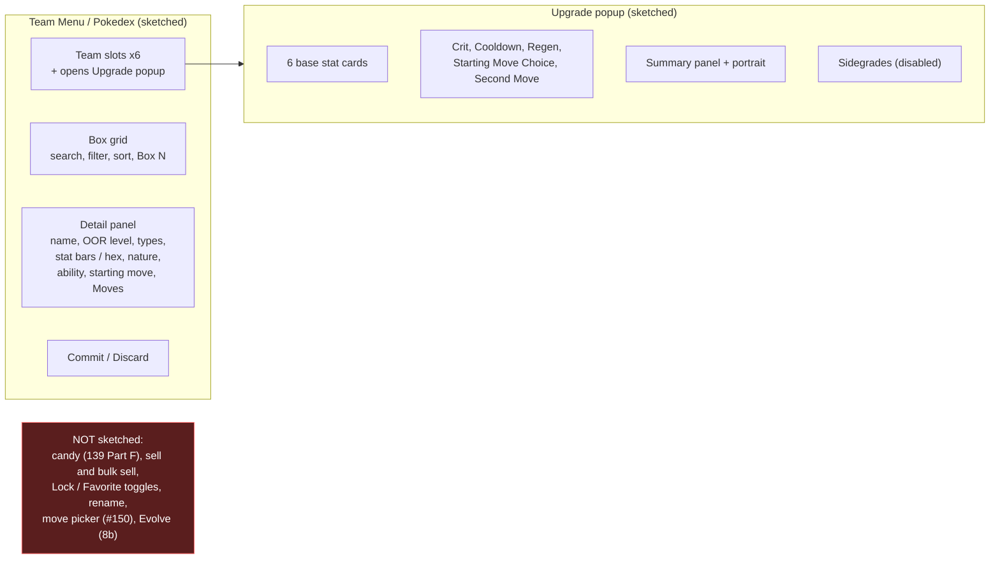
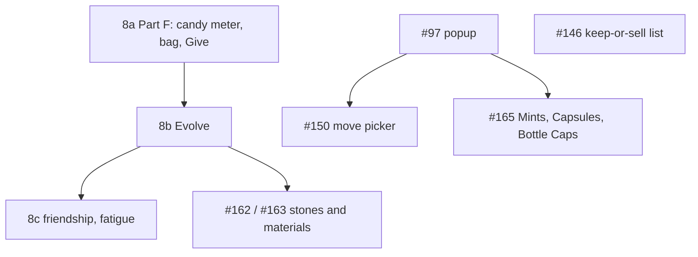

# 97-139 - Team Menu Sketch Gap Review (2026-11-23)

Reviewed: assets/excalidraw/team-menu.excalidraw and assets/excalidraw/poke-upgrade.excalidraw, against
"97 - Upgrade System Design.md", "139a - Candy Build Plan.md" (Part F) and "139 - Candy and Evolution Slice Opening.md"
(8b, 8c). No code. Questions are listed at the end, with no default.

## Resolved (Jess, 2026-11-23)

The nine questions and the gaps below are answered by decision 2026-11-23-97-139-team-menu-and-upgrade-popup-rulings. The rest of this file is the first review, kept as history.

## What the sketches cover

## #139 Part F: missing entirely

Nothing for candy appears in either sketch. Part F needs:

| Element | Rule it serves | Notes |
|---|---|---|
| OOR XP bar to the next level | 139a "Meter" [Approved] | The sketch puts the OOR level where the HP bar was, but has no bar |
| Evolution tick on that bar | 139a "Meter" | Shown at the next level-based evolution; none when there is none |
| Candy bag counts (XS, S, M, L, XL) | Part F "bag counts sit in the same panel" | Five icon and count pairs |
| Size picker | Part F | Picks which size Give uses |
| Give button (one per press, hold repeats) | 139a | Needs a held-repeat behavior on the button piece |
| Give until [level] input | 139a [Approved], control [Open] | The plan suggests a level stepper made from the button piece |
| Refusal and result feedback | C5 (refused only at OOR 100), bag empty reports the level reached | Toasts, plus a disabled Give at 100 |

The detail panel has no free space for this as drawn (the stats box takes 338 px), so the candy controls need a place.

## #97 Upgrade popup: gaps in what is sketched

| Gap | Why it matters |
|---|---|
| No price on the buy buttons | Prices scale by BST stars and level; the player must see the cost before buying |
| PokeCoins balance not shown in the popup | The team menu header shows it, but the popup dims the screen around it |
| Pips have two states (bought, empty); the bands need a third (locked until OOR band) | Caps rise at OOR 1, 10, 20, 40, 80 |
| Disabled (capped by OOR) has no reason text | For example "Opens at OOR level 20" |
| No max state | A fully bought card needs a "Max" look, distinct from capped by band |
| Pip counts drawn: HP 10, the other five stats 5 | Design: every base stat has 10 levels |
| Names: "Cooldown++" and "Bench Regeneration++" | Design names them Reflexes and Synthesis |
| Cooldown text says "Increases attack cooldown" | It cuts move cooldowns by 2% a level |
| Shedinja HP greyed "no effect" state | Design (acquisition F2b) |
| Starting Move Choice and Second Move open nothing | The #150 picker has no sketch; it also needs the learnset by OOR level (a later rebake) |
| Summary "Base +%% -> New Base" | Unclear whether "New Base" previews the next purchase (hover) or shows the current total |
| No close button label | The bottom right button is unlabeled (neutral) |

## Team menu: today's features the sketch drops

Today's screen (js/ui/menu-team-copies.js) has these; the sketch has no control for them:

| Feature | Today | In the sketch |
|---|---|---|
| Sell one copy | Gold "Sell for N" with a reason when it cannot | Missing |
| Bulk sell | Select mode, tick cells, "Sell N for X" | Missing (the grid has no tick state) |
| Lock / Favorite | Toggle buttons | Shown as icons in the name bar; no toggle |
| Rename | Nickname edit | Name shown; no edit control |
| Add to or remove from the team | Today's team editing | No drag or button drawn for moving a copy between grid and slots |
| Upgrade a box copy | | The `+` is only on team slots; a box copy has no way in |
| Grid cell states | On team, locked, favorite, ticked | Not drawn |

Also unspecified: what the "Pokedex" entry in the Box N dropdown shows (uncaught species, silhouettes?), the empty box
state, and the background animation (already noted as needing a talk).

## Looking ahead: the rest of #139 and its neighbors

| Coming | UI it will need | Sketch status |
|---|---|---|
| 8b Evolve | Evolve button; "ready to evolve" badge on grid cell and team slot; evolve popup (before and after, confirm, animation); branch pick popup (Eevee and others) | None |
| 8b non-level evolutions | A requirement line in the detail panel ("Needs a Fire Stone", "Friendship", "Trade") since candy does not apply (D8) | None |
| 8c friendship | A friendship readout (0 to 255) on the copy | None |
| #161 fatigue | A fatigue % readout on the copy, and on team slots before a run | None |
| #162 / #163 stones | Stones held on the save; a "use on this copy" action from the Team menu | None |
| #165 Mints, Capsules, Bottle Caps | A "use item" action on the copy (Nature, Ability rows are natural homes); Bottle Caps locked under OOR 50 | None |
| #150 picker | Move list popup with learn level and egg-move unlock | None |
| #146 keep-or-sell | End-of-run list; can reuse the grid cell and the box capacity counter | Separate screen, none |
| #164 sidegrades | Behind the disabled button | Deferred, fine |

## Questions for Jess (asked plainly)

1. Where do the candy controls live: in the detail panel, in their own popup like Upgrade, or as a tab of the Upgrade
   popup?
2. Give until's input: a level stepper, a typed number, or something else?
3. How does a box copy (not on the team) reach the Upgrade popup?
4. Where do Sell, bulk sell, Lock, Favorite and Rename go?
5. How does a copy move between the grid and the team slots?
6. Do upgrade purchases save at once (like selling today), or wait for Commit, so Discard could undo them?
7. What does the summary's "New Base" show: the current total, or a preview of the next purchase on hover?
8. What does the "Pokedex" entry in the Box dropdown show?
9. Should Evolve, friendship and fatigue get space reserved now, or be sketched when 8b and 8c open?
