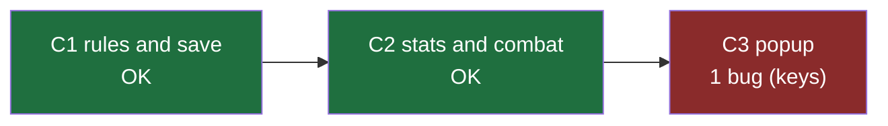

# 97 - Slice C Review (2026-11-26)

Scope: commits c8ecd63d (C1), 48638be1 (C2), b0d91486 (C3), 58b73112 (session end), read against
"97 - Upgrade Popup Plan" and decision 2026-11-26-97-upgrade-popup-open-questions.

## Verdict

Solid slice. Rules, stats and popup match the plan and all eight rulings. One real bug in the popup's keyboard path
(below); everything else is small.

## Checks run

| Check | Result |
|---|---|
| node tools/check.js | all passed (274 files, 70 harnesses; 96 lint warnings, 0 errors) |
| docs/proposals/upgrades-harness.js | all passed |
| tools/smoke-upgrade-popup.js | all 23 checks passed, no console errors |
| Extra browser repro (scratch, not committed) | confirms finding 1 |

## Findings

| # | Severity | Where | Finding |
|---|---|---|---|
| 1 | Bug | js/ui/menu-upgrades.js `items`, js/ui/menu-team.js `press`, cursor home | By keys, buying the last open level of a card removes its button from the cursor stops. The cursor then falls back to the Team menu's home stop (slot 1), which sits behind the popup. The next Enter lifts the slot 1 Pokemon behind the popup; after Esc you are holding it. Repro: fresh copy at OOR 1, popup opens on HP++, Enter, Enter (HP++ now "Needs Lv 10"), Enter: Bulbasaur is lifted. Same after a card is fully bought (starting move cards, at once). |
| 2 | Test gap | tools/smoke-upgrade-popup.js | The keys check buys only one level, so finding 1 slipped through. Add a check: buy a card out by keys, then the cursor is still on a popup stop and Enter lifts nothing. |
| 3 | Minor | js/systems/leader-belief.js `hitOnYou` | The leader reads your HP fraction from species HP over your real max HP, so with HP++ it thinks a full-HP you is hurt (about 87% at +15%). The plan accepted "species stats only, as for IVs", and IVs already skew it the same way. No action unless leaders feel off. |
| 4 | Minor | js/core/debug.js stat readout (around line 1283) | The dev stat readout shows plain and IV/EV/nature values, not the raised base. Dev only. |
| 5 | Question | Team menu detail panel | The stat rows show species base stats (HP 45) even when HP++ is bought. Intended (the popup's summary owns the raised numbers), or should the panel show them? |
| 6 | Note | Team menu Revert | Revert undoes the roster only; coins spent on upgrades stay spent. Consistent with Revert's job, worth knowing for the feel test. |
| 7 | Note | working tree | assets/excalidraw/poke-upgrade.excalidraw is modified and uncommitted. |

## Checked and fine

| Area | What was verified |
|---|---|
| Prices | 3-star listed price rounded to 10, then x stars / 3, rounded again; floor 3, cap 7 stars (ruling 2) |
| Bands | base stats 2 levels and power upgrades 1 per band at OOR 1, 10, 20, 40, 80; starting moves no band |
| Save | copies.js drops the old 5 cap for each upgrade's own maximum; unknown ids and zeros cleaned; without G.Upgrades loaded nothing is cut. save.pupg kept, unread (ruling 7) |
| Evolution | levels live on the copy, price follows the species (ruling 3) |
| Stat readers | raised base reaches HP (start and level up), Atk and SpA (attackFactor), Def and SpD (hurt and applyPlayerDefense), Speed and dodge recharge, and the pause hex start band. No missed reader found |
| Stacking | Cooldown++ seeds cdMul and items multiply on it; Critical Hit++ seeds critChance and items add on it |
| Regen | field through the regen getter (player-sim-pass), bench through benchUpdate, never both on one member; neutral 0 for leaders and enemies (ruling 4) |
| Leaders | neutral profile, numbers unchanged (ruling 8) |
| Old upgrades | Magnet, Fortune, Card Reroll, Veto and the random second starting move are gone from the build path; no leftover callers of upgradesOf, Upgrades.perks or scr-upgrades |
| Draft | buying writes the copy and coins straight to the save; the Team draft only holds slots, so it cannot overwrite a purchase |

## Fix for findings 1 and 2 (approved and built 2026-11-26)

After a buy that leaves the card with no live button, the cursor moves to the next live card in card order (left
column then right, wrapping), else Close (G.MenuUpgrades.stopAfterBuy, called from the Team menu's buyUpgrade). While
the popup is open, Enter on a stop outside it does nothing (pressInUpgrades in js/ui/menu-team.js). The smoke now buys
a card out by keys and checks that the next Enter buys another card. Smoke and check.js pass; the repro's third Enter
now buys Atk++ instead of lifting Bulbasaur.

Correction: the circling shine on a fully bought card IS in Jess's sketch (the card note: "The edge of the panel gets a
white shine that circles the card"), since 2026-11-23. The first answer here said it was not; that was wrong. The
circling-rim idea for selected portraits is #171.

Missed: the sketch has two arrows beside the portrait (left and right) for moving between team members without
closing the popup. The plan never listed them, so they were neither built nor named under "Not built".

## Follow-up built 2026-11-26

The portrait arrows are built (wrap, hidden with one caught member, Q and E labelled, 1 to 6 jump to a slot) and the
card shine is removed: decision 2026-11-26-97-upgrade-popup-switch-arrows-and-no-shine. The smoke covers both.
