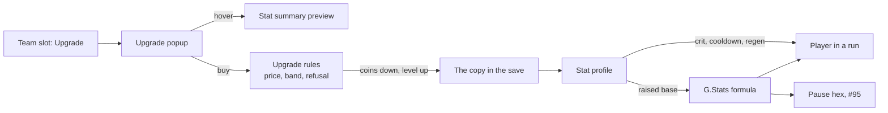
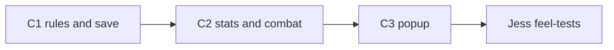

# 97 - Upgrade Popup Plan (slice C, 2026-11-25) [Proposed]

Goal, done and test: agreed on the issue, 2026-11-23. Rules: decisions 2026-11-23-97-139-team-menu-and-upgrade-popup-rulings,
2026-11-23-97-upgrade-system-redesign, 2026-11-23-97-upgrade-price-shape-bst-and-bands. Numbers: 97 - Upgrade System Design.

## How it fits

## Build order

| Part | Where | What changes |
|---|---|---|
| C1 | js/data/upgrades.js | Per-copy catalog (nine power upgrades, two move upgrades), price by BST stars, bands at OOR 1, 10, 20, 40, 80, one purchase function and one summary function. Vitality, Strength, Carapace, Stride and Wisdom go. The old Magnet, Fortune, Card Reroll and Veto levels stop being read, and their debug toggles go. |
| C1 | js/systems/copies.js | The saved rank limit becomes each upgrade's own maximum. Today it is 5 for all, which would cut a 10-level stat to 5 on load. |
| C1 | js/core/debug.js | Max, clear and toggle upgrades act on copies. |
| C2 | js/core/stats.js | The profile also carries six base multipliers, crit, cooldown and regen, neutral by default. One helper raises a base stat; the fraction is kept and only the final stat rounds. |
| C2 | js/entities/player.js, js/game.js | HP, Atk, Def, SpA, SpD, Speed and dodge recharge read the raised base. Crit, cooldown and regen read the profile. Regen also ticks in the bench update. |
| C2 | js/ui/pause-pokemon.js | The hex's starting bands use the raised base (#95). |
| C3 | js/ui/menu-upgrades.js, dev.html, css/bw-upgrades.css | The display-only screen is replaced by the sketch's popup, for one copy. |
| C3 | js/ui/menu-team.js, menu-team-slots.js | Upgrade opens by copy, not species; a slot with no copy refuses. |

## Reuses, new, not built

| | |
|---|---|
| Reuses | G.Candy level, G.Copies, G.Stats.profile, panel.clean, button.glitch intents and states, the Team menu cursor, the portrait |
| New | Upgrade pips; the shine around a fully bought card (nothing in the library circles a panel edge) |
| Not built | #150 picker (starting-move cards are bought but act later), #169 leader upgrades, #164 sidegrades (button shown disabled), #165 items, the Character Upgrades list, leader-authored upgrades |
| Touched-code cleanups | The menu's dead "upgrades" route (no button opens it) |
| Size | js/entities/player.js (1,365 lines) is already over 1,000 and grows slightly |

## Tests

| Check | Kind |
|---|---|
| A buy takes its price and raises one level; refused when unaffordable or above the band (end-goal test) | new harness |
| Hover preview equals the value after buying (end-goal test) | new harness |
| A save with no upgrades plays exactly as today; a level above 5 survives a reload | new harness |
| Raising a base never lowers a stat; regen heals on the bench and on the field | new harness |
| Hex: yellow band empty at run start | tools/smoke-pause-menu.js |
| Popup: mouse, keys, Esc, every button state | browser smoke |

## Risks

- The stat formula is read in several places; one missed reader gives a stat that disagrees with the popup.
- Leaders use the same Player frame. With a neutral profile their numbers must not move.
- Old per-species levels (save.pupg, set by the debug tools) stop giving power, so a debug save feels weaker (accepted).
- Dropping Fortune lowers PokeCoin income until Character Upgrades; the #131 estimates assumed no bonus.
- Whole-number rounding hides small raises at low levels: base 80 with +3% is 21 either way at level 10, 87 against 85 at level 50.

## Decided (Jess, 2026-11-26)

All eight are settled in decision 2026-11-26-97-upgrade-popup-open-questions.

| # | Ruling |
|---|---|
| 1 | Starting-move cards are buyable now; the level is saved and acts when #150 lands |
| 2 | Below 3 BST stars a copy pays the 3-star price |
| 3 | Levels survive evolution, no extra charge |
| 4 | The regen card is "Regeneration++", field and bench |
| 5 | Speed keeps Attack's price, reviewed with #166 data |
| 6 | The draft numbers go in as written, still [Proposed] |
| 7 | Old Magnet, Fortune, Card Reroll and Veto levels stop being read until Character Upgrades |
| 8 | Leaders authored with upgrades: out, #169 |

Also: the old per-species stat levels (save.pupg) stop giving power, with no refund.
