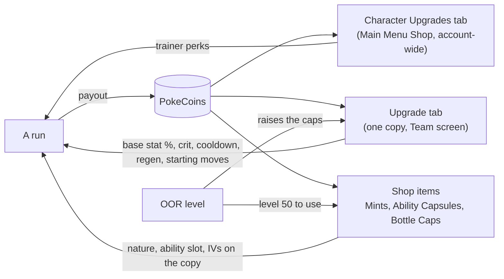
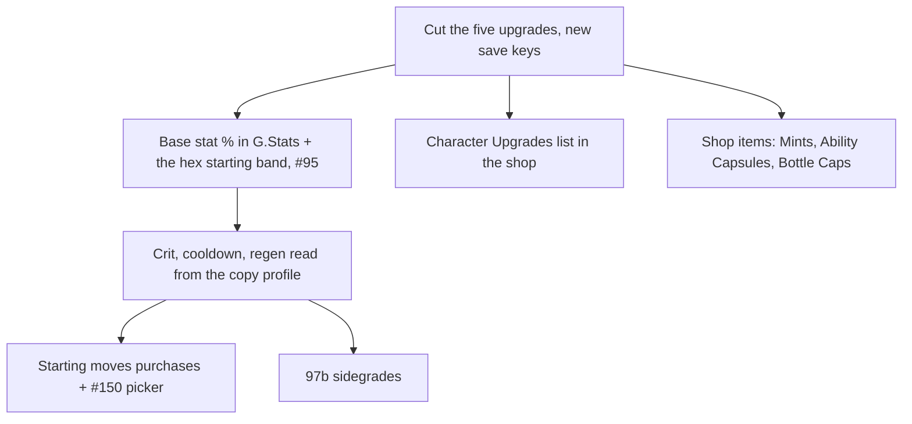

# 97 - Upgrade System Design (2026-11-23, grilled with Jess, rounds 1 to 4)

The redesign of the permanent upgrades. Replaces the 13 placeholders in js/data/upgrades.js (review:
97 - Upgrade System Review.md). Decision: 2026-11-23-97-upgrade-system-redesign. No code. Ships with the #128 new
save, so old upgrade levels need no migration (2026-11-15-128-exp-candy-unparked-97-ships-with-new-save).

## The system

## Rulings

| Topic | Ruling | Tag |
|---|---|---|
| Purpose | Catch-up power and sidegrades; part of the roguelite identity. A poor player restarts stronger (2026-11-15-125-xp-tracks-skill-against-the-world-level). | [Approved] |
| Two homes | Account-wide upgrades live in the Main Menu Shop's Character Upgrades tab; per-copy upgrades in the copy's Upgrade tab (today's Upgrades screen from the Team screen). | [Approved] |
| Currency | PokeCoins for both. | [Approved] |
| Numbers | Caps, prices, the star price factor, the OOR level bands and how many runs maxing takes: set in #131 from traced payouts. | [Approved] |
| Cut | Vitality, Strength, Carapace and Stride (flat or multiplier power outside the stat model), and Wisdom (clashes with #125). | [Approved] |
| EVs | Stay earned only in runs. No upgrade buys EVs. | [Approved] |
| Belt and balls | Belt size and ball quality stay in the Pokeballs tab (#137), not in #97. | [Approved] |

### Per-copy upgrades (Upgrade tab)

| Upgrade | Effect | Rules | Tag |
|---|---|---|---|
| Base stat (one per stat: HP, Atk, Def, SpA, SpD, Spe) | Raises the copy's species base stat by a %, inside the G.Stats formula | A %, so it carries through evolution (Bulbasaur +10%: base HP 45 becomes 49.5; as Ivysaur 60 becomes 66). The raised base keeps its fraction; only the final stat rounds, as today. Same cap and price curve for every stat. Shedinja's HP upgrade shows greyed out, "no effect" (acquisition F2b). | [Approved] |
| Critical Hit | A base crit chance for this copy (today the base is 0) | Adds to the in-run Critical Hit card's chance; x1.5 as now. | [Approved] |
| Reflexes | Cuts this copy's move cooldowns by a % | Move cooldowns only. Gates, the dodge and the swap lock are untouched. | [Approved] |
| Synthesis | Regenerates a % of max HP per second (scales with HP) | Ticks on the bench, per the COMBAT-RULES bench rule. Stacks with a Bench Nurse style sidegrade. | [Approved] |
| Starting moves (was Repertoire) | Buy 1: the copy may change its starting move. Buy 2: it starts with 2 moves | Per copy. The second move counts as a filled slot for move prices (2026-11-15-124-move-price-by-slots-filled). The pick list is #150. | [Approved] |
| Caps and the OOR level | The caps of the four power upgrades (base stat, crit, cooldown, regen) rise with the copy's OOR level, in bands | Bands set in #131. | [Approved] |
| Price | Every copy pays by its species' star rating (rarer pays more) | The same stars that weight Lost Pokemon rescues (acquisition A13b). | [Approved] |
| A copy that leaves | Sold or released (#146), its upgrades are lost, no refund | | [Approved] |
| Where they compute | The copy's upgrade levels travel in its profile with its IVs, EVs and nature (G.Copies.profileOf, G.Stats.profile); combat reads crit, cooldown and regen from there, so no entity works them out on its own | | [Approved] |
| Leaders | A leader's slot may be authored with any per-copy upgrade, none by default (leader principle) | | [Approved] |

### Account-wide upgrades (Character Upgrades)

Magnet (pickup range), Card Reroll, Veto, PokeCoin % (lower than today's Fortune), Silver % (new), Berry Pocket,
Team Items Pocket. That is the list for now. [Approved]

### Shop items (not upgrades; new issue)

| Item | Effect | Tag |
|---|---|---|
| Mint | Changes a copy's nature | [Approved] |
| Ability Capsule | Switches a copy's ability slot | [Approved] |
| Bottle Cap | Each one adds IV points toward 31 on one stat; usable on a copy at OOR level 50 or higher (mainline Hyper Training) | [Approved] |

### The stat hex (#95)

The starting band counts everything the copy owns before the run: the raised base, IVs (Bottle Caps included), EVs
and nature. Yellow is only what the run adds. [Approved]

## Sidegrades (child issue 97b, its own grilling)

Per-copy perks that trade or bend a rule, for example "Bench Nurse: heals the other benched Pokemon while this one
is benched" and "Tactician: refreshes every buff on entering the field; this Pokemon's swap cooldown is 10 s".

| Question for 97b | Tag |
|---|---|
| How many a copy holds, how one is bought or unlocked, whether it can be swapped | [Open] |
| The list of sidegrades and each one's numbers | [Open] |
| Whether leaders can be authored with them (the leader principle says yes unless ruled otherwise) | [Open] |

## Build order (after #131 numbers)

